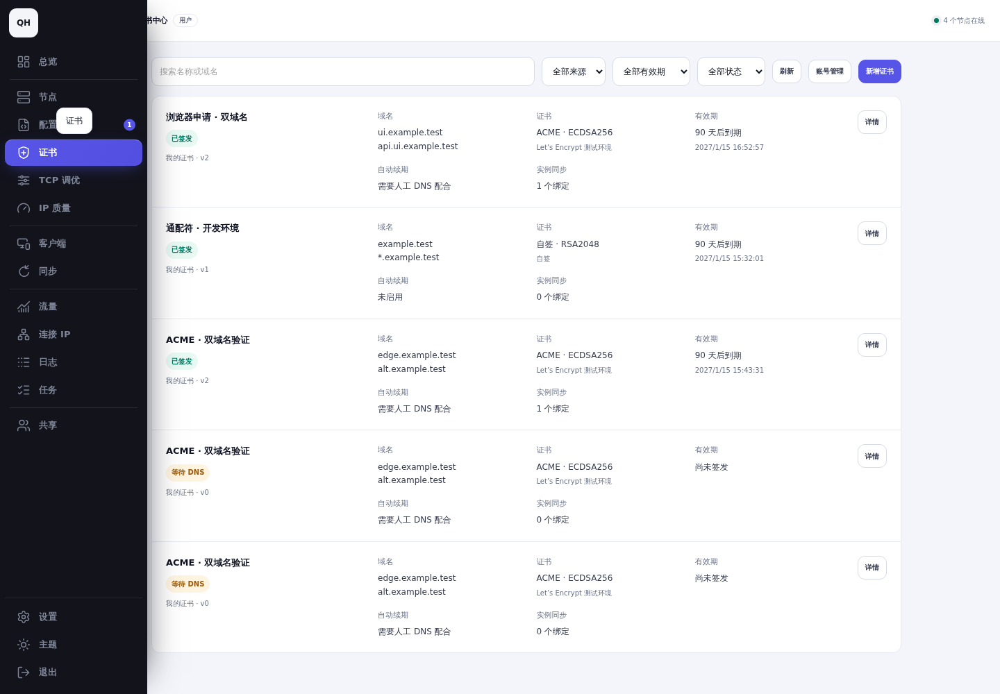
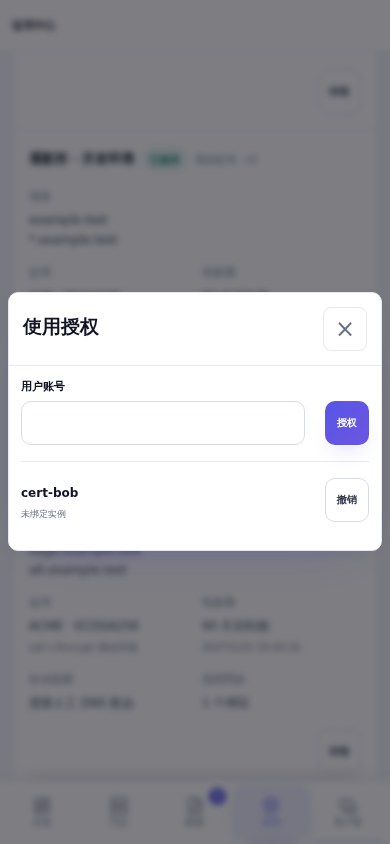

**使用流程**

进入导航中的“证书”，在“账号管理”创建自己的 ACME / DNS 账号，然后申请、导入或创建自签证书。在支持原生 TLS 的协议配置中选择本人或获授权的证书，填写证书覆盖的 SNI，保存并部署。申请进度、TXT 记录、版本、绑定及各实例同步结果在证书详情查看。替换协议证书并成功部署后解除旧绑定；有绑定或未完成任务时不能删除证书。

**资源与权限**

| 资源 | 归属及校验 |
| --- | --- |
| 证书、版本、ACME / DNS 账号、订单 | 创建者所有；管理员角色不获得他人的私钥、账号密钥或凭据。 |
| 使用授权 | 所有者按用户名授予使用权；不包含管理、转授权或私钥下载。 |
| 部署绑定 | 绑定证书与配置实例；同时检查证书使用权、实例权限及现有共享端口 / 内核限制。 |
| HTTP-01 授权 | 节点所有者为已接受共享的用户授予精确域名；部署共享不自动授予公网入口管理权。 |
| 异步执行 | 使用资源所有者身份；领取、签发和同步时重新检查账号状态与授权。 |

撤销授权会阻止待执行分发及后续同步，保留已部署文件，避免中断业务。授权界面列出该用户的绑定目标，撤销确认说明影响。切换账号会销毁证书弹窗、表单、域名筛选及账号缓存。普通列表、订单、任务历史和错误响应不返回私钥或 DNS 凭据；下载仅提供公共证书链。

**支持范围**

| 项目 | 实现 | 实际验证范围 |
| --- | --- | --- |
| DNS API | Cloudflare API Token；阿里云 AccessKey；腾讯云 DNSPod SecretId / SecretKey；查询、创建、精确删除 TXT、传播等待、取消 / 重试 | 三家官方 API 的请求及签名契约测试；本地 Pebble 真实 DNS-01；未使用真实供应商凭据。 |
| 手动 DNS | 持久订单、逐 SAN TXT / 状态、复制、继续、取消及清理提示 | 普通用户真实浏览器完成双域名申请；离开 / 重启可继续。需要人工配合，不承诺无人值守续期。 |
| HTTP-01 | 现有 Agent、临时 80 端口监听或已有网站转发；逐 A / AAAA 公网入口预检查 | 本地 Pebble 实际通过运行中的 Nginx → Agent 挑战处理器验证两个 SAN，业务路由保留；公网双栈入口检查使用可控网络测试。 |
| PEM 导入 / 替换 | 粘贴或上传；私钥匹配、链签名与有效期、DNS SAN、服务器用途和算法检查 | 正常 / 错配 / 过期 / 异常格式及域名边界测试；不提供面板任意文件路径导入。 |
| 自签 | SAN、有效期 1–825 天、RSA 2048 / 4096、ECDSA P-256 / P-384 | 浏览器真实创建；客户端仍需显式信任，正常 TLS 验证保持开启。 |
| CA | Let's Encrypt 正式 / 测试目录、ZeroSSL（邮箱及 EAB） | 实际签发使用 Pebble v2.10.1，未向官方 CA 签发；固定官方目录，不提供自定义 ACME 地址。 |

截图测试服务仅在独立预览进程将“Let's Encrypt 测试环境”目录替换成本地 Pebble；正式面板使用固定官方目录。未使用跳过 CA 验证或 `ALWAYS_VALID` 的测试模式。

**已有节点 HTTP-01**

验证节点与部署节点独立保存。Agent 仅接收本订单的域名、令牌、响应及有效期；账号密钥与证书私钥留在面板。挑战严格匹配 Host、路径和令牌，不写业务目录，不接管他人路由。过期、断开、取消、失败及重启会移除本任务资源。

没有网站且端口空闲时 Agent 临时监听公网 TCP 80。已有 Caddy / Nginx 需由入口所有者配置一次挑战路由并保留 Host，转发到该节点 `127.0.0.1:9080`。不会自动改写未知网站配置；端口占用且未接入时签发失败并显示入口检查原因。面板自身不需要开放 80。公网必须能访问验证节点的 80；泛域名只能使用 DNS-01。

```nginx
location /.well-known/acme-challenge/ {
    proxy_pass http://127.0.0.1:9080;
    proxy_set_header Host $host;
}
```

**保存、部署与恢复**

复用项目配置加密及 previous keys 机制，加密保存证书私钥、ACME 账号密钥、DNS 凭据和持久订单；缺少加密配置时拒绝创建。维护任务分批重新包装旧密钥数据；解密失败保留原数据并报错。备份需同时保存数据库、`QCH_CONFIG_ENCRYPTION_KEY` 与仍需使用的 `QCH_CONFIG_ENCRYPTION_PREVIOUS_KEYS`，恢复后先确认可解密再移除旧密钥。

面板配置保存稳定证书引用，Agent 按实际用户 / 实例映射到受保护目录中的不可变 `vN` 文件。成对校验、写入及同步后原子提交，目录 / 文件为 root:内核组 0750 / 0640，非 root 内核可读取。配置校验、服务重启、TCP / QUIC TLS 就绪及精确叶证书指纹检查失败时恢复上一配置与证书对。Reality、WireGuard 专用密钥不会被识别成 TLS 证书文件。

维护任务每 15 秒扫描数据库；到期前 30 天自动续期，唯一活动订单与 PostgreSQL advisory lock 防止重复签发，重试按 1–64 分钟退避，最多 8 次。手动 DNS 续期由用户继续。签发成功后仅向有效授权且仍绑定已部署配置的实例同步。离线实例保留待同步状态；领取时固定版本，旧任务无法覆盖新部署。签发与各实例部署状态分别记录，失败保留旧证书。

数据库版本从 75 升至 76，新增证书、版本、账号、订单、授权、挑战、绑定及版本固定表。已有节点本地证书及 Caddy 托管 TLS 配置继续使用原流程。升级前备份；回退旧面板程序需恢复配套 v75 数据库备份，已有节点配置可继续运行。

**实际测试**

| 验证 | 结果 / 证据 |
| --- | --- |
| 项目检查 | `make check`、`make build`、schema 75 → 76 检查及最终模块 / 样式 / 格式检查通过。[记录](logs/project-checks.txt) |
| 普通用户完整浏览器流程 | cert-alice 创建 ACME 账号 → 双 SAN 真实本地 DNS 验证 → v1 加密保存 → Trojan 选择证书 → 真实签名 Agent → 非 root Mihomo v1.19.32 → CA 及主机名验证的 TLS 1.3 → 浏览器续期 v2 → 自动同步 → 运行叶指纹更新。[记录](logs/ordinary-user-browser-deployment.txt) |
| 自动续期 / 重启 | 本地真实 CA、DNS API 契约服务：持久订单 / 账号恢复、无人登录自动续期 v2、精确 TXT 清理、取消及加密轮换。[记录](logs/local-acme.txt) |
| 多用户对抗 | API / PostgreSQL 验证管理员不可读取他人私有资源、伪造归属拒绝、证书 / 实例双权限、撤销阻断旧任务、已绑定删除冲突、历史无私钥；桌面 / 手机真实浏览器验证账号隔离、普通用户保存账号 / 自签 / 授权、共享实例选择、切回本地路径恢复，以及同一浏览器退出 / 换账号后的筛选词和账号清理。[浏览器记录](logs/browser-forms.txt) |
| 共享 HTTP 权限 | 精确域名授权、非所有者拒绝、无关授权不可见；真实 UI 授权与普通用户节点选择。[服务端](logs/http-grants.txt)、[浏览器](logs/http-sharing-browser.txt) |
| 现有 Nginx 认证 | 两 SAN 实际 HTTP-01 验证、业务页面保留、挑战清理；本地回环端口替代公网 80。[记录](logs/nginx-http01.txt) |
| 部署 / 回滚 | 实际 Mihomo 监听端口冲突，恢复旧配置、服务与证书；修正后部署成功。[记录](logs/live-rollback.txt) |
| 文件隔离 / 就绪 | 实际非 root 读取、两实例独立路径、符号链接与密钥错配拒绝、证书成对回滚；TCP / QUIC 握手及错误叶证书拒绝。[文件](logs/protected-files.txt)、[就绪](logs/listener-readiness.txt) |

未实测：真实 Cloudflare / 阿里云 / 腾讯云凭据、官方 Let's Encrypt / ZeroSSL 签发、真实公网 IPv4 + IPv6、多物理节点的完整 HTTP-01 → 异地部署组合。Nginx 验证和实际 Agent 部署分别验证，不将本地测试描述为正式 CA 或供应商验证成功。Caddy 接入使用相同挑战转发契约，未做本次真实 Caddy 业务站点签发。

**截图**

修改前基线：`42a2a28bec8bf4022fa439a4802a6443b589ac7c`。前后均使用同一测试服务数据库、账号、节点、浅色主题、Trojan 安全页及顶部滚动位置；桌面 1440 × 1000，触摸手机 390 × 844。新增证书页面在基线不存在，不制作虚假的修改前截图。TLS 左侧绿线来自基线 `frontend/styles/060-preset-base.css` 的 `.security-section`，本次没有新增。

| 场景 | 桌面 | 手机 |
| --- | --- | --- |
| 普通用户协议修改前 / 后 | [前](screenshots/before-user-protocol-desktop-light.png) / [后](screenshots/after-user-protocol-desktop-light.png) | [前](screenshots/before-user-protocol-mobile-light.png) / [后](screenshots/after-user-protocol-mobile-light.png) |
| 管理员协议修改前 / 后 | [前](screenshots/before-admin-protocol-desktop-light.png) / [后](screenshots/after-admin-protocol-desktop-light.png) | [前](screenshots/before-admin-protocol-mobile-light.png) / [后](screenshots/after-admin-protocol-mobile-light.png) |
| 共享实例修改前 / 后 | [前](screenshots/before-shared-user-protocol-desktop-light.png) / [后](screenshots/after-shared-user-protocol-desktop-light.png) | [前](screenshots/before-shared-user-protocol-mobile-light.png) / [后](screenshots/after-shared-user-protocol-mobile-light.png) |
| 普通用户列表（浅 / 深色） | [浅](screenshots/user-list-desktop-light.png) / [深](screenshots/user-list-desktop-dark.png) | [浅](screenshots/user-list-mobile-light.png) / [深](screenshots/user-list-mobile-dark.png) |
| 管理员 / 被授权用户列表 | [管理员](screenshots/admin-list-desktop-light.png) / [被授权用户](screenshots/shared-user-list-desktop-light.png) | [管理员](screenshots/admin-list-mobile-light.png) / [被授权用户](screenshots/shared-user-list-mobile-light.png) |
| DNS API / 手动 DNS | [自动](screenshots/dns-auto-desktop-light.png) / [手动](screenshots/dns-manual-desktop-light.png) | [自动](screenshots/dns-auto-mobile-light.png) / [手动](screenshots/dns-manual-mobile-light.png) |
| 已有节点 HTTP-01 / 共享验证节点 | [自有](screenshots/http-node-desktop-light.png) / [共享](screenshots/http-shared-node-desktop-light.png) | [自有](screenshots/http-node-mobile-light.png) / [共享](screenshots/http-shared-node-mobile-light.png) |
| 导入 / 自签 | [导入](screenshots/import-desktop-light.png) / [自签](screenshots/self-signed-desktop-light.png) | [导入](screenshots/import-mobile-light.png) / [自签](screenshots/self-signed-mobile-light.png) |
| 手动 TXT / 已签发与同步 | [TXT](screenshots/manual-order-desktop-light.png) / [签发](screenshots/ui-issued-desktop-light.png) | [TXT](screenshots/manual-order-mobile-light.png) / [签发](screenshots/ui-issued-mobile-light.png) |
| 使用授权 / 协议选择授权证书 | [授权](screenshots/authorization-desktop-light.png) / [选择](screenshots/shared-user-protocol-selected-desktop-light.png) | [授权](screenshots/authorization-mobile-light.png) / [选择](screenshots/shared-user-protocol-selected-mobile-light.png) |





**72 小时清理**

测试进程、浏览器及本次两个容器已经停止，测试监听端口已释放。任务 `qch-cert-a978-cleanup.timer` 已实际注册、启用且处于 active，`Persistent=true`。最后测试结束时间及准确执行时间见 [任务清单](cleanup.json) 和 [systemd 查询记录](logs/cleanup-timer.txt)。执行时间为 **2026-10-20 17:26:07 Asia/Hong_Kong（UTC+08:00）**，即 09:26:07 UTC。

root 所有的执行器与清单保存在 `/var/lib/qch-certificate-a978`，独立于分支和工作区。清理前同时校验两个容器的完整 ID 与本任务标签，只删除本次数据库 / Agent 容器及其匿名卷、独立预览目录、原始截图目录和 `/tmp/qch-cert-tools`。不删除现有镜像、其他容器、真实用户数据或仓库。此目录内的报告、脱敏日志和截图长期保留；外部 TXT / 挑战在验证结束时已即时清理。

参考：[1Panel](https://github.com/1Panel-dev/1Panel)、[Let's Encrypt 验证方式](https://letsencrypt.org/docs/challenge-types/)、[ZeroSSL ACME / EAB](https://zerossl.com/documentation/acme/)、[Cloudflare DNS API](https://developers.cloudflare.com/api/resources/dns/subresources/records/)、[阿里云 DNS API](https://help.aliyun.com/zh/dns/api-alidns-2015-01-09-overview)、[腾讯云 DNSPod API](https://cloud.tencent.com/document/product/1427/56166)。
