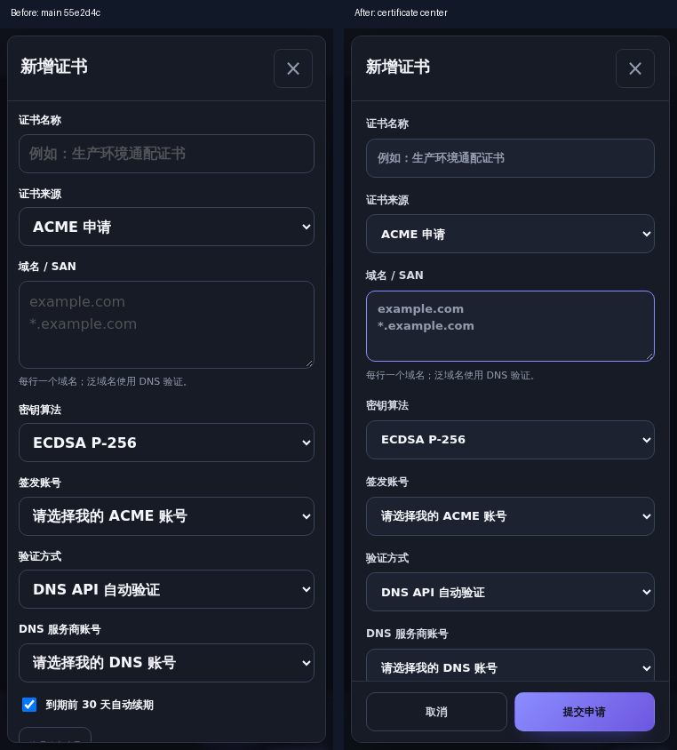
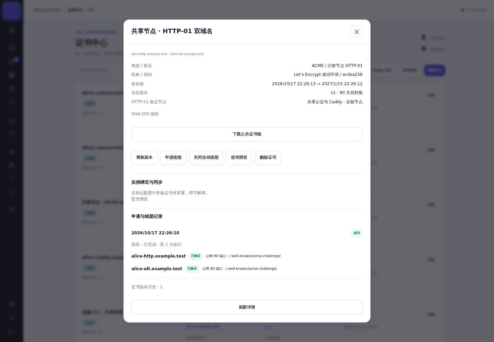
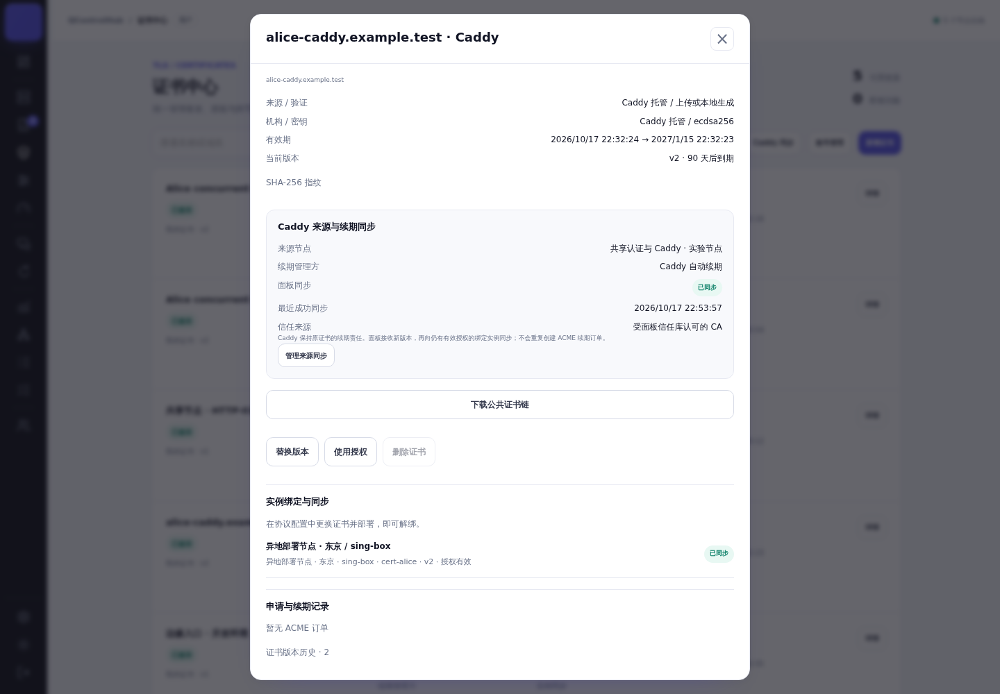
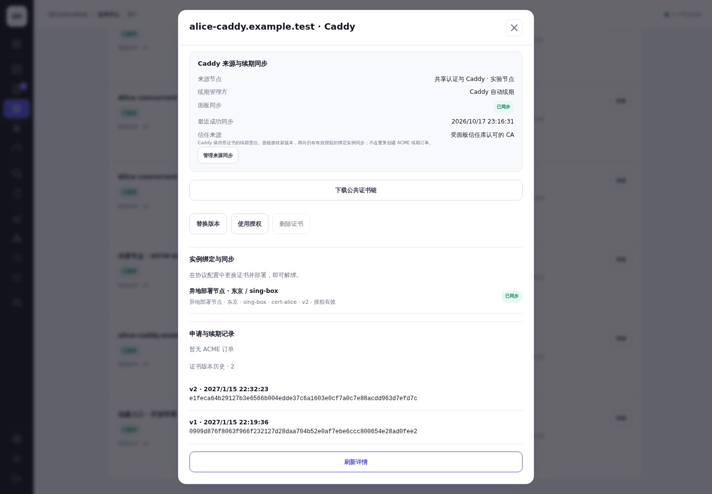
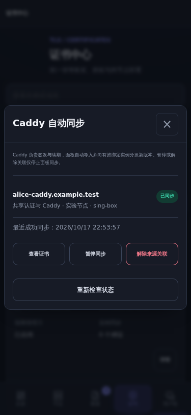
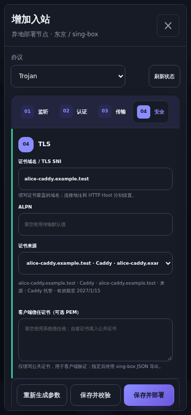

# 证书中心、共享 HTTP-01 与 Caddy 证书同步

## 基线与交付范围

- 基于最新 `main`：`55e2d4ca4a85d3d23b026072cdb616144f81c462`（#293）；提交前再次 fetch，基线未变化。
- 分支：`codex/certificate-center-shared-http-caddy`。
- 管理员 `cert-admin`、普通用户 `cert-alice` / `cert-bob` 使用真实密码登录、Cookie / CSRF、数据库资源隔离和真实 Agent 签名通道。图片和视频均为本次测试数据。
- Caddy 2.11.7、sing-box 1.14.3、Mihomo 1.19.32、PostgreSQL 17、真实 systemd Agent；另用真实 Nginx 与 Pebble 做代理挑战集成测试。

## 排查结论与修复

### 共享认证权限与协议部署权限

原实现已有独立的 HTTP 域名授权表，但所有者在节点共享流程中无法配置它。普通用户接受共享后具有内核、端口等协议权限，却未取得 HTTP-01 公网入口权限；原申请页使用 `can_manage || httpGrant` 筛选并隐藏不可用节点，用户无法区分缺少认证授权、未接受、停用、离线或旧版 Agent。仅接受共享而没有域名授权的普通用户不能独立签发，这是可复现的授权体验脱节。显式补过旧授权的用户并非全部失败，不能将根因简单归为宿主管理权限。

现在所有者可直接在共享弹窗中配置精确域名。共享接收页面展示认证范围；申请页使用后端统一的 `/certificate-http-nodes` 能力与原因，展示可用与不可用节点、允许域名、处理入口。协议部署仍按内核、端口、实例权限单独检查。旧客户端省略 `http_domains` 时保留原授权；新界面明确提交空数组即撤销。旧账号管理授权入口继续工作，并更新共享修订号，避免另一窗口覆盖新授权。

所有 SAN 复用同一规范化函数（去空白、大小写、末尾点、IDNA），HTTP-01 拒绝泛域名并引导 DNS-01。创建、执行、挑战下发、公网探测、CA 验证与续期前重新检查有效用户、已接受且启用的共享、域名授权、在线及能力。授权失效作为终止原因进入清理；撤销域名立即删除对应挑战行。API 不接受客户端冒充的订单所有者。

### 公网挑战路由

原 Agent 已有按 Host / token 匹配的内存挑战和 80 / 9080 监听，面板也已有公网响应等待；问题是项目托管 Caddy / Nginx 没有将挑战路径接到 9080。挑战下发成功不等于公网可达。

- 空闲 80：受管理的 Agent 临时挑战服务响应；订单、域名、token 与过期时间由认证通道下发。
- 托管 Caddy：固定 `/.well-known/acme-challenge/*` 路由转发至 `127.0.0.1:9080`，保留 Host，Caddy 自身 ACME solver 仍可签发；其他路径和已有租户业务路由保留。
- 托管 Nginx：只有项目可以管理的空闲 80 或已有本项目标记的监听才自动接入；支持双栈。已有托管部署在 Agent 修复运行环境时校验、重载并迁移路由，失败恢复原配置，不启动已停止的服务。
- 外部 80 占用：不改外部配置，表单说明准确路径、Host、9080、A / AAAA 与所有者接入方式。现有公开探测逐个检查解析出的公开 IPv4 / IPv6，正确匹配 token 后才提交 CA 验证；错误阶段保存在申请记录。

清理只移除本订单令牌；固定代理路由保留供其他订单使用，无令牌返回失败响应。断线清空内存监听；重连从仍有效的订单重建。撤销共享、停用用户、取消订单、异常重试均走既有订单清理流程。真实多用户取消 / 撤销 / 停用 / 移除共享测试没有破坏其他用户和 Caddy 服务。

### Caddy 自动发现、归属与版本

原 Caddy 证书仅在节点 certmagic 存储中，面板没有对应资源。现在认证 WebSocket 通道每 30 秒发送服务端确认的来源清单，新签发、存量升级、重启、重连和续期均通过同一路径补同步。来源按最近请求时间轮转分批，单次上限 128，失败来源不会阻塞其他用户。

服务端从**已确认应用的配置版本**、部署成功任务、实例所有权、共享接受状态、内核分配和活动用户重建来源。成功任务的快照原本会被清空，所以不能仅依赖任务快照字段；使用被应用的配置修订及对应客户端元数据。草稿、失败部署和归属不确定的实例不进入清单。来源 ID 包含节点、所有者、配置和域名；Agent 上报不能指定所有者、服务名或文件路径，面板导入时再次核验部署关系。

Agent 根据服务端清单、受保护部署 manifest、Caddy automation subject / issuer 和 certmagic 的 `issuer_data.ca` 核验来源，只读取固定 `certificates/<issuer>/<domain>/<domain>.crt/.key/.json`。跳过其他域名目录、ACME 账号目录和任意路径；限制大小 / 数量，拒绝符号链接、硬链接、异常文件、不安全权限 / 所有者及打开时身份变化。来源未知只显示待核验 / 阻断，保留现有业务。

证书链与私钥复用严格 PEM、完整链、匹配密钥、SAN、有效期、算法和 SHA-256 检查。信任状态分别显示“受面板信任库认可的 CA”“未受信任 / 测试 CA”“自签来源”。系统自定义信任库可能认可测试 CA，因此该字段不冒充对正式生产 CA 的绝对判定；扫描同时限制在已确认的项目生产 issuer 配置，不从旁路 staging 树挑选更新证书。

同一来源重复扫描只更新时间，续期新增版本并保持证书 ID、授权和绑定；不同用户即使 SAN / 指纹相同也不合并。旧有效期或旧 NotBefore 的报告不能覆盖新版本。来源节点离线、部署关系失效时展示最近成功同步时间及现有有效期。暂停 / 解除关联保留当前资源，可恢复；删除保留来源抑制记录，避免反复自动重建。手动替换 Caddy 资源会转为导入证书并解除关联，恢复来源不会覆盖该手动资源。

### 续期与目标实例

Caddy 负责原证书的续期。Agent 上传新版本，面板验证加密保存，既有同步 worker 向仍有证书授权和实例操作权限的绑定分发。Caddy 来源 `auto_renew=false`，不创建面板 ACME 续期订单。界面分别显示来源、续期方、面板同步和目标实例状态。

管理员和普通用户使用统一协议证书选择器，显示名称、SAN、来源、有效期和可用状态；长内容有可换行摘要。按目标节点生成证书路径，复用配置校验、原子切换、运行检查和失败恢复。替换 / 解绑沿用既有资源关系。普通用户将导入证书部署到另一台自己获准操作的真实节点，并自动接收 Caddy v2 已实际验证。

### 秘密保护与升级

私钥仅通过已有认证 WSS 中的专用信封传送，既不进入普通心跳，也不进入任务输出、列表、客户端导出或日志。面板按原有证书加密配置保存；缺少 `QCH_CONFIG_ENCRYPTION_KEY` 时不请求私钥，已知来源显示阻断，新来源由全局加密提示说明。普通获授权使用者不会收到所有者的来源节点、配置、账号或诊断标识。

Agent 主服务仍沿用原 capability 范围。读取 Caddy 非 root 所有的 0700 / 0600 存储时，使用短时受限 helper，仅加 `CAP_DAC_READ_SEARCH`，只允许 Unix socket、只写固定请求目录，并将响应原子写入 root 0600 临时文件，随后发送和删除；不通过 stdout / journal 回传。孤立临时文件按固定命名和权限规则清理，ACME 账号密钥保持原保护范围。

数据库版本从 77 升为 78，新增来源表和抑制记录；旧证书模型兼容新增可选元数据，旧 Agent 无新 feature 时不请求同步。升级面板与 Agent 后自动补扫描已确认托管部署。常规回滚须遵循项目 schema 版本保护并保留数据库备份；新数据迁移后不可直接将旧面板连接新 schema。暂停来源不会改变节点的 Caddy 续期；回滚代理配置应沿用受保护 manifest 与原有配置备份。

## UI 实际覆盖

列表 / 搜索 / 来源与状态筛选，新增 / 导入 / 自签 / 替换，三种 ACME 方式，ACME / DNS 账号，共享 HTTP 授权，详情 / 申请 / 版本 / 指纹，Caddy 来源管理，使用授权与受影响实例，绑定与诊断，协议选择器均使用项目现有 token、按钮、弹窗容器与主题。

修复 body 下弹窗遗漏页面作用域样式的问题；避免后加载的通用弹窗宽度覆盖；统一原生输入 / select / file / checkbox、焦点、disabled、busy、滚动、触摸尺寸、长文本与危险操作。打开弹窗时主题实时变化。显式 Tab 焦点循环、Escape、返回原触发控件和滚动锁定已测试。切换来源 / 认证方式 / 新增账号保留适用填写上下文；来源轮询避免重复渲染，保留展开、滚动和焦点，填写表单时不刷新。

375×812、768×1024、1440×1000、812×375、375×500（缩小可视区域模拟软键盘占用）、两种主题、字体缩放 1.3、减少动态效果以及普通动态效果通过实际 Chromium 检查。未将模拟可视区域宣称为真实手机软键盘或物理触摸设备测试。

## 测试证据

| 检查 | 结果 / 原始记录 |
| --- | --- |
| 完整项目 Go 测试，真实 PostgreSQL | [通过](logs/full-tests.txt)，`make test`；项目本身通过独立 browser target 运行浏览器测试 |
| 构建、格式、模块、样式、schema / PR 策略、部署脚本与 vet | [通过](logs/final-build-checks.txt)，`make build non-browser-checks` |
| 新增 API 两普通用户 / 伪造请求 / 来源隔离与版本测试 | [通过](logs/new-api-tests.txt)，[最终来源回归](logs/final-source-tests.txt) |
| 定向 HTTP / Caddy / 证书回归 | [通过](logs/final-regressions.txt) |
| Agent / API / Store 证书相关 race 检查 | [通过](logs/race-tests.txt) |
| 真实 Nginx、Caddy → Agent → Pebble 两 SAN 验证与业务保留 / 清理 | [通过](logs/real-acme-proxies.txt) |
| 三个真实账号、独立 Agent、Caddy 自动导入 | [通过](logs/live-caddy-import.txt) |
| 两普通用户并发 HTTP、重新签发、越权、取消、收权、停用、移除共享 | [通过](logs/live-http-users.txt) |
| Caddy 遵循 CA ARI 实际续期，另一个节点实际 TLS 指纹 | [通过](logs/caddy-renewal.txt) |
| 重复 / 重连幂等，正确归属，密文存储，普通接口 / journal 无私钥 | [通过](logs/live-final.txt) |
| 账号、DNS 表单、证书选择与两用户浏览器检查 | [通过](logs/multi-user-browser.txt) |
| 响应式 / 焦点 / 填写保留 / 动态效果 | [通过](logs/responsive-ui.txt) |
| 相同数据前后对照 / 所有者共享 / 协议选择 | [截图对照](logs/visual-comparison.txt)、[所有者](logs/owner-sharing-visual.txt)、[选择器](logs/protocol-visual.txt) |

安全对抗测试还覆盖不同节点伪造来源、同域名 / 指纹不同用户隔离、重复扫描、旧报告、暂停、删除抑制、密钥不匹配、符号链接、硬链接、不安全权限、无加密配置、其他 issuer 元数据等。目标环境最初缺少标准服务目录，首次部署按预期失败；补齐真实服务 unit / 目录后重新部署与续期均通过，保留[环境装配失败记录](logs/fixture-setup-failure.txt)，未把它作为成功证据。

### 验证边界

本地 ACME 使用 Pebble 的**真实验证器**，没有跳过验证。测试域名与公开格式的合成双栈地址仅存在任务容器的 DNS / network namespace；通过 fixture Go overlay 将 Caddy CA 端点改成本地 CA，生产代码的 CA 常量保持原样。覆盖真实 TCP 80、A / AAAA 检查、挑战路由、TLS、ARI 续期、认证 Agent 和内核，但**没有验证真实互联网 DNS、防火墙 / NAT 或生产公开 CA 签发**。不需要也没有创建外部 DNS 记录。运行环境的临时 AAAA 故障注入均已恢复。

本地新通道在真实 Debian / systemd 上验证；OpenRC 通道完成代码 / 项目回归，完整 CI 的 Alpine / OpenRC 结果见 PR checks。未逐一在物理移动设备或所有外部网站软件上验证。CI 结果以 PR 最新提交为准。

## 修改前后截图

同一账号 `cert-alice`、同一数据库、同一筛选数据、主题和视口；所有者共享对照使用同一 `cert-admin`。修改前使用基线提交归档前端，连接同一测试 API。共有功能为真实前后渲染；新增 Caddy 同步只展示修改后，不虚构旧版界面。

| 页面 | 桌面浅色前 / 后 | 手机暗色前 / 后 |
| --- | --- | --- |
| 列表 | [前](screenshots/before-list-desktop-light.png) / [后](screenshots/after-list-desktop-light.png) | [前](screenshots/before-list-mobile-dark.png) / [后](screenshots/after-list-mobile-dark.png) |
| 新增 | [前](screenshots/before-create-desktop-light.png) / [后](screenshots/after-create-desktop-light.png) | [前](screenshots/before-create-mobile-dark.png) / [后](screenshots/after-create-mobile-dark.png) |
| HTTP 节点 | [前](screenshots/before-http-desktop-light.png) / [后](screenshots/after-http-desktop-light.png) | [前](screenshots/before-http-mobile-dark.png) / [后](screenshots/after-http-mobile-dark.png) |
| 账号 | [前](screenshots/before-accounts-desktop-light.png) / [后](screenshots/after-accounts-desktop-light.png) | [前](screenshots/before-accounts-mobile-dark.png) / [后](screenshots/after-accounts-mobile-dark.png) |
| 详情 | [前](screenshots/before-detail-desktop-light.png) / [后](screenshots/after-detail-desktop-light.png) | [前](screenshots/before-detail-mobile-dark.png) / [后](screenshots/after-detail-mobile-dark.png) |
| 证书授权 | [前](screenshots/before-grants-desktop-light.png) / [后](screenshots/after-grants-desktop-light.png) | [前](screenshots/before-grants-mobile-dark.png) / [后](screenshots/after-grants-mobile-dark.png) |
| 共享认证授权 | [前](screenshots/before-sharing-desktop-light.png) / [后](screenshots/after-sharing-desktop-light.png) | [前](screenshots/before-sharing-mobile-dark.png) / [后](screenshots/after-sharing-mobile-dark.png) |
| 协议证书选择 | [前](screenshots/before-selector-desktop-light.png) / [后](screenshots/after-selector-desktop-light.png) | [前](screenshots/before-selector-mobile-dark.png) / [后](screenshots/after-selector-mobile-dark.png) |

每组还保留桌面暗色与手机浅色原图，位于 [screenshots](screenshots)。

### 新功能真实结果

[实际浏览器流程录屏](video/shared-http-caddy.webm)：普通用户填写并提交共享节点 HTTP-01，真实签发成功，再查看 Caddy v2 / 目标绑定与来源管理。录屏未展示私钥、登录密码或账号密钥。

## 72 小时资源保留与清理

测试结束即停止本任务测试进程、浏览器和三个容器，释放映射端口；临时 DNS 覆盖与订单挑战此前已恢复 / 清理。测试数据库、账号、源 / 目标节点及 fixture 文件在停止状态保留 72 小时。测试结束时间：`2026-10-17T23:20:57+08:00`；准确清理时间：**`2026-10-20T23:20:57+08:00`（Asia/Shanghai）**；任务 **`qch-cert-e528-cleanup.timer`**。系统持久 timer 的实际注册信息见 [cleanup.json](cleanup.json) 与 [注册校验记录](logs/cleanup-registration.txt)。

清理脚本 [cleanup-certificate-unified.py](../../scripts/cleanup-certificate-unified.py) 的 root 副本和 manifest 存放 `/var/lib/qch-certificate-unified-e528`，不依赖聊天继续运行。它核对固定 64 位 Docker ID、任务标签、root 所有 manifest、精确目录白名单与 72 小时时间，再移除本次三个容器、一个网络和两个临时目录。不删除公共镜像、其他任务环境、测试报告、脱敏日志、截图、录屏或源码。`Persistent=true`；机器关机错过时间会在恢复后执行，Docker 暂时不可用则服务重试。
