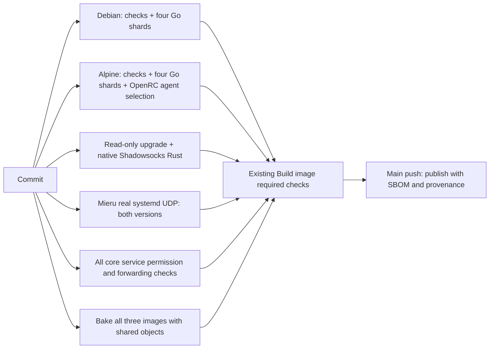

# CI performance and reliability

## Measurement

The implementation is based on `main` at `ffdc09adbffb6b47bfcebd275b10b6125817a4c0`.
Application code, test assertions, platform integrations and pinned core releases
are unchanged. PR #267 tracks the measured cold/warm comparison:
https://github.com/qimaoww/QControlHub/pull/267

Use attempt-specific job data, not a mixture of original jobs and a retry:

```sh
python3 .github/scripts/ci-report.py RUN_ID --attempt 1 --output report.json
gh run download RUN_ID --pattern 'ci-timings-*' --dir timing-artifacts
```

The report measures time from workflow scheduling to completion of every
necessary job, queue time from job creation to runner start, individual step
time and aggregate actual runner minutes. It excludes image publication and
GitHub's rounded billing units. Upload/download and cache save times are included
in job duration. Submission webhooks before Actions creates the run are not
observable from these APIs.

Baseline PR run 38549771383 (first attempt, all jobs successful) required **2000s
(33m20s)** and **69.50 job minutes**. Its workflow completion timestamp is one
second later. See [raw job/step summary](ci-performance/baseline-pr.json).

| Baseline component | Debian / systemd | Alpine / OpenRC |
| --- | ---: | ---: |
| Job queue | 2s | 2s |
| Container/service initialization | 25s | 12s |
| Go setup including cache restoration | 17s | No persisted Go cache |
| Node setup | 1s | Included in dependency step |
| System test dependencies | 20s | Included in combined step |
| All checks | 1684s | 1882s including environment preparation/build |
| Release binaries | 21s | Included in combined step |
| Whole job | 1780s | 1901s |
| PostgreSQL API + store execution | 374.120s | 396.763s |
| Browser-bearing frontend Go package | 850.107s | 935.467s |

The old critical path was environment preparation -> the browser-bearing Go
shard -> a second complete browser suite -> platform bootstrap -> image builds
(94s / 51s / 20s on separate runners). Go shards 2 and 3 on Debian executed only
217s and about 0.9s of package tests, respectively. Function counts incorrectly
placed an 850s browser suite beside several small packages.

Old logs do not separately identify pure compilation, module downloading inside
a test command, individual scenes or BuildKit cache export. Those intervals must
not be presented as independently measured historical numbers. Baseline Debian
restored a 249MiB Go cache; Alpine and sandbox compilation were cold on every
run. This is a mixed-cache baseline, not a fully warm workflow.

After the user narrowed the scope on 2026-10-14, real browsers are optional: local
`make check` / `make frontend-check` retain all 81 modes; `.github/workflows/browser.yml`
provides manual Debian and Alpine validation. Routine PR checks and main publication
do not run or depend on that workflow. Frontend module smoke, contracts, policy,
style and diagnostic regressions remain mandatory. This is an explicit scope
change; its time saving is distinguished from scheduling/cache improvements.

Separate dispatch-only measurement branches (`codex/ci-baseline-measure` and
`codex/ci-optimized-measure`) keep
the respective workflows and identical application/test code, add `workflow_dispatch`, and
disable setup-go restoration / select fresh image cache scopes for controlled
cold comparisons. The optimized experiment also selects fresh platform-cache
identities, retaining cache-save costs. They never publish because the event is
not a main push. Their runs and final PR cold/warm attempts are recorded in the comparison.
No extra benchmark workflow runs on routine PRs.

The optimized platform artifacts contain:

- `phases.tsv`: environment dependencies, modules and release compilation
  (the optional browser workflow records its own browser phase) elapsed time/status.
- `go-tests-*.ndjson`: complete per-test Go events, including failure output.
- `go-tests-*.json`: elapsed shard time, package execution time and outcome.
  Shard elapsed minus serial package execution includes compilation, loading
  and tooling overhead; it is not labelled pure compilation.
- `browser-*.json`: each scene's Chromium startup, interaction/assertion,
  cleanup, elapsed time and verdict. The same assertions and per-scene deadlines remain.

## Task structure and coverage



`make check` and routine CI share each ordinary Go package, every existing Node
and shell check, a full `go vet ./...`, and the complete serial module smoke suite.
The architecture package is included in the ordinary sweep. The only intentional
scope difference is real browsers: local `make check` includes the Go browser
wrapper once; routine CI skips that exact wrapper and does not install Chromium.
`make browser-checks` and the manual workflow execute the complete browser matrix.
`make frontend-check` includes both module smoke and browsers. `go test ./...`
still includes real browsers for callers who use Go directly.

The planner performs one `go list` with package directories/imports/test
imports. Runtime weights in `.github/ci-package-times.json` come from the
baseline package execution data; frontend now excludes the browser wrapper.
Unknown packages receive a conservative function-count estimate. Every selected
package is checked for exactly-once assignment. Database users, including
transitive helper imports and `internal/testdb`, share one `-p 1` shard.
The four-way partition remains; a serial database chain and a large agent
package cannot be evenly split without changing their isolation model.

Separate databases isolate data but do **not** isolate PostgreSQL's cluster-wide
xmin horizon. No database package or HOT-page test was made concurrent. An
unknown `--extra` task waits for the database shard. `--extra-independent` is
used only for Alpine's agent tests, which do not connect to PostgreSQL. For
future parallel database integration, use separate PostgreSQL server clusters.

Module smoke's awaited domain suites share temporary DOM globals and a fixture
object populated by earlier suites. Their order remains unchanged. Browser
workers instead run in separate Node processes, with distinct HTTP fixtures,
ports, Chromium profiles, storage and CDP connections. Every one of the original
81 modes is assigned once, retaining desktop, touch/mobile, permissions, motion,
performance and layout assertions. Chromium is still launched fresh per scene.
Local timing showed startup around 120-300ms: process reuse across scenes would
save little and complicate isolation.

Workers are capped at two and reduced to one when CPU/memory are constrained.
Reports print available CPUs and memory. Each worker cleans the entire Chromium
process group and its profile. Go's wrapper uses an 18m deadline inside the 20m
package timeout, allows graceful interruption, and limits pipe drain to 10s.
Scheduler cancellation escalates after 6s. Shell tasks run in process groups,
retain failures through pipelines/after-checks, and clean descendants on signals.
Named Docker containers are stopped and removed even if cancellation interrupts
image pulling or container creation.

## Caches and environment

Cache format is `qch-v4`. Module and object caches have independent identities
for Debian/glibc, Alpine/musl and the upgrade sandbox. Alpine and sandbox keys
fingerprint the actual image's Go version, architecture, OS and libc; floating
base tags continue to receive upstream updates and invalidate objects when their
fingerprint changes. Debian setup-go still selects Go 1.25.0 from go.mod.
Dependency hashes and Go source hashes create new cache entries; restore prefixes
can supply older objects/modules, which Go revalidates and recompiles as needed.
Changing Go/libc/OS identities cannot restore another platform's objects.

Alpine mounts restored module/object directories into its temporary container.
The sandbox mounts a separate persistent object directory while keeping its
rootfs and source/module mounts read-only and network disabled. Only compiler
objects gain a writable mount. Because the sandbox drops DAC_OVERRIDE, cache
permissions are prepared explicitly. Its existing CHOWN capability restores
cache ownership to the caller before the unprivileged native compiler runs.

All ordinary Go, selected agent, sandbox, native runtime and browser invocations
use `-count=1` or execute an explicit test binary. Database/runtime observations
are never accepted from Go's test-result cache. Missing caches still download
modules and compile normally. Pinned upstream binary versions and SHA256 checks
remain intact. These downloads took about 0-4s in the baseline: adding another
archive cache/restore/save layer was not justified by that cost. Debian apt and
Alpine apk still execute and get actual runtime dependencies.

Bake solves the three targets together, sharing module and compiler layers.
Production Go compilation copies only relevant source and embedded assets;
Go tests and browser fixtures are excluded from the image context. An object
layer precedes VERSION-dependent links, so a new commit's version can relink
without recompiling dependencies. Compiler objects live in exported layers;
unexported BuildKit cache mounts would not persist through GHA cache export.
Each target retains its own BuildKit scope. Publication imports the same scopes
and uses the same SHA, image targets/content, `sbom: true` and `provenance: mode=max`.
Publication itself is gated and has not been exercised by the PR event.

## Gate reliability and rollback

Ruleset 20995958 requires Title and description, Debian / systemd, Alpine /
OpenRC, and the three existing Build image check names. These names are retained.
The image checks now explicitly require all six producer jobs, using `always()`
and exact `success` comparisons. A failed, cancelled, skipped or missing producer
fails the gate. This also makes the previously non-required sandbox, Mieru and
permission checks necessary for merge. Main publication has explicit dependencies
on all producers and gates for the same workflow commit.

Regression tests exercise failed shards/checks, serial after-check ordering,
new packages/helper imports, one metadata call, cancellation and all non-success
gate states. Real local cancellation left no worker/browser/profile or Docker
container behind. Actual replaced PR runs were cancelled; their required image
checks failed rather than reporting success. Cold and warm mandatory CI attempts, optional browser experiments, dependency
changes and resource limits are detailed in the PR.

Rollback controls:

- Set `QCH_BROWSER_WORKERS=1` locally or choose worker count `1` in the manual workflow for serial
  browser execution; no coverage or assertion needs to change.
- Bump `qch-v4` identities / Bake scopes or disable cache restore/save to force
  a rebuild. Never remove `-count=1` to improve measured runtime.
- Remove `--extra-independent` if an extra task starts using PostgreSQL.
- Revert this PR for the original scheduler, dependency graph and Dockerfile.
  No application schema/data migration is involved.
