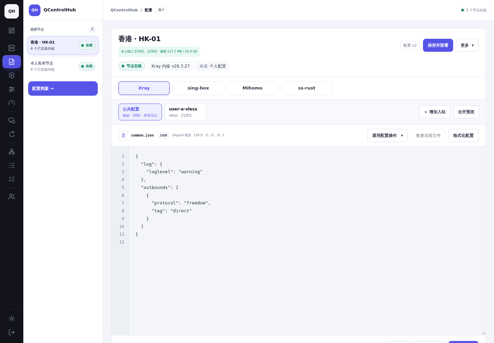
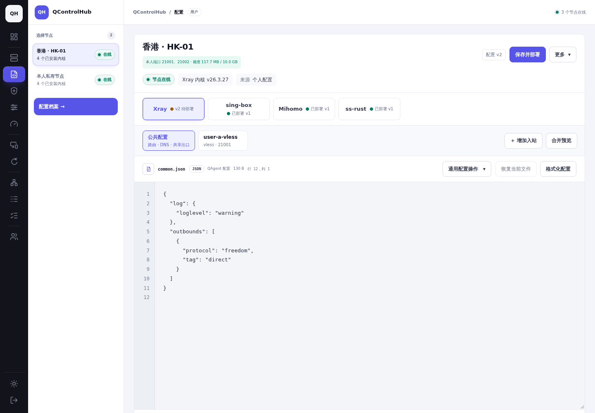
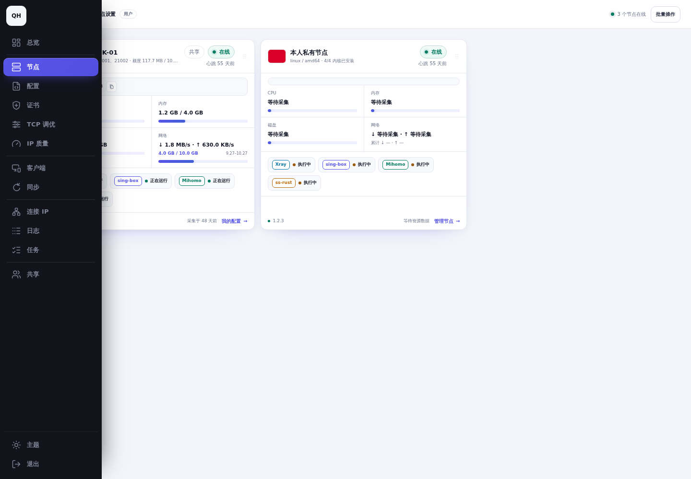
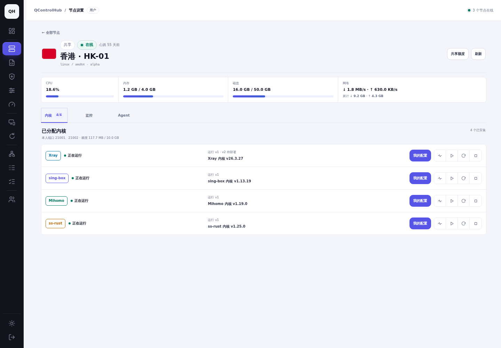
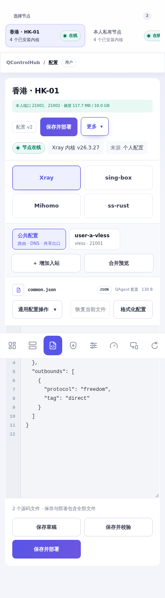
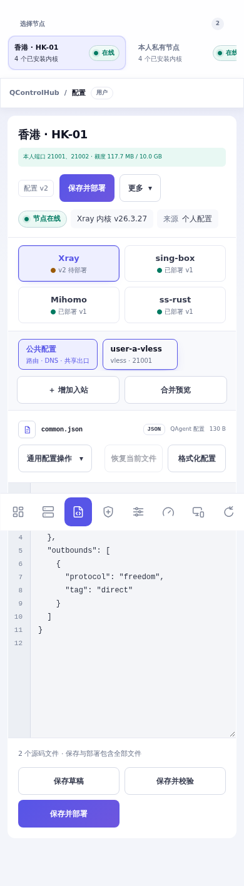
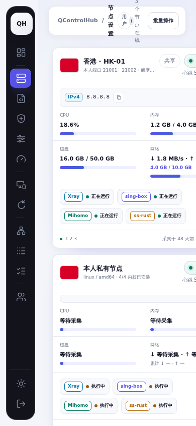
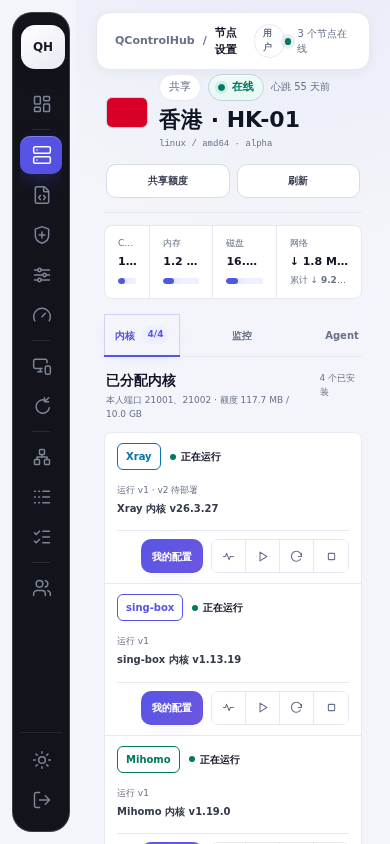
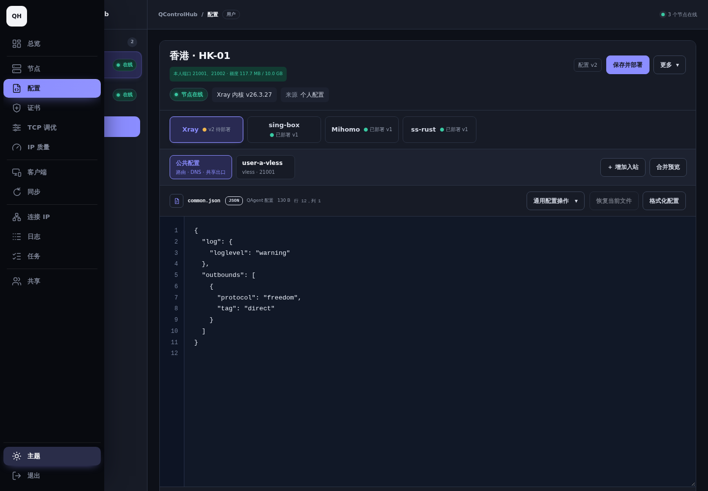
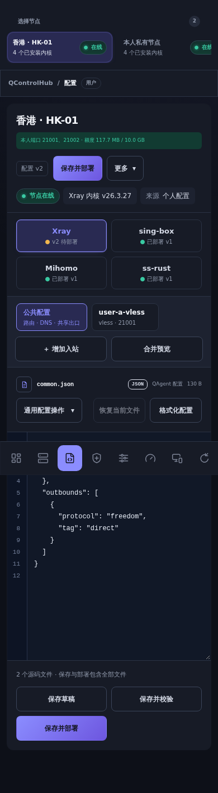

# 恢复配置状态控件与节点管理入口

## 根因与修复

基线：`22dd96acc33fda3219b7440ccd26a504fa28bc26`（2026-10-18 最新 main）。

PR #292 的两处页面调整造成了退化：

- `live-config-view.js` 对共享节点直接省略了原有内核选择按钮内的状态控件。
- `agent-view.js` 把共享节点卡片从节点管理详情改为直接进入配置页，导致用户无法从卡片进入实例管理。

本次恢复原有位置、布局和样式。共享用户配置状态取自服务端鉴权后的 `runtime[engine].instance`：比较配置 ID 与版本，显示“尚未配置”“vN 待部署”“已部署 vN”；缺少实例元数据或配置版本未核实时显示“配置待核实”。服务停止后仍保留文件部署状态。相同版本号、不同配置 ID 仍识别为待部署。

共享节点卡片恢复 `#settings-node-{id}`，保留节点管理中的“我的配置”入口，以及配置页“更多 → 实例管理”返回入口。共享实例的运行状态、当前运行版本、限制原因与启停操作继续位于节点管理。自有节点沿用原有服务状态控件。

## 实际验证范围

- `GOFLAGS=-buildvcs=false make non-browser-checks`：通过。
- `GOFLAGS=-buildvcs=false go test ./frontend -skip '^TestAgentBrowserRuntimeSmoke$' -count=1`：通过。
- 六组真实 Chromium 浏览器回归：`shared-node`、`shared-node-mobile`、`config-inbounds`、`config-inbounds-mobile`、`config-layout`、`config-layout-mobile`，全部通过。
- 回归测试实际点击共享节点卡片进入详情，验证普通用户可用的重启、停止按钮及 `运行 v1 · v2 待部署`，同时核查宿主管理控件不可见。覆盖撤销后移除操作、自有节点入口、管理员布局、配置未提交内容及切换确认。
- 配置状态矩阵覆盖未安装、未配置、已保存未部署、部署后继续编辑、同版本号不同配置、停止、失败、未知、离线、旧 Agent 缺少实例元数据及配置版本未核实。
- 桌面 1440×1000、手机 390×844，前后使用相同普通用户 A、同一节点与配置、浅色主题及页面状态；补充深色主题。页面均无横向溢出。

截图和录屏使用项目浏览器夹具，真实执行当前页面代码；基线仅由路由返回上述提交的两个渲染模块。账号、资源和服务数据为测试夹具。本次只恢复前端显示和导航，未修改 API、数据库、Agent 或权限规则，未重新部署生产环境，也未重新执行真实内核启停；原完整链路证据保留在 [共享实例验收](../shared-instance-lifecycle/README.md)。

浏览器原始读数：[browser-proof.json](browser-proof.json)。录屏演示“节点卡片 → 节点管理 → 我的配置 → 更多 → 实例管理”，不将模拟服务数据作为真实内核启动证明。

## 修改前后截图

### 桌面配置状态

| 修改前 | 修改后 |
| --- | --- |
|  |  |

### 桌面节点入口

| 修改前：卡片进入配置 | 修改后：卡片进入节点管理 |
| --- | --- |
|  |  |

### 手机配置状态

| 修改前 | 修改后 |
| --- | --- |
|  |  |

### 手机节点入口

| 修改前 | 修改后 |
| --- | --- |
|  |  |

### 深色主题

| 桌面 | 手机 |
| --- | --- |
|  |  |

### 导航流程录屏

[手机导航流程录屏](restored-navigation.webm)

## 72 小时清理

测试结束时间：2026-10-18 04:01:17 UTC（UTC+8 12:01:17）。浏览器会话已关闭，测试服务已停止，42457 端口已释放。未创建真实账号、数据库或容器。

已实际注册并启用持久定时器 `qch-ui-status-4b5d-cleanup.timer`，执行时间为 **2026-10-21 04:01:17 UTC（UTC+8 12:01:17）**。

仅清理本次 `output/playwright/config-status-navigation` 临时夹具目录。执行前检查固定绝对路径、非符号链接及捕获的目录设备号/inode；目录身份变化则拒绝清理。截图、录屏、报告和 [清理清单](cleanup-manifest.json) 保留于本目录。已有测试环境、生产环境及先前清理定时器均不在本任务范围内。
