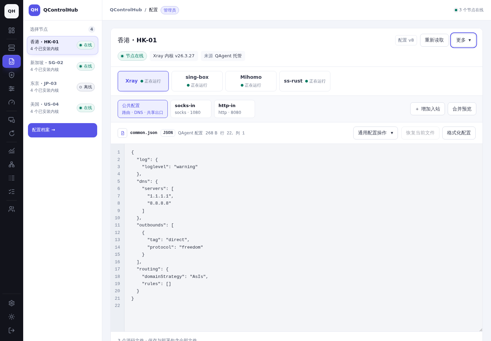
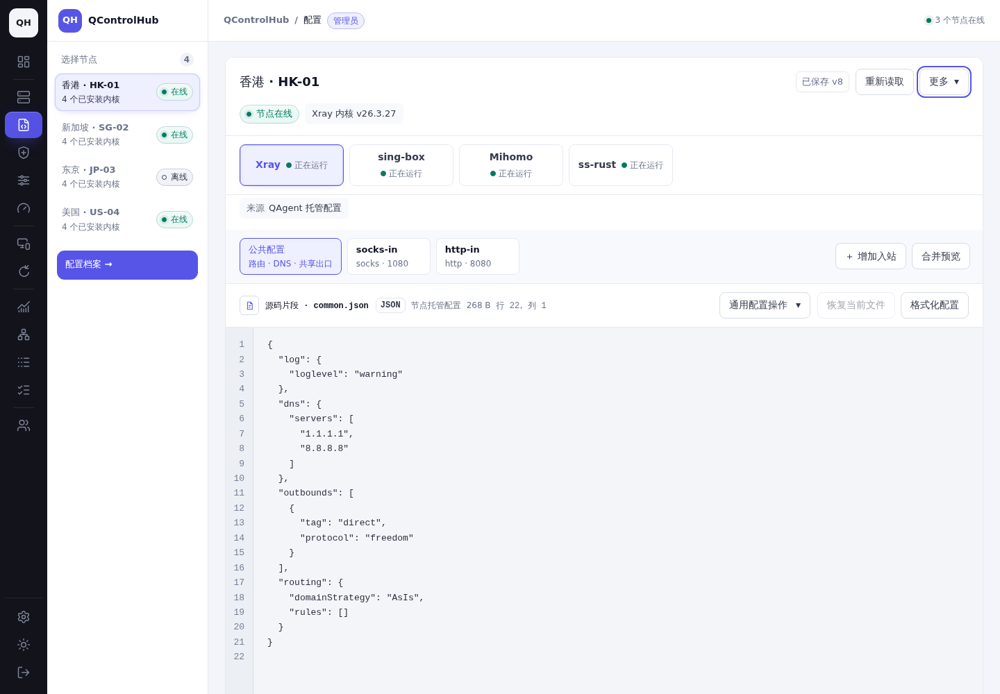
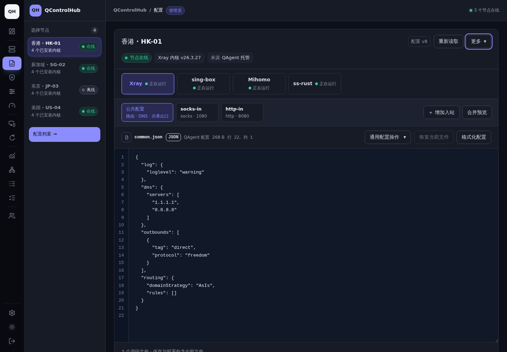
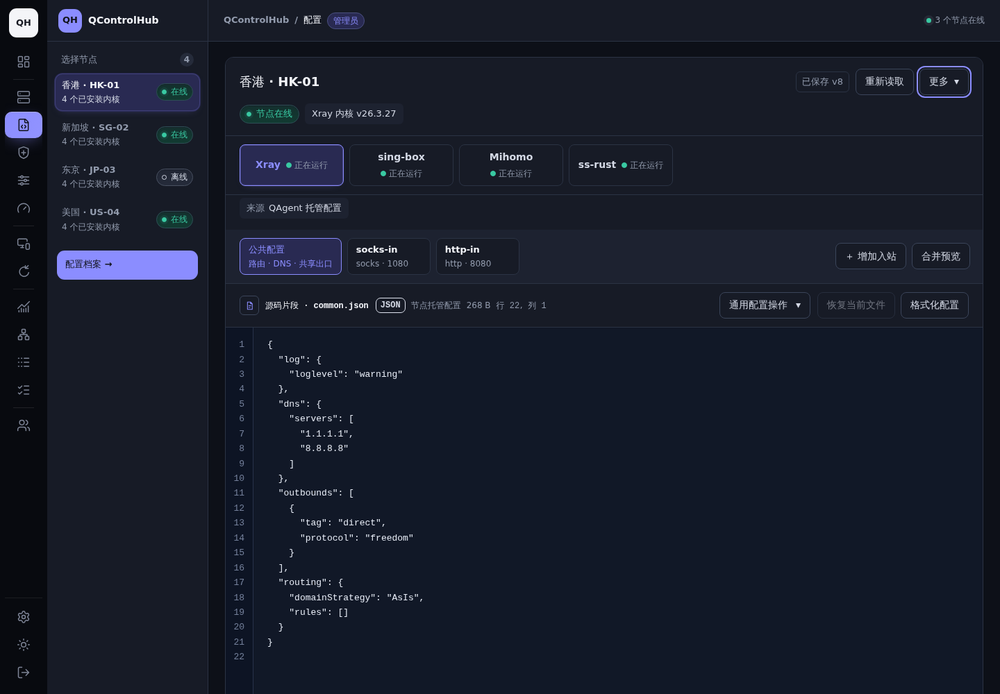
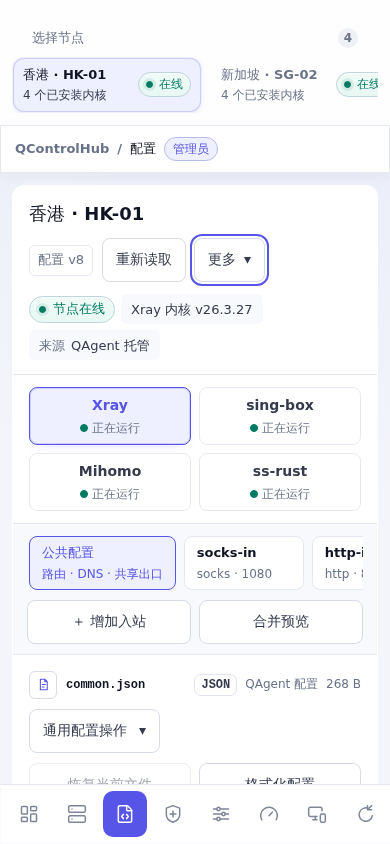
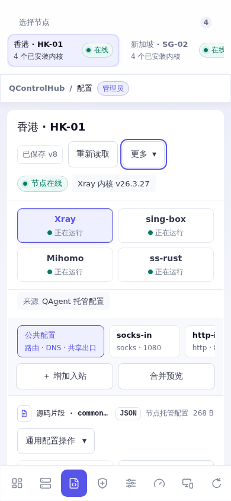
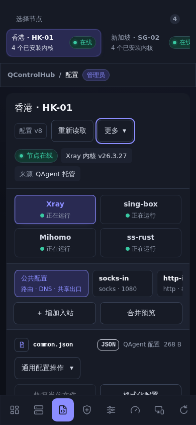
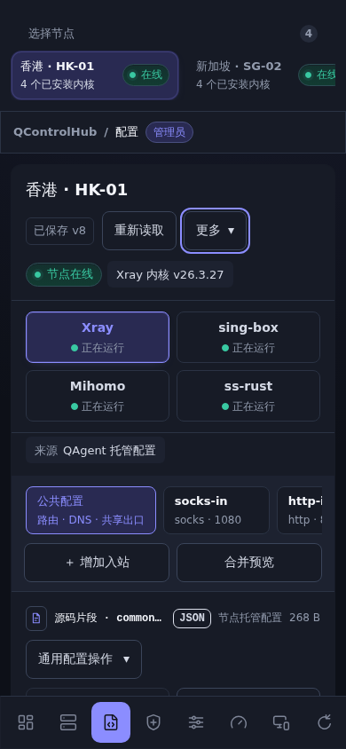

# 配置工作区布局与编辑流程

## 基线与范围

- 基线：`955f442e69ddb0a35b8163822ff3129c30e9c02f`，开始修改前从 `origin/main` 创建 `codex/config-workspace-flow`；交付前再次 fetch，main 未前进。
- 范围：主导航「配置」、直接打开的协议/通用字段弹窗、共享的提交结果组件及相应测试。没有修改后端接口、授权规则、配置解析器、其他页面布局或 GitHub Actions。
- 完全复用现有组件、类名和动效；没有增加或修改 CSS、内联样式、主题变量、字体或 UI 库。

## 实际问题与原因

| 问题 | 原因与处理 |
| --- | --- |
| 来源混在标题中，节点、内核、保存状态和缓存说明重复，阅读顺序不清楚 | 标题保留节点和保存版本；节点在线状态、内核运行状态沿用独立显示；来源放在内核选择下方，清理重复解释 |
| 共享用户头部和编辑器底部都有部署按钮；托管配置缺少单独保存入口 | 提交集中到现有页脚，按保存草稿、保存并校验、保存并部署排列；系统服务来源只提供实际支持的导入并迁移 |
| 片段和最终完整配置的边界不够明显 | 当前文件标为「源码片段」，合并预览标为「完整配置」；保留现有全部文件提交提示、跟随选中对象的操作菜单和稳定的新增入站入口 |
| 保存或明确放弃修改后，旧片段草稿仍可能留在编辑器中 | 原协调 key 不含保存版本，旧文件控制器被复用；新 key 包含保存版本和明确重置序号，普通刷新协调仍保留正在编辑的内容 |
| 切换或刷新期间旧表单可继续操作，部分异步边界缺少上下文检查 | 统一节点/内核/来源切换，冻结旧编辑区；检查账号对象、导航代次、来源、目标和连接状态；提交前、预检后、保存后及任务返回后再次核对；旧响应不能创建后续任务 |
| 刷新先删缓存，失败后难以继续编辑 | 保留原编辑器和多个文件草稿，等待新鲜读取和工作区请求成功后再替换；失败提示内容已保留 |
| 个人保存使用与托管快照相同的缓存 key | 个人、托管、导入快照分开存放，避免个人草稿覆盖主机快照；沿用账号退出时的上下文重置 |
| 源码提交与表单提交的结果反馈不同，校验任务没有进入统一结果跟踪 | 两条路径共用版本结果区；校验成功明确「尚未部署」，部署/迁移分别跟踪终态；冲突、保存后任务失败、结果暂不可读取保留内容并提供核对路径 |

## 调整后的流程

1. 左侧/移动端节点区选择节点，在工作区选择内核。
2. 确认个人配置、节点托管配置或系统服务配置；可访问来源仍由原授权和实际内核能力决定。
3. 选择公共配置或入站文件，在原源码编辑器编辑；现有协议表单用于新增/修改，通用配置和出站操作跟随选择。高级字段、历史、差异留在「更多」。
4. 页脚执行保存草稿、保存并校验、保存并部署，或在只读系统服务快照上执行导入并迁移。
5. 在编辑器后查看带版本的保存/任务结果。运行状态继续独立显示，不据此推断当前草稿已生效。

保留原完整配置合并、未知字段和数字 token 处理、原生格式、准确的 tag/端口定位、引用维护、统计及独立出口生成。部署前仍强制读取 Agent 新鲜配置、核对基线，并把确切保存版本传给任务接口。保存已成功而后续结果不明时阻止重复提交，要求重新读取核对；已确认的部署失败可以在原目标继续修改/重试。

## 截图对比

截图来自实际运行的仓库页面，基线通过 `git archive` 运行上述提交的原始前端；修改后运行当前前端。两边使用同一 fixture 管理员、节点 `alpha`（香港 HK-01）、Xray、托管来源、v8、公共配置文件、相同主题/视口/焦点。API、Agent 状态及配置是仓库测试数据。没有制作静态设计稿或拼接页面。

| 状态 | 修改前 | 修改后 |
| --- | --- | --- |
| 桌面 · 浅色 · 1440×1000 |  |  |
| 桌面 · 深色 · 1440×1000 |  |  |
| 手机 · 浅色 · 390×844 |  |  |
| 手机 · 深色 · 390×844 |  |  |

同一页脚位置的操作区对比：

| 状态 | 修改前 | 修改后 |
| --- | --- | --- |
| 桌面浅色 | [操作区](before-desktop-light-actions.png) | [操作区](after-desktop-light-actions.png) |
| 桌面深色 | [操作区](before-desktop-dark-actions.png) | [操作区](after-desktop-dark-actions.png) |
| 手机浅色 | [操作区](before-mobile-light-actions.png) | [操作区](after-mobile-light-actions.png) |
| 手机深色 | [操作区](before-mobile-dark-actions.png) | [操作区](after-mobile-dark-actions.png) |

弹窗补充截图：[小屏手机 375×812](phone-small-dialog.png)、[手机横屏 844×390](phone-landscape-dialog.png)、[平板竖屏 820×1180](tablet-portrait-dialog.png)、[平板横屏 1180×820](tablet-landscape-dialog.png)。横屏弹窗内容滚动，页脚留在可见范围；记录的页面宽度均未超出视口。

## 实际操作录屏

- [切换与草稿（4.88 秒，390×844）](switch-and-draft.webm)：修改片段 → 取消内核切换保留草稿 → 文件/完整配置预览 → 确认放弃并切换内核。
- [表单、保存、校验、部署和失败重试（9.16 秒，1440×1000）](edit-save-validate-deploy.webm)：复用协议表单新增入站 → 校验 → 源码修改 → 保存草稿 → 校验 → 部署失败 → 原目标重试成功。
- [部署失败截图](deployment-failed.png)、[重试结果截图](deployment-retried.png)、[操作与版本记录](browser-proof.json)。

录屏由 Playwright CLI 录制实际页面。第二段使用共享用户的个人实例 fixture；任务失败/成功由测试响应驱动，**不代表真实内核已部署**。

## 本地验证

环境：Debian GNU/Linux 13，Chromium `152.0.7977.82`，PostgreSQL 17 独立容器。截图使用真实 Chromium 的视口模拟；触摸检查另建 `isMobile/hasTouch` 上下文，使用 tap 和 CDP 原生触摸滑动。**没有使用手机/平板真机，也未验证 Safari、Firefox 或真实内核/系统服务迁移。**

| 检查 | 结果与证据 |
| --- | --- |
| `GOFLAGS=-buildvcs=false make non-browser-checks` | 通过，包含模块策略、生成物检查、部署脚本回归、Go vet；[日志](verification/checks.txt) |
| `GOFLAGS=-buildvcs=false make build` | 通过；[日志](verification/build.txt) |
| `node frontend/module_smoke.mjs`；`go test ./frontend -skip '^TestAgentBrowserRuntimeSmoke$' -count=1` | 通过；[模块日志](verification/module-smoke.txt)、[前端日志](verification/frontend-tests.txt) |
| 浏览器 8 模式：`config-inbounds{,-mobile}`、`config-layout{,-mobile}`、`config-migration`、`config-scope`、`shared-node{,-mobile}` | 全部通过；[矩阵日志](verification/browser-final.txt) |
| 最终受影响流程重跑 | 入站/手机/迁移通过；[日志](verification/browser-targeted.txt)。新增节点乱序后桌面/手机布局通过；[日志](verification/browser-node-race.txt) |
| 新增浏览器回归 | 多文件完整提交与超长数字 token；保存后新基线；保存/校验≠部署；刷新失败保留多个草稿；节点/内核/来源乱序与旧表单冻结；共享实例失败重试；冲突保留；保存中切换账号不再创建任务，任务返回后也不写入新账号缓存 |
| 原有入站与协议回归 | 四内核新增/修改/删除、表单与源码/预览切换、tag/端口定位、引用、出站及通用字段、高级表单、弹窗未保存确认；同上浏览器日志 |
| 实际 API + PostgreSQL | 四内核表单保存和独立出口、共享实例状态/版本/伪造目标、旧 Agent、管理员/自有节点端口规则、共享 TLS 冲突保留与重试、配置读缓存；[日志](verification/api-tests.txt) |
| 真实登录会话 + API + PostgreSQL | `TestMultiUserBrowserSessions` 桌面和手机，各三个独立密码/Cookie/CSRF 浏览器会话；私有工作区、外部配置/修订/任务拒绝、重复提交、版本冲突、撤销共享及同上下文切换账号均通过；配置修订和独立出口 API 也通过；[日志](verification/identity-tests.txt) |
| 配置模型与存储回归 | 引用重命名/删除、未知字段、原生顺序/精度、读缓存过期及权限、共享实例生命周期和原接收者重试通过；[日志](verification/model-tests.txt) |
| 手机/平板触摸与键盘 | 390×844、844×390、820×1180、1180×820 的 tap、菜单、弹窗关闭确认、Escape 和无横向溢出通过；手机原生触摸滑动成功；[日志](verification/touch.txt) |

浏览器复跑命令为 `QCH_BROWSER_SMOKE_MODES=<上述逗号分隔模式> node frontend/agents_browser_smoke.mjs`。数据库测试使用仅回环监听的本次独立数据库和 `QCH_TEST_DATABASE_URL`；真实身份浏览器测试额外设置 `QCH_MULTI_USER_BROWSER=1`。日志中没有跳过上述数据库/身份测试。未运行完整 `make check` 或其他页面的完整浏览器矩阵。

[capture.mjs](capture.mjs) 接收基线/当前测试站点两个 origin，可复现截图与录屏；[touch.js](touch.js) 通过 Playwright CLI `run-code --filename` 在当前测试站点复现触摸检查。界面录屏的任务响应与 API/数据库回归是两类证据，不能据录屏声称真实内核已执行。

## 测试环境与清理

- 验证结束：**2026-10-19 04:17:16，Asia/Shanghai（UTC+8）**。
- 已停止两个 fixture HTTP 服务，关闭本次 Playwright 会话和录制会话，停止数据库容器；`39835`、`36299`、`55593` 端口均已释放。
- 持久任务：**`qch-config-flow-7850-cleanup.timer`**，已登记为 `enabled/active`，`Persistent=true`，重启后可补执行。
- 执行时间：**2026-10-22 04:17:16，Asia/Shanghai（UTC+8）**，即结束后 72 小时；对应 **2026-10-21 20:17:16 UTC**。
- 范围：本次停止的 `qch-config-flow-7850-db`（按完整容器 ID、标签和挂载核对）及其唯一匿名数据卷；本工作树的 `output/playwright/config-workspace-flow`；本次生成且指纹一致的两个 `bin` 可执行文件，目录为空时才删除 `bin`。不清理其他容器、卷、项目或共享工具缓存。
- 截图、录屏、本报告和必要日志保留在 `docs/config-workspace-flow/`；清理执行脚本/清单位于工作树外 `/var/lib/qch-config-flow-7850`，供定时执行和审计。清单不包含数据库密码。
- 已执行身份校验 dry-run，尚未提前执行删除。[资源清单](cleanup-manifest.json)、[登记与端口核对](cleanup-registration.json)、[dry-run](cleanup-dry-run.txt)、[timer](qch-config-flow-7850-cleanup.timer)、[service](qch-config-flow-7850-cleanup.service)、[清理脚本](cleanup.py)。

风险主要是异步协调和旧编辑器恢复，已针对失败、乱序、部分成功与账号切换验证。回滚本 PR 的前端模块即可恢复原流程；无需迁移数据库或回退配置文件。
