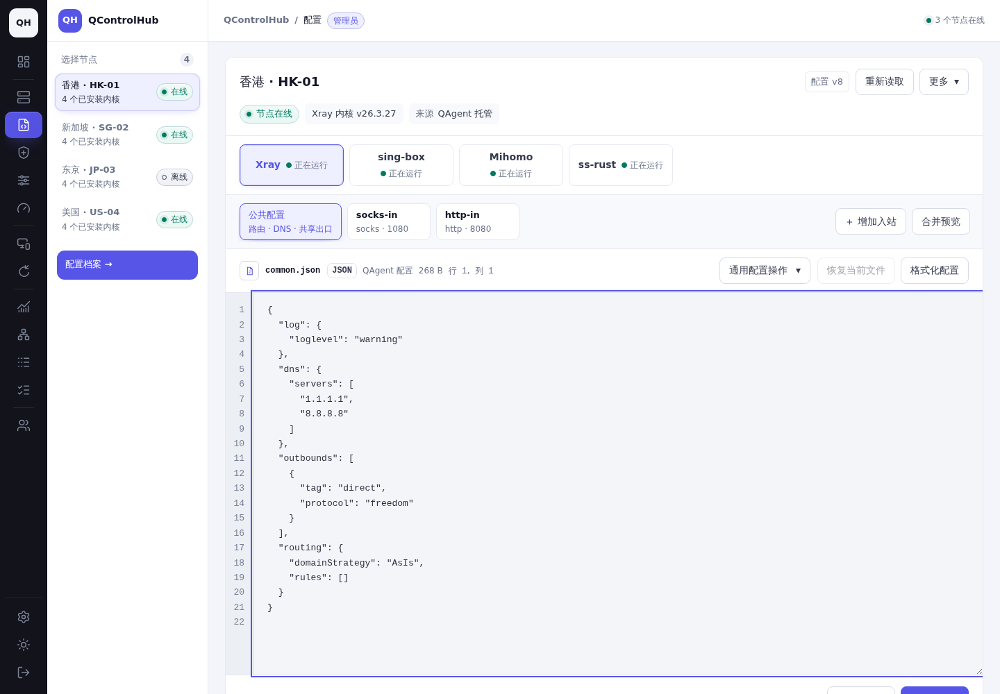
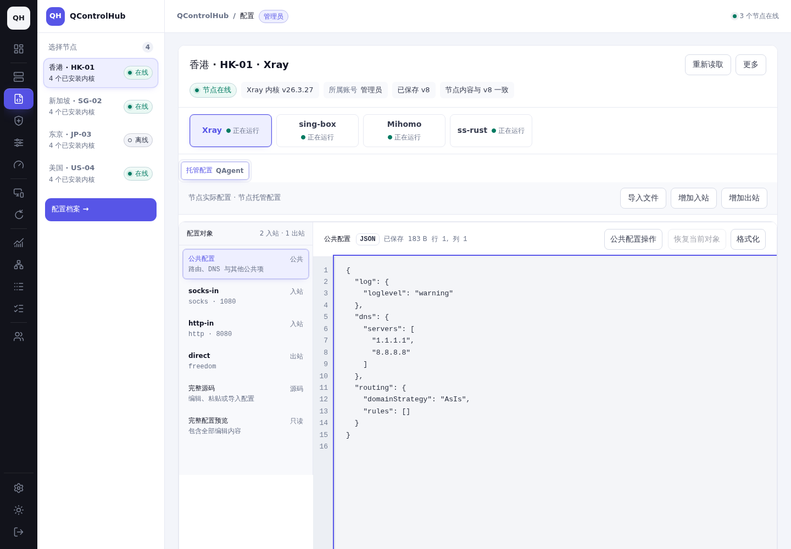
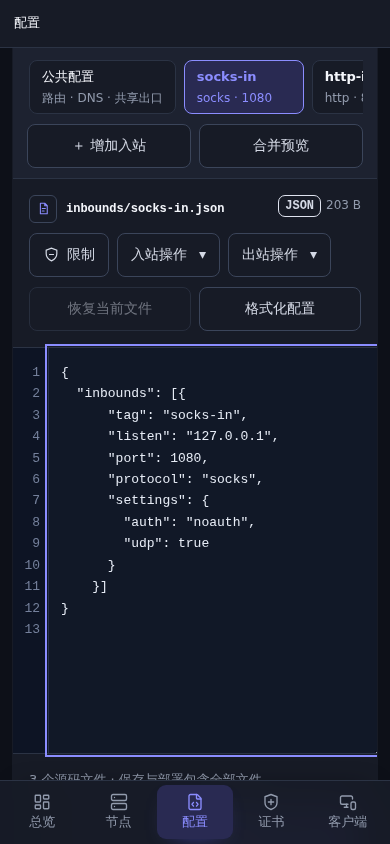
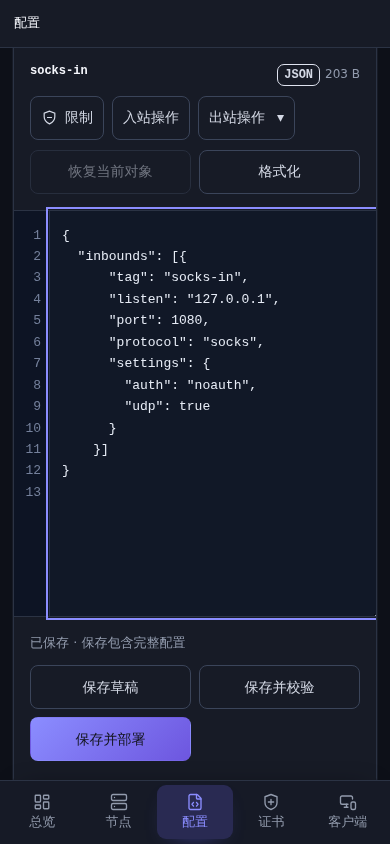

# 配置工作区重构报告

## 基线与范围

- 基线：`955f442e69ddb0a35b8163822ff3129c30e9c02f`，提交前再次 fetch，仍为 `origin/main`。
- 分支：`codex/config-workspace-refactor`。
- 沿用原生 ES modules、Go API 和现有主题。没有修改 CSS、添加样式规则、内联样式、主题变量、UI 库或 GitHub Actions。
- 改动覆盖配置工作区、协议表单、完整源码、文件导入、对象操作和提交反馈；其他页面只调整入口、账号清理及共用组件衔接。

## 原有问题与页面重组

原页面将节点、内核、来源、文件、公共字段和协议操作分散在多处。对象导航与编辑工具各自生成，协议弹窗通过渲染完整预设页面再提取局部 DOM 组装。文件切换、原生配置入站列表、协议草稿和任务反馈分别维护状态。完整合并预览只读，无法直接编辑整份配置。

重构后的页面依次组织为：

1. 工作区标题、节点/内核选择、来源切换、账号归属和独立的保存/部署/运行状态。
2. 固定的文件导入及新增对象入口。
3. 同一配置对象导航：公共配置、入站、独立出站、完整源码、完整配置预览。桌面使用现有双栏，手机使用现有横向对象导航。
4. 当前对象标题、对象操作菜单和源码工具；协议表单使用独立组件和原有高级折叠字段。
5. 保存草稿、保存并校验、保存并部署，以及邻近的任务进度、部分成功和失败反馈。

个人配置、QAgent 托管配置、系统服务快照按现有权限呈现。系统服务快照只提供导入迁移，显示“系统服务快照 / 待导入并迁移”，不借用托管配置版本，也不提供其他来源的历史和差异。

## 模块职责和数据流

| 模块 | 职责 |
| --- | --- |
| `live-config-page.js` | 工作区加载编排、权限、部署前新鲜快照、刷新和版本核对 |
| `config-workspace-state.js` | 账号/节点/内核/来源隔离，加载票据，版本基线、文档、草稿和操作状态 |
| `config-document.js` / `config-json.js` | 原生完整文档、分段投影、稳定对象标识、选择和引用更新 |
| `config-files.js` | 将文档对象映射到现有导航与编辑器，不再拥有独立配置事实 |
| `config-source-editor.js` | 完整源码、空白草稿、本地文件读取、异步预览和输入保留 |
| `protocol-form.js` / `preset-embedded-view.js` | 可组合协议表单；只渲染实际需要的表单和辅助区域 |
| `config-inbounds.js` / `config-outbounds.js` / `config-restrictions.js` | 当前对象的弹窗、原子修改、草稿和权限衔接 |
| `live-config-submit.js` / `live-config-state.js` | 单次提交锁、精确目标/版本/内容、保存后任务、部分成功及重试 |
| `preset-status.js` | 按工作区跟踪任务、终态/重连反馈和过期回调隔离 |
| `config_drafts.go` / 配置 API | 无写入草稿预览，以及完整草稿与表单修改的同一次版本检查和持久化 |
| `configschema` / `serverconfig` 文档补丁 | 对原始 JSON token 或 YAML 节点应用实际字段变化，保留无关内容 |

读取结果只有在账号数据对象、路由、加载票据和工作区仍一致时才进入模型。编辑器围绕同一完整文档工作，公共项/入站/出站是投影；完整预览读取同一合并结果。提交先固定节点、内核、来源、版本和内容，保存返回后立即提交新基线，再独立跟踪校验/部署任务。

切换时捕获草稿并确认，标签页内的 sessionStorage 按账号隔离，刷新、返回和深链接可恢复对应上下文。切换账号、退出和授权失效会清理工作区及相关缓存。文件读取、原生预览、表单初始化和任务回调均检查上下文，组件销毁后的响应无法覆盖新工作区。

保存成功但任务创建失败时，反馈已保存版本并保留内容；重试使用该有效版本，不重复创建相同保存。运行状态、未保存修改、已保存待部署、校验结果、部署结果分别显示。托管部署保留独立的新鲜 Agent 读取、版本比对和现有内核校验。

### 完整源码与自定义配置

- Xray、sing-box 的“完整源码”可编辑任意原生字段；“完整配置预览”只读，包含全部分段修改。
- Mihomo 和 ss-rust 保持原生完整配置编辑，入站对象由无写入预览解析，输入更新不重置光标。
- “更多 / 新建空白配置”可以从空内容开始；粘贴和本地 UTF-8 文件导入进入同一草稿。导入不保存、不部署，覆盖未保存修改前确认。
- 文件、语法、格式不匹配和校验错误保留输入。文件上限沿用 2 MiB；识别明确的其他内核格式，不用字段白名单拒绝未知合法扩展。
- JSON 不经过浮点数往返，保留大整数、未知字段、必要数组顺序和未修改 token；重命名更新已知引用并拒绝重复标识，未知自定义字段不误改。
- YAML 保留未知字段、注释、顺序、锚点和别名。直接源码切换/保存不主动格式化；用户主动格式化及必要的 YAML 表单变更可能由原生编码器调整缩进，不能承诺逐字节排版不变。
- 表单提交携带当前完整草稿，通过相同权限、端口、额度、统计生成字段和实例隔离检查，在一个乐观版本检查内应用修改，避免覆盖源码中未被表单覆盖的字段。

### 删除或合并的实现

- 删除“渲染完整预设页面，再抽取表单并搬移 DOM”的弹窗组装方式。
- 合并分段配置和原生配置的并行导航，移除重复工具栏及旧选择状态。
- 将文件模型从 DOM 绑定中提取，移除第二套 dirty/基线维护。
- 事件绑定按职责命名，修复编辑器监听与配置模型监听互相覆盖。
- 嵌入表单不再提前生成整页导航和未使用的高级编辑区。
- 原有格式化、统计、独立出口、端口和共享实例机制继续复用。

## 修改前后截图

截图均由本地 Chromium 实际渲染并已人工查看。每组使用相同 fixture 管理员、节点 `alpha`、Xray v8 数据、主题、视口和选中对象。完整截图清单、选中对象、溢出检查以及保存内容/预览语义 SHA-256 见 [screenshots.json](evidence/screenshots.json)。六组保存内容的字节哈希一致，前后完整预览的语义哈希一致；旧预览曾重排根字段，新预览保留原文。

每个单元格依次链接：工作区 / 入站 / 完整预览。

| 视口 / 主题 | 修改前 | 修改后 |
| --- | --- | --- |
| 桌面 1440×1000 / 明 | [工作区](evidence/before-desktop-light-workspace.png) · [入站](evidence/before-desktop-light-inbound.png) · [预览](evidence/before-desktop-light-preview.png) | [工作区](evidence/after-desktop-light-workspace.png) · [入站](evidence/after-desktop-light-inbound.png) · [预览](evidence/after-desktop-light-preview.png) |
| 桌面 1440×1000 / 暗 | [工作区](evidence/before-desktop-dark-workspace.png) · [入站](evidence/before-desktop-dark-inbound.png) · [预览](evidence/before-desktop-dark-preview.png) | [工作区](evidence/after-desktop-dark-workspace.png) · [入站](evidence/after-desktop-dark-inbound.png) · [预览](evidence/after-desktop-dark-preview.png) |
| 手机 390×844 / 明 | [工作区](evidence/before-mobile-light-workspace.png) · [入站](evidence/before-mobile-light-inbound.png) · [预览](evidence/before-mobile-light-preview.png) | [工作区](evidence/after-mobile-light-workspace.png) · [入站](evidence/after-mobile-light-inbound.png) · [预览](evidence/after-mobile-light-preview.png) |
| 手机 390×844 / 暗 | [工作区](evidence/before-mobile-dark-workspace.png) · [入站](evidence/before-mobile-dark-inbound.png) · [预览](evidence/before-mobile-dark-preview.png) | [工作区](evidence/after-mobile-dark-workspace.png) · [入站](evidence/after-mobile-dark-inbound.png) · [预览](evidence/after-mobile-dark-preview.png) |
| 平板 820×1180 / 明 | [工作区](evidence/before-tablet-light-workspace.png) · [入站](evidence/before-tablet-light-inbound.png) · [预览](evidence/before-tablet-light-preview.png) | [工作区](evidence/after-tablet-light-workspace.png) · [入站](evidence/after-tablet-light-inbound.png) · [预览](evidence/after-tablet-light-preview.png) |
| 平板 820×1180 / 暗 | [工作区](evidence/before-tablet-dark-workspace.png) · [入站](evidence/before-tablet-dark-inbound.png) · [预览](evidence/before-tablet-dark-preview.png) | [工作区](evidence/after-tablet-dark-workspace.png) · [入站](evidence/after-tablet-dark-inbound.png) · [预览](evidence/after-tablet-dark-preview.png) |

### 桌面工作区

修改前：

修改后：

### 手机入站编辑

修改前：

修改后：

## 实际操作录屏

以下是 Chromium 对生产页面组件的实际点击、输入、滚动和提交录像，非动画示意。任务和节点响应由隔离 fixture 控制；录屏中的部署成功不代表连接真实内核运行。

| 录屏 | 操作 |
| --- | --- |
| [桌面：上下文与草稿，10.96 秒](evidence/desktop-context-drafts.mp4) | 分段修改、完整预览、取消/确认切换内核、切回恢复、刷新、节点往返 |
| [手机暗色：文件、保存与重试部署，8.72 秒](evidence/mobile-file-save-retry-deploy.mp4) | 本地文件进入草稿、完整预览、保存成功后任务失败、重试校验、指定版本部署和状态核对 |
| [手机明色：协议与独立出站，5.36 秒](evidence/mobile-protocol-outbound.mp4) | 新入站表单、字段分组、保存并校验、选择同步、独立出站弹窗 |

文件信息见 [recordings.json](evidence/recordings.json)。桌面录屏的页面刷新包含真实重载瞬间。视频仅做 H.264 编码，没有替换、拼接或生成操作画面。

## 实际验证结果

最终结果摘要和命令见 [validation.txt](evidence/validation.txt)。

| 验证 | 结果与范围 |
| --- | --- |
| 全量 Go | `go test -count=1 -timeout 20m -p 1 -skip '^TestAgentBrowserRuntimeSmoke$' ./...` 全部通过，使用本次独立 PostgreSQL；浏览器矩阵另跑 |
| 构建 | `go build -buildvcs=false -trimpath ... ./cmd/control-plane ./cmd/agent` 通过 |
| 前端模块与边界 | module smoke、module/smoke policy、frontend Go 静态契约全部通过 |
| 配置浏览器矩阵 | 9 模式通过：入站桌面/手机、布局桌面/手机、来源迁移、共享范围、访问限制、预设桌面/手机；只读收尾再跑 3 模式通过 |
| 真实 HTTP 多用户浏览器 | 管理员、Alice、Bob 三个独立密码/Cookie/CSRF 会话，桌面和手机通过：共享接受/撤销、跨账号配置/历史/任务拒绝、任务去重、版本重试、同浏览器切换账号隔离 |
| 真实 HTTP 协议表单 | Alice 自有节点、Bob 共享实例，各桌面/手机均通过：安装失败、重试、刷新、新入站表单、自动准备内核、精确版本部署；Agent 任务完成由 fixture 报告 |
| 新增数据库集成 | 只读草稿预览不写配置/任务；过期版本拒绝；完整 YAML 草稿与公共字段一次原子保存；评论/别名/大整数保留；共享端口/核心授权/另一用户不受影响 |
| 数据与状态回归 | 完整/分段一致性、未知字段、数字精度、空白/本地导入、错误输入保留、文件乱序、稳定对象/引用、新增修改删除、任务部分成功与重试、账号清理 |

首次全量运行暴露两类测试环境/断言问题，已按证据处理：旧断言依赖整体 JSON 美化后的固定空白，现改为按实际语义构造测试输入；独立 PostgreSQL 初始化继承 Asia/Shanghai，导致两个按 UTC 周期构造数据的既有流量历史测试失败，将本次测试集群会话时区设为 UTC 后，针对测试和最终完整未缓存套件均通过。主机时区没有修改。

### 设备范围和未验证项

- 使用 Linux Chromium，桌面真实浏览器进程；手机/平板为视口及触摸模拟，人工查看截图、弹窗、菜单、源码与状态；自动化检查滚动、焦点、选中状态、触摸和键盘操作。
- 多用户 API/浏览器使用真实 HTTP、独立 PostgreSQL、真实登录和 CSRF。正向配置表单流程覆盖自有用户与共享用户；管理员正向工作区主要通过生产 UI fixture 和 API 回归验证。
- 没有使用实体手机/平板，没有覆盖 Safari、Firefox 或移动系统原生文件选择器；本地文件通过浏览器 file input 注入。
- 没有向真实代理内核/系统服务执行部署、安装或迁移，没有验证真实节点网络抖动；任务结果为确定性 Agent 报告或 API fixture。原生语法、字段与权限在 API/模型层验证，真实内核兼容性依赖既有节点校验机制。
- 未运行包含所有其他页面的完整浏览器矩阵，也没有运行整个 `make check`；实际命令和排除项已明确列出。

## 证据复现

`capture/server.mjs ROOT` 分别服务基线归档与当前 checkout；两个版本均使用同一配置 fixture。`capture/screenshots.mjs BEFORE_URL AFTER_URL OUTPUT` 生成 36 张配对截图并核对保存字节及完整预览语义。`capture/recordings.mjs AFTER_URL RAW_DIRECTORY` 录制三段流程并断言目标内容/版本。

脚本需要环境现有 Playwright 和 Chromium，可通过 `QCH_PLAYWRIGHT_MODULE` 指向已安装模块、`QCH_CHROMIUM` 指定浏览器；不向项目添加依赖。截图与录屏之外的测试日志只保留必要结果摘要，未复制数据库或浏览器凭据。

## 风险与回滚

主要风险在完整文档与协议表单合并、共享实例任务以及原生 YAML 修改。对应增加精度、未知字段、共享授权、任务重试和真实 HTTP 回归；物理设备及真实内核验证仍需后续环境。

无数据库迁移，既有 API 请求兼容，新增预览接口不写入。可回滚本 PR 提交并重新部署控制面；回滚不会自动撤回已保存配置或部署。需要恢复配置时使用现有版本历史和正常部署流程。

## 测试环境清理

测试结束于 **2026-10-19 15:34:56 Asia/Shanghai**。本次浏览器、四个 HTTP 服务和独立 PostgreSQL 已停止，相关端口和进程核对均为空。

持久 systemd 任务 **`qch-config-workspace-cleanup-20261019-abszbg.timer`** 已启用，状态 `active / waiting`、`Persistent=yes`，执行时间为 **2026-10-22 15:34:56 Asia/Shanghai**（`2026-10-22 07:34:56 UTC`），距测试结束 72 小时。

清理仅删除 `/tmp/qch-config-workspace-20261019-ABsZBG`：本次基线归档、独立 PostgreSQL 程序/数据/套接字、临时构建和原始视频等。脚本使用固定路径及归属标记，拒绝符号链接和挂载目录，已通过 dry-run；不会按旧 PID 终止其他进程。调度文件和执行审计保留在 `/var/lib/qch-config-workspace-cleanup-20261019-abszbg` 及对应 systemd unit，便于核对执行结果。

本目录截图、录屏、报告和脱敏结果摘要，以及 `output/playwright/config-workspace-20261019` 下的浏览器观察记录单独保留。详细登记及已核验的调度属性见 [cleanup.json](evidence/cleanup.json)。
