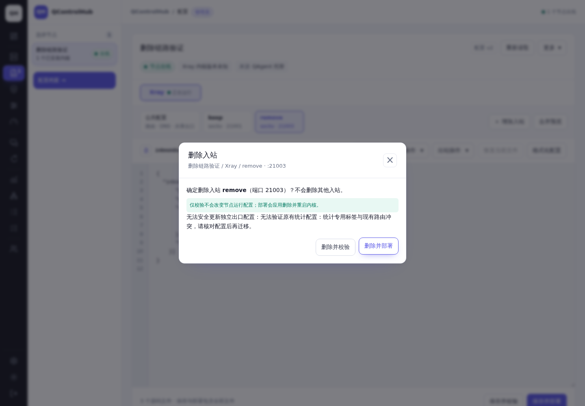
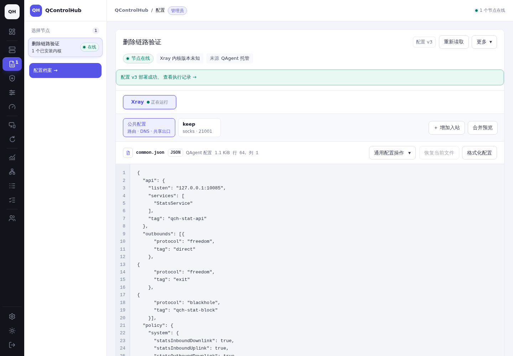
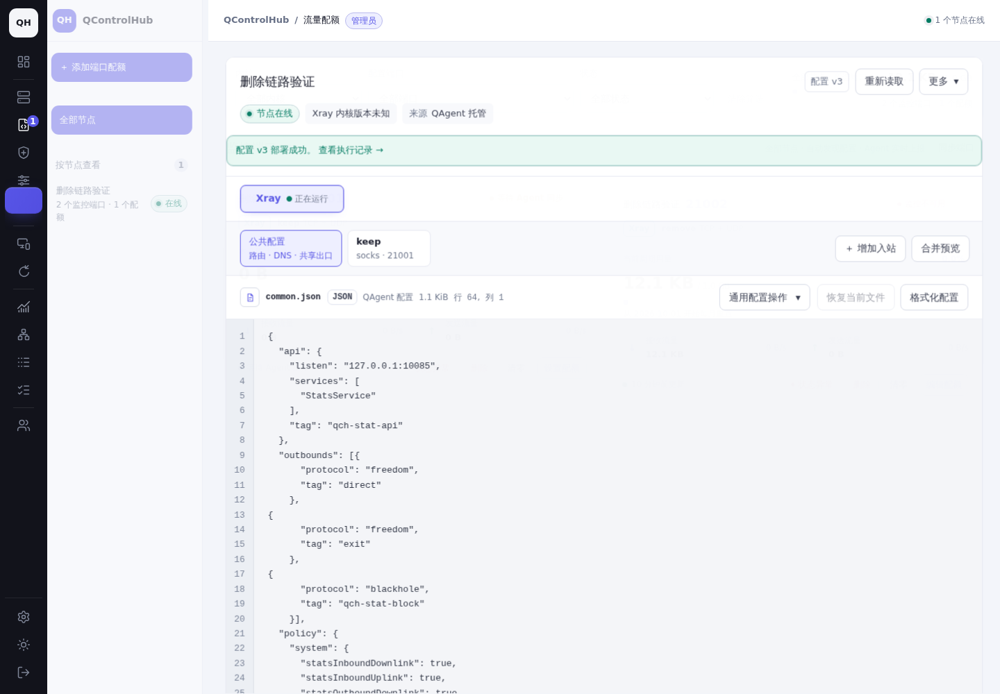
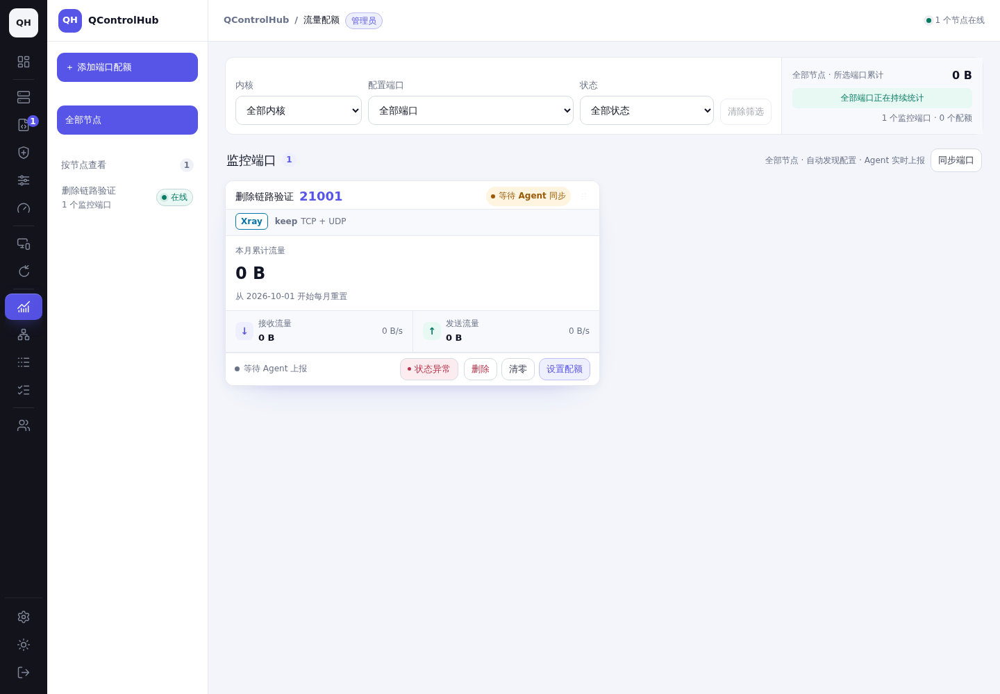

# 入站删除、源码保存与流量监控修复

## 基准和复现

- 基准：`0601339cce552c3806b57787579c2358a4021e17`，2026-10-19 再次 fetch 后仍为最新 main。
- Chromium，浅色主题，桌面 1440×1000；同一测试账号、节点、数据库快照和配置。额外检查手机 390×844、平板 820×1180。
- 测试配置：两个入站 keep/remove、独立出口绑定、自定义域名路由；历史版本先正常编译，再模拟旧源码保存只改端口 21002→21003，遗留旧统计克隆及规则。
- 把新增回归用例放入基准 checkout，8 个 API 子用例均失败；删除及源码保存返回与报告一致的统计标签冲突，旧普通 PUT 留下旧端口的生成内容。见 [基准失败日志](logs/before-regression.log)。
- SSH 只读检查得到 sing-box 1.14.3、Mihomo 1.19.32。现场磁盘上的 sing-box 配置通过现有校验；未获取面板中实际报错的保存版本，因此不宣称完整复现现场版本。私有配置未纳入仓库。

## 根因和改动

### 删除及手动编辑被阻止

原逻辑先按当前入站重新编译已有配置，再允许更新。旧源码保存修改端口、标签或原出口后，旧统计克隆/规则无法由当前内容重现，导致删除尚未开始就失败。源码保存同样经过这条路径。

新增恢复路径仅查询同一配置、节点、内核、账号的历史版本；完整重现其中的统计计划，逐项核对当前生成内容，剥离已证实的生成项，然后保留原始出口绑定和自定义路由重新编译。真实冲突或被修改的保留标签仍拒绝。预设删除、源码编辑、字段编辑及普通 PUT 复用此逻辑。最后一个入站沿用无监听处理，不生成下一份统计计划。

删除失败统一展示“删除入站失败”和简短原因，详情使用现有诊断组件、脱敏和错误折叠区。

### 删除后仍显示

原部署收尾把停止监控绑定到 `TrafficSettled`，基础实例还限定为自动发现且未启用配额；删除成功的有配额记录会继续启用。前端自动刷新同时一直复用 `trafficEndpoints`，使端口选项和数量继续保留旧集合。

部署结果先确认准确生效版本，再按节点、内核、共享实例和配置身份停用消失的监听；计数、配额、历史和关联关系保留，速率清零。草稿不改变监控集合；失败/回滚保留旧集合；不以结算标志判定监听是否存在。新增持久配置身份与报告 generation；端口复用开启新报告代际，旧采样不能归入新监听。历史累计仍遵循现有端口配额账本，并非另建额度。

发现结果在节点锁内再次核对生效版本；共享实例拒绝旧任务身份的迟到心跳。部署准备不提前复活已停用的共享端口。每次流量刷新重取端口集合，清除已失效筛选，侧栏使用同一合并集合。

## 已有残留修正

schema 79→80 为策略增加 `config_id/config_version/inbound_tag`。访问流量策略或 Agent 重连时，事务内按确认生效版本修正：已绑定项按配置身份停用；旧未绑定项须在同一配置的历史版本中证明端口归属。状态不确定、版本缺失或无法证明归属时保留原记录。变更后通知在线 Agent 更新采集集合。

没有删除历史、配额或预留；预留释放仍执行原有停机/结算要求。不提供按端口批量删除 SQL。

## 实际证据

| 删除失败（基准） | 同一配置删除并部署成功（修复） |
| --- | --- |
|  |  |

| 基准：部署后旧端口仍显示 | 修复：部署后只保留 keep |
| --- | --- |
|  |  |

- [修复前同一快照的流量页](evidence/after-traffic-before-delete.png)
- [流量页保持打开、自动刷新移除端口的录屏](evidence/traffic-auto-refresh.webm)
- [同次录屏中的配置删除与部署页](evidence/traffic-auto-refresh-1.webm)
- [数据库基准](logs/before-state.txt)、[修复后数据库](logs/after-state.txt)、[API 与页面集合](logs/after-api-page.txt)
- [重启后修正旧残留](evidence/after-restart-repair.png)
- [手动编辑原始路由并保存成功](evidence/manual-edit-success.png)；生成的统计副本仍受保护
- [真实冲突的删除错误详情](evidence/after-real-conflict-error.png)、[手机错误详情](evidence/mobile-delete-error.png)
- [手机删除最后一个入站](evidence/mobile-last-delete.png)、[端口集合为空](evidence/after-last-delete-empty.png)、[空集合 API 与页面](logs/last-empty-page.txt)
- [手机流量页](evidence/mobile-traffic.png)、[手机同步候选](evidence/mobile-sync.png)、[平板](evidence/tablet-traffic.png)

截图和视频来自真实 Chromium、HTTP API 和 PostgreSQL。部署任务由可重复 Go 测试夹具模拟确认，**不是生产节点真实删除、服务重启或网络计费录屏**。录屏的流量页没有导航或手动刷新；另一页执行删除，等待部署确认后由 2 秒轮询更新。

修复后 DB：21001 启用；21002 停用、速率 0、用量 12,345、1 GiB 配额保留；生效版本 v3。API 保留停用策略供历史授权使用，当前端点和页面卡片/筛选只有 21001。重启测试人工恢复一条旧无绑定残留，再由确认生效 v3 自动修正。

## 回归矩阵

| 场景 | 验证 |
| --- | --- |
| 普通、独立出口、多入站删除 | API 恢复测试；配置保留绑定和自定义路由测试 |
| 最后一个入站 | Store 空集合测试；现有 sing-box 真实内核 ordinary/shared 校验通过 |
| 改标签/端口、旧统计升级、重复编译 | accounting update 与新增历史配置测试；编译结果一致 |
| 自定义路由、真实冲突 | 新增 Xray/sing-box API 冲突分支和配置保留断言 |
| 草稿、失败、回滚、成功 | Store 删除生命周期、共享实例回滚及既有 API 回归 |
| 已打开流量页自动更新 | 真实浏览器双页录屏、前端自动刷新回归 |
| 配额、历史、共享实例/其他账号 | Store 保留计数和历史、共享实例隔离测试 |
| 旧上报、旧任务、旧发现、迟到心跳 | generation、任务冲突、生效版本锁内复核、无采样时间旧心跳测试 |
| 同端口新入站 | 新标签、新 generation，旧采样不改变累计 |
| 旧残留修正、刷新与重启 | Store 幂等修正；数据库注入旧残留后面板进程重启并重新登录 |

## 测试结果和限制

- `make non-browser-checks`：通过。
- 新增 API 10 子用例、Store 删除生命周期/共享实例隔离：通过。历史升级与端口变更组合用例也通过。
- `QCH_SING_BOX_BINARY=... go test ./internal/serverconfig -run '^TestSingBoxFinalInboundDeletion$'`：ordinary/shared 均通过，见 [真实内核日志](logs/live-core.log)。
- `make test` 按仓库的 `-p 1` 串行要求执行；最终全量结果及当前提交的必需 CI 状态记录在 [PR #303 的 Validation](https://github.com/qimaoww/QControlHub/pull/303)。先前并行包/迁移试跑触发 PostgreSQL 集群 vacuum horizon 的 HOT 存储断言，串行 Store 全套通过；不修改或放宽该性能门槛。
- [非浏览器检查日志](logs/checks-final.log)、[流量模块检查](logs/traffic-final.log)、[新增 API 10 子用例](logs/final-accounting.log)。GitHub CI 提供 Debian、Alpine、升级沙箱、真实内核权限及镜像构建日志。
- 未在生产执行删除/部署；未对生产计费流量做端到端注入。浏览器使用模拟任务结果；实际服务部署/回滚依赖仓库 Agent 回归与真实内核检查，不把夹具当作现场部署证据。

## 清理

任务 `qch-inbound-delete-20261019` 已登记为 `/etc/cron.d/qch-inbound-delete-20261019`，由已启用且运行中的 `cron.service` 持久执行。登记后的分钟触发记录已在 system journal 中确认；到期前脚本退出且不删除资源。最终测试结束时间、72 小时后的执行时间及停止端口确认见 [PR #303 的 Validation](https://github.com/qimaoww/QControlHub/pull/303)。时区：Asia/Shanghai（UTC+08:00），按 UTC 时间戳校验到期，下一分钟执行，失败继续重试。

[清理脚本](cleanup/cleanup.py)仅允许本次测试容器完整 ID `9b83bbd1d8b3a472effb7498f8e36c54dcc8e8c87748b11fb62d17522d41c1aa`、其匿名数据卷，以及带本次随机归属标记的两个目录：`/tmp/qch-inbound-delete-20261019` 和本工作树的 `output/playwright/inbound-delete`。容器名、数据卷或目录归属不符则拒绝删除。Docker 不可用时重试，不误记完成。

测试结束即停止测试 API、关闭本次浏览器、停止 PostgreSQL 并释放端口；数据保留至清理时。提交在 `docs/inbound-delete-traffic` 的截图、录屏、报告和脱敏日志不在清理范围内。完成回执保留在 `/var/lib/qcontrolhub-task-cleanup/qch-inbound-delete-20261019/receipt.json`，清理完成后自动移除该 cron 条目。
