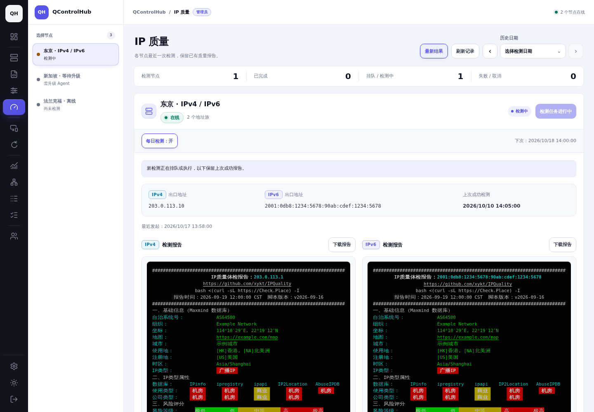
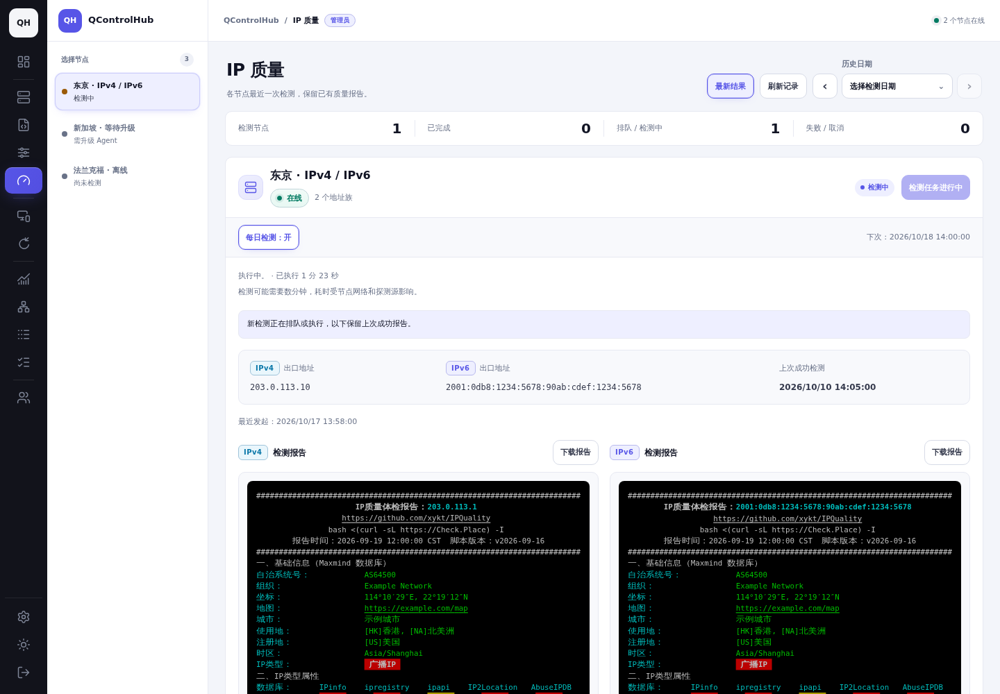
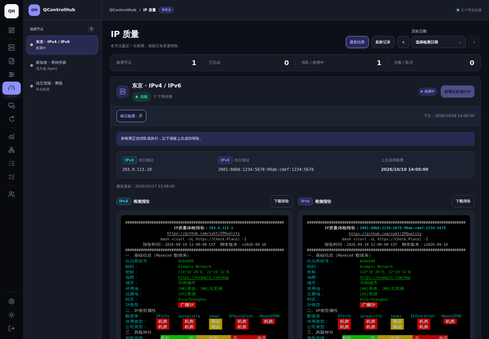
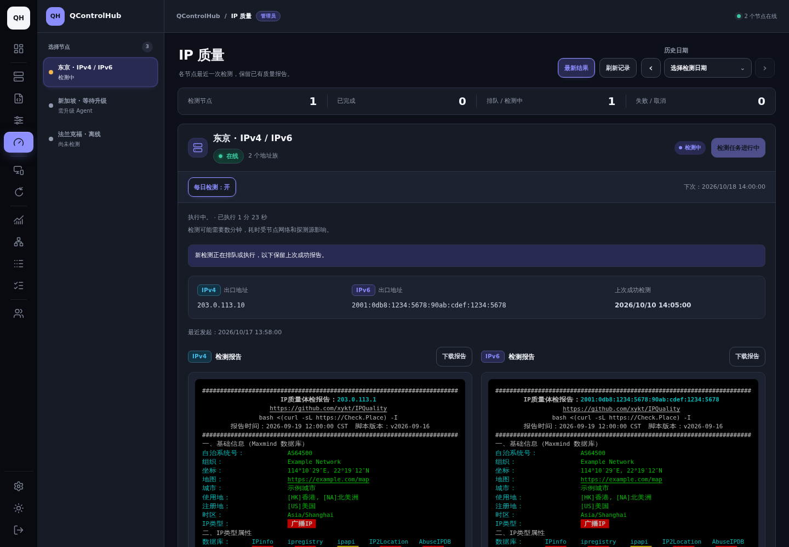
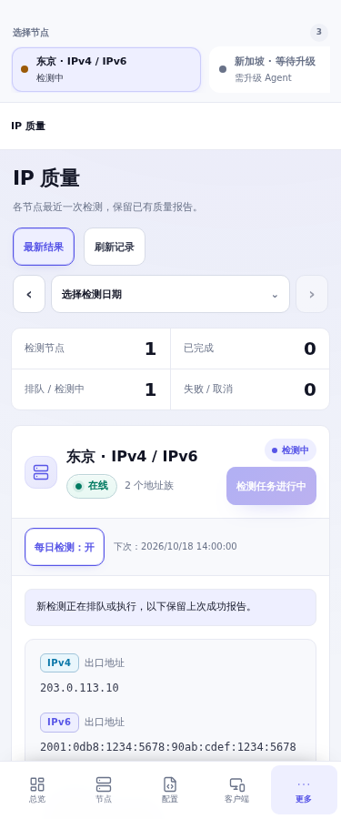
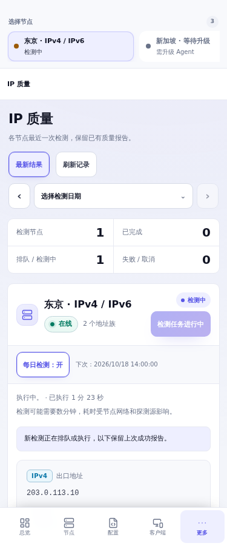
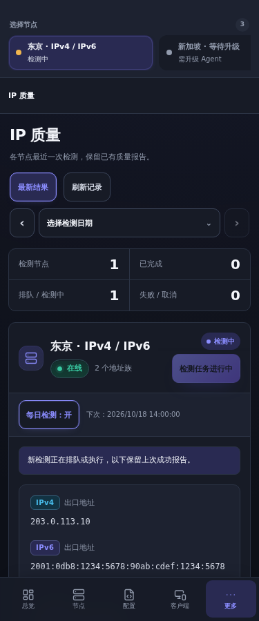
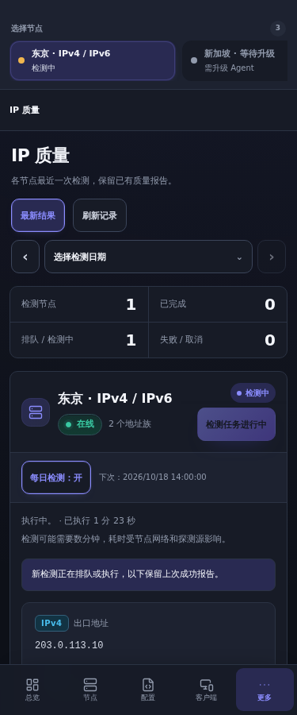

# IP quality task creation repair (schema v74)

## Cause and affected databases

The reported request is `POST /api/v1/ip-quality`, failing during the task
`INSERT` with PostgreSQL `23514`, constraint `tasks_check`. No task was committed
and the Agent had not received an execution request.

The pre-BBR bootstrap (for example the parent of `440c54c9`, schema v41) declared:

```sql
engine varchar(20) NOT NULL CHECK (
  engine IN ('mihomo','xray','sing-box','ss-rust')
  OR (action='upgrade-agent' AND engine='')
)
```

Although written beside `engine`, this expression references two columns.
PostgreSQL gives the unnamed check the table-level name **`tasks_check`**.
The later `ALTER TABLE ... DROP/ADD CONSTRAINT tasks_engine_check` replaces a
*different* constraint. `CREATE TABLE IF NOT EXISTS` preserves the original table
and its original check. Migration versions v42 (BBR/TCP) and v62 (IP quality)
expanded the named rule without removing the original one. Checks are combined
with AND, so the old rule continues rejecting legitimate empty-engine tasks.

Both `62da8cf3` (v69) and `c8115c3d` (v73) submit the same IP quality action with
an empty engine. Their engine rules are identical; v73 also allows `uninstall`
in the action rule. This upgrade does not introduce a new IP quality request
shape. The failure is conditional on the *history of table creation*, not just
the current binary or ledger version. A new request must reach insertion:
permissions, feature/online checks and active-task reuse happen first. A
reused pending task would not exercise the broken INSERT.

The feedback summary establishes the reported constraint and successful manual
removal. The original database/log attachment was unavailable. The exact
installation lineage and whether the feature was previously used cannot be
established from that summary; the SQL history and isolated reproduction verify
the structural cause without assuming those details.

## Observed constraint sets

Actual PostgreSQL 17 catalog queries, not SQL substring checks, distinguish the
following states. The primary key, foreign keys, NOT NULL rules and other
non-check constraints are retained.

| Database state | CHECK constraints on `tasks` |
| --- | --- |
| Pre-v42 table upgraded to v69/v73 | `tasks_check` (only upgrade-agent may omit engine), `tasks_engine_check` (all five node actions may omit engine), `tasks_action_check`, `tasks_status_check`, `tasks_install_if_missing_check` |
| **Fresh v73 bootstrap** (`c8115c3d` SQL executed separately) | Same five names, but **both** engine checks allow all five node actions. Thus a fresh installation normally succeeds while still containing a duplicate. |
| Manually repaired v73 | Four checks; `tasks_check` absent |
| Fresh v74 and all repaired upgrades | Exactly `tasks_action_check`, `tasks_engine_check`, `tasks_status_check`, `tasks_install_if_missing_check` |

The resulting engine rule is:

```sql
CONSTRAINT tasks_engine_check CHECK (
  engine IN ('mihomo','xray','sing-box','ss-rust')
  OR (action IN ('upgrade-agent','enable-bbr','disable-bbr','configure-tcp','ip-quality')
      AND engine='')
)
```

The action rule retains all 16 current `core.Action.Valid()` actions, including
`uninstall`. The status rule retains pending/running/succeeded/failed/canceled.
The automatic-install rule still requires validate/deploy, a non-null config ID
and a positive, non-null config revision. Config version and foreign-key rules
are unchanged. The API continues to reject an explicit engine on node actions;
the historical database rule also accepts a *supported* engine on those actions.
This repair preserves that existing boundary rather than tightening old rows.

## Migration behavior

Schema **73 -> 74** runs even on an already-applied v73 installation. Under the
existing session advisory lock, the transaction explicitly drops only the
confirmed superseded name `tasks_check` before applying the canonical schema.
The step has its own error context: `schema v74 remove superseded tasks_check`.
All other existing migration steps, ledger insertion and commit remain within
the same transaction. A failure rolls back the DDL, data updates and version
entry. A subsequent startup retries. Concurrent startups wait for the lock,
then reread the ledger and skip work already committed by the first process.

The `CREATE TABLE` path explicitly names the action, engine and status checks,
so PostgreSQL cannot generate another unnamed, two-column `tasks_check` there.
The existing named DROP/ADD statements converge the upgrade path to the same
four checks. Missing legacy constraints, a previous manual removal and partial
engine-check sets are supported through `IF EXISTS`. Unrelated custom checks
are preserved and tested. No tables or business records are deleted by this
repair.

## Error feedback and progress

After validated task insertion fails on one of the known tasks action/engine
checks, the API returns HTTP **500** with the existing `error` string plus:

```json
{
  "code": "task_schema_incompatible",
  "stage": "task_creation",
  "request_id": "req_..."
}
```

The message says task creation failed before Agent execution and asks the
administrator to check the control-plane upgrade and migration status.
`X-Request-ID` matches the body and server log. Structured HTTP logs include
SQLSTATE, constraint, schema/table, action, Agent ID and creation stage.
PostgreSQL Detail, the failing row, connection credentials and SQL arguments
are excluded. Scheduled-queue errors also retain the safe SQLSTATE/constraint
and action/Agent context in their error chain. Other `23514` violations, such
as status, automatic-install or report data failures, are not classified as
schema incompatibility. Older clients can keep reading `error`; the new client
also accepts older servers without a code or request ID.

The existing page now distinguishes the creation request, queue, execution and
terminal state. Elapsed time uses stored creation/start/finish timestamps and
the current clock, refreshed by the existing five-second polling loop. Finished
checks retain their final duration. No progress percentage or live stage is
invented: this Agent protocol sends diagnostic stage text only with the final
result. A future live-stage transport can be displayed once available.

Creation failure restores the button and keeps a separate inline error with its
request ID. Existing equivalent active tasks are reused by the server and the
page disables duplicate submissions. The most recent successful report and its
original archive/task association remain visible during a new attempt and on
failure/cancellation. Manual and scheduled checks share `createTaskTx`, the
same lifecycle timestamps and report/history readers.

## Regression coverage

The original v61 and BBR migration fixtures edited only `tasks_engine_check` on
a modern schema. They did not retain the unnamed historical `tasks_check`, so
they tested a single replaceable rule and missed the real failure. Those
fixtures now include the legacy two-column rule as well.

New real PostgreSQL tests use isolated schemas and cover:

- v69 and already-applied v73 with both old and modern checks; a legal task is
  first rejected with `23514/tasks_check`, then accepted after formal startup.
- v73 after manual repair, only the old rule, or neither engine rule present.
- Fresh initialization and direct schema replay: catalog constraint sets agree.
- Repeated migration/startup, transaction failure injected at ledger insertion,
  DDL/data/ledger rollback, retry, and preservation of an unrelated custom check.
- Two real startup connections observed waiting on the migration advisory lock.
- Byte-equivalent JSONB row snapshots of users, nodes/live state, enrollment
  credentials, settings, configs/revisions, tasks, reports, archive bytes,
  sharing/ports and daily schedules. The retained report fixture uses a
  supported engine so it can coexist with the historical restrictive check.
- Actual create/claim/complete for all five node actions with an empty engine;
  actual inserts for every supported action and all four engines; rejection of
  missing/unknown engines, unknown actions, invalid statuses and invalid
  automatic-install intent/config revisions. Negative cases use independent
  transactions. Legal automatic installation and positive config versions are
  checked too.
- Both HTTP creation endpoints reproduce the old failure, then upgrade and
  exercise the signed Agent WebSocket claim/result/ACK, saved report/archive,
  history and account visibility. The existing scheduled, revocation, account
  isolation and report-retention tests run alongside these cases.
- Browser tests exercise delayed creation, duplicate clicks, schema failure and
  long request IDs, retry, queue/run/cancel/fail, retained reports, history,
  account switching, mobile touch layouts and reduced motion.

### Screenshot comparison

Both versions use the same controlled data, theme, viewport and running state:
clock 2026-10-17 14:00:00 UTC+8; start 13:58:37 (83 seconds elapsed); successful
report from October 10; same enabled daily schedule. The 83-second fixture is
for comparison only and does not promise a detection time. Desktop is
1440 x 1000; mobile is 375 x 900 with touch emulation. Screenshots are unmodified
browser captures of `c8115c3d` and this change.

| View | Before | After |
| --- | --- | --- |
| Desktop / light |  |  |
| Desktop / dark |  |  |
| Mobile / light |  |  |
| Mobile / dark |  |  |

## Deployment and rollback

1. Back up PostgreSQL with the normal deployment backup procedure and retain the
   current images/configuration. Use a maintenance window for the ALTER TABLE
   locks; migration time depends on table size and competing transactions.
2. Deploy the new control plane. Each instance acquires the existing migration
   lock; the first performs v74 and later instances observe the committed ledger.
   Stop traffic to older control planes during the schema transition.
3. Confirm startup succeeded and `max(version)=74` in
   `qcontrolhub_schema_migrations`. Inspect `pg_constraint` for the four canonical
   checks and absence of `tasks_check`; do not rely on the ledger alone.
4. Create a check on an online, capable node. Verify Agent claim/result,
   succeeded status, report/archives/history and the enabled daily schedule.
   If creation fails, correlate its request ID with the server logs.
5. Do not delete the ledger entry, blindly drop all task checks, or disable
   constraint validation to work around a migration failure. Resolve the logged
   failure and restart so the transaction can retry.

The data shape remains compatible with current task semantics, but old binaries
supporting schema <=73 **refuse to start against v74** by design. There is no
supported in-place schema downgrade. Roll back with a v74-compatible backport,
or restore a coordinated pre-upgrade backup and matching application images,
accounting for all writes since backup. A pre-v74 backup can restore the broken
historical rule, so it must be repaired again before using IP quality/BBR/TCP.
Do not lower the ledger version to force an old binary to run or initialize
replacement tables using the historical unnamed check.

## Execution record

Local validation uses Linux amd64, Go 1.25.12, PostgreSQL 17.11 in a disposable
container bound to localhost, isolated schemas, and Chromium. Automated probes
are controlled fixtures, including Agent bash execution and signed WebSocket
result delivery; they do not measure a public node's IP reputation.

The opt-in live check also passed on 2026-10-17 with
`QCH_IPQUALITY_TEST_IMAGES=debian:bookworm-slim make ip-quality-clean-test`.
This used the current Agent in a disposable Linux amd64 Debian container
(image digest `sha256:7c7b2c966bc9ee8cedfeef67e0e279108992c77681fa595db4a9d65c06ccc587`),
actual package repositories and upstream probe services. Both first and repeat
detections exited successfully and produced one validated report each. The
script verified first-run dependency installation and repeat-run reuse; the
whole command, including build/container setup and both detections, took
100.56 seconds. This is an observation, not a detection-time promise. The
container was removed by the test. No feedback-provider or production node
was accessed; the live CLI probe and the controlled authenticated API lifecycle
are separate checks, not a production deployment acceptance run.

Final command results and hosted CI status are recorded in the PR.
