# 多用户内核日志：修复与验证记录

## 版本和实际根因

- 修改前：`c8115c3dd53c34491d3ccc7617378b1411f6abc8`（开始任务时最新 `main`）。
- 功能修复及截图版本：`d744ec66507cca722d109aae1f0afdc922406262`。
- 分支：`codex/multi-user-core-logs`。

问题包含三个独立环节：

1. systemd 的服务名解析支持模板实例，但采集器启动时只收到基础服务名单；新部署的共享实例没有加入订阅。OpenRC 的固定来源名单也遗漏共享实例文件。部署任务执行者不能作为实例归属依据。
2. 原记录、游标和状态主要按节点与内核区分，无法可靠区分同节点、同内核的多个用户实例。查询复用了节点管理权，普通共享用户被拒绝，而管理员管理全节点的能力又可能暴露用户自有节点。
3. 实机回归发现 OpenRC 管理的日志快速截断并写回相同大小时可能沿用旧偏移；journal 轮转清空后，`journalctl --quiet` 的空结果退出码 1 被当作失败，失效游标还需退回最近时间点恢复。

## 采集和来源

- 受保护的共享配置目录每 5 秒动态发现一次；部署前先准备订阅，再启动实例，保留首次启动日志。支持 Mihomo、Xray、sing-box、shadowsocks-rust。
- 保留现有受管路径、服务身份、systemd 模板与有效用户、OpenRC 启动脚本和日志文件权限检查。拒绝自定义替换或不安全来源，并单独报告该实例失败。
- 新来源包含 `agent_id`、`engine`、`instance_id`、`service`。主实例为 `main`，共享实例使用稳定分享 ID `shr_…`。控制面依据认证 Agent、规范服务名、分享与部署台账核验来源；上传的用户归属字段不受信任。
- 服务端保存实例所属用户和采集当时节点所有者。查询同时匹配两个归属，节点转移不会将旧所有者的记录自动交给新所有者。
- 来源状态按节点、内核和实例独立保存；失效状态显示等待上报。Agent 能力不足、离线、等待、失败和正常但无日志分别显示。
- 共享 systemd 实例复用两条 journal 订阅（受管命名空间与兼容来源），节点连同原主实例最多四条 journal 进程；共享来源上限 256。共享队列有界，高频实例优先淘汰自身旧条目；文件预算在实例间分配。批次保持 32 条上限和确认前重传身份，服务端原子入库及去重。
- 共享实例日志不进入原节点级客户端连接日志推导，避免通过另一视图暴露共享实例内容。

## 服务端权限

所有日志读取必须具有 `core-logs.read`，并满足下列资源约束；不要求另有 `agents.read`：

| 身份 | 授权范围 |
| --- | --- |
| 管理员 | 自有节点的主实例及该节点共享实例；兼容原未分配所有者的节点 |
| 管理员访问普通用户自有节点 | 拒绝；接受该用户分享也不能绕过此边界 |
| 普通节点所有者 | 自有节点主实例；不会因拥有节点而获得其他共享用户的实例 |
| 普通共享用户 | 仍被接受、启用且内核获授权的本人实例；不暴露同节点其他用户 |
| 停用账号、撤销分享或节点 | 后续请求重新核验，不沿用旧授权 |

同一资源关系用于节点、用户、实例、内核、级别、关键词、汇总、历史游标以及来源选项和采集状态。指定不可访问的资源返回 404，防止资源探测。当前项目没有独立内核日志导出路由；现有 GET 获取数据的方式受同一授权约束。实时展示沿用现有轮询，每次读取都重新授权。

ETag 包含当前授权结果、筛选和账号凭据范围；在比较 ETag 前执行授权。来源接口禁止缓存。页面先核验来源，再显示同范围缓存；账号和授权范围变化会清除旧行、缓存和失效选择。异步请求有取消和版本保护，旧请求不能覆盖新账号或筛选。

## 历史与升级

数据库迁移为 **73 → 74**，增加身份列、实例索引和独立状态表。

- 升级前历史没有可信节点所有者快照：保留数据，并标记 `node_owner_id=unverified`，不猜测用户归属，不经普通日志接口展示。这是主动收紧，可能减少升级后可见历史。
- 旧 Agent 后续上传仍可接收：由当前认证链路记录节点所有者，实例保持空值，只能在该所有者的节点汇总中显示为“历史来源未归属”。不能将其归入主实例或某个共享用户。
- **已有共享节点需要升级 Agent**，才能动态采集、核验并区分共享实例，及上报实例状态。旧 Agent 不具备这些能力时页面明确提示，不能声称共享实例采集正常。

## 验证结果

使用隔离的真实 PostgreSQL 17 数据库和 Chromium。管理员、普通用户 Alice、Bob 均通过实际密码会话登录，分别使用独立浏览器上下文；Alice 的专项浏览器测试仅有日志读取权限，没有节点读取权限。

| 验证 | 结果 |
| --- | --- |
| 全部 Go 测试与 `make non-browser-checks`，4 个分片；含 `go vet ./...`、前端模块、部署脚本检查 | 通过 |
| `make browser-checks`：83 个现有前端场景、首次安装、多用户、新日志隔离矩阵 | 通过 |
| 管理员共享节点 A/B 同内核，A/B 各自接入节点；汇总、参数伪造、内核/级别/关键词及历史分页 | 通过 |
| 管理员不能借角色或接受分享读取用户自有节点；普通节点所有者不能读取其他共享用户实例 | 通过 |
| 分享撤销、停用账号、所有者转移、旧 ETag、同浏览器切换账号 | 通过 |
| 快速 A → B 筛选，延迟 A 响应不能覆盖 B；刷新和分页保持有效选择 | 桌面及移动端均通过 |
| 同节点单实例失败不覆盖其他实例状态；不可信来源与伪造归属 | 通过 |
| 无来源历史不继承新所有者；旧 Agent 数据不归入共享用户 | 通过 |
| systemd 实际 PID 1，四种官方内核，各 A/B 两个实例 | 通过，81.23 秒 |
| Alpine OpenRC，四种官方内核，各 A/B 两个实例 | 通过，60.03 秒 |

实际服务测试逐个覆盖动态发现、启动输出、重启、journal 轮转与 vacuum / OpenRC 文件轮转、确认前批次重取、故障隔离、恢复和删除。另有 journal 游标恢复和 WSS 生命周期/上传确认的回归；确认前批次重取模拟断线重传，不将其描述为完整网络故障演练。

官方内核及 SHA256 来自项目固定下载脚本：Mihomo 1.19.32、Xray 26.3.27、sing-box 1.14.3、shadowsocks-rust 1.25.0。systemd/OpenRC 实际验证在独立容器内完成，不修改宿主机服务。CI 的实际服务权限任务已加入同一共享日志生命周期测试；可选浏览器工作流也包含新日志矩阵。

### 查询和前端开销

- 先得到授权来源关系，再用实例覆盖索引读取各来源有界窗口，每内核最多 2000 条；批量查询，无逐用户往返。
- PostgreSQL 真实 `EXPLAIN` 回归加入同节点 50,000 条其他实例日志，确认所选实例使用分区实例索引的 Index Only Scan，不沿全局日志逐条寻找授权数据。
- 32 条、8 个共享来源的上传保持 **6 次 SQL 查询**预算，来源归属一次批量核验；状态也使用批量写入。
- 本次完整浏览器压力测试加载 8000 条、DOM 最多 200 行。桌面初次显示 179 ms、扩展窗口 42 ms、分页 9 ms、关键词过滤 11 ms、切换确认 8 ms、经授权校验后的缓存切换 31 ms。这些是当前测试机观察值，不是所有部署的延迟保证。
- 页面关键词和级别筛选保留现有最近窗口内交互语义；服务端也支持相应参数和历史游标，且执行相同资源约束。

## 截图条件及对比

所有图片都是实际页面截屏。修改前保存原数据库快照；修改后对比恢复相同的三个账号、三个节点及六条原始记录。由于历史记录本身不含归属，此人工测试快照的六条数据仅根据已知的造数来源补入节点所有者；**生产迁移不做这种推断或回填**。可见记录从六条变为两条，是修正管理员读取用户自有节点的权限后产生的预期变化。

成对截图使用 `logs-admin`、浅色、简体中文、Asia/Shanghai、页面滚动位置 0。桌面 1440×1000；移动 390×844，启用触摸与粗指针。修改前页面在首次修改前已留档；此处对比补拍使用归档的精确基线代码和原始数据库快照，补齐相同的移动设备条件。

| 页面 / 尺寸 | 修改前 `c8115c3d` | 修改后 `d744ec66` |
| --- | --- | --- |
| 内核日志，桌面 1440×1000 | 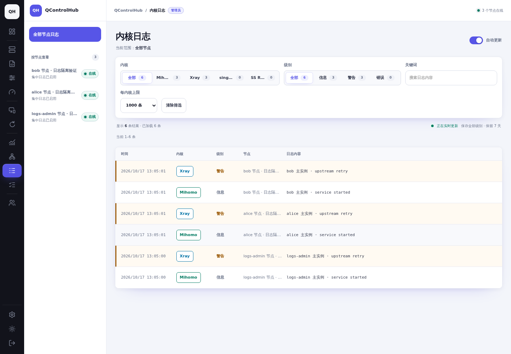 | 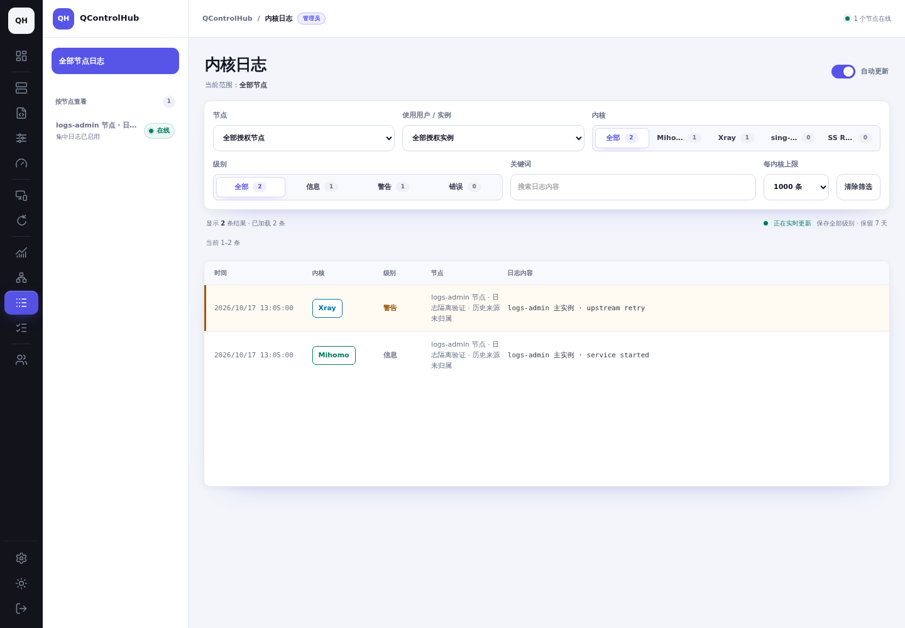 |
| 内核日志，移动 390×844 | 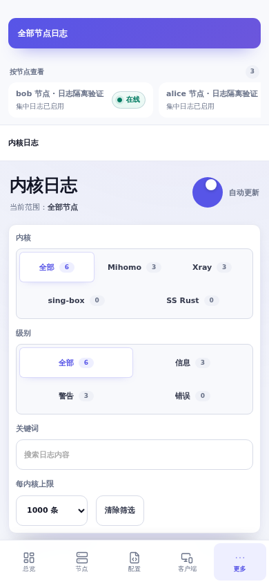 | 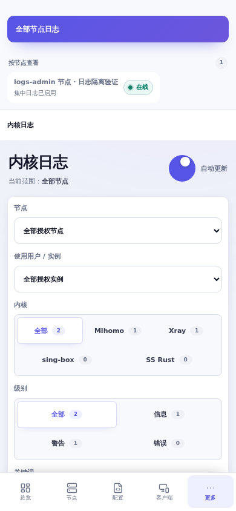 |

### 角色与筛选（`d744ec66`）

下面共享实例的八条日志是隔离测试数据，在上述成对对比完成后加入。管理员可选择主实例、Alice 或 Bob；Alice 的共享节点选项只有本人实例，无 Bob 或主实例元数据。节点选项中管理员只有自己提供的节点，Alice 有自己节点和获分享节点。

| 尺寸 | 管理员选择 Alice 的实例 | Alice 仅见本人授权范围 |
| --- | --- | --- |
| 桌面 1440×1000 | 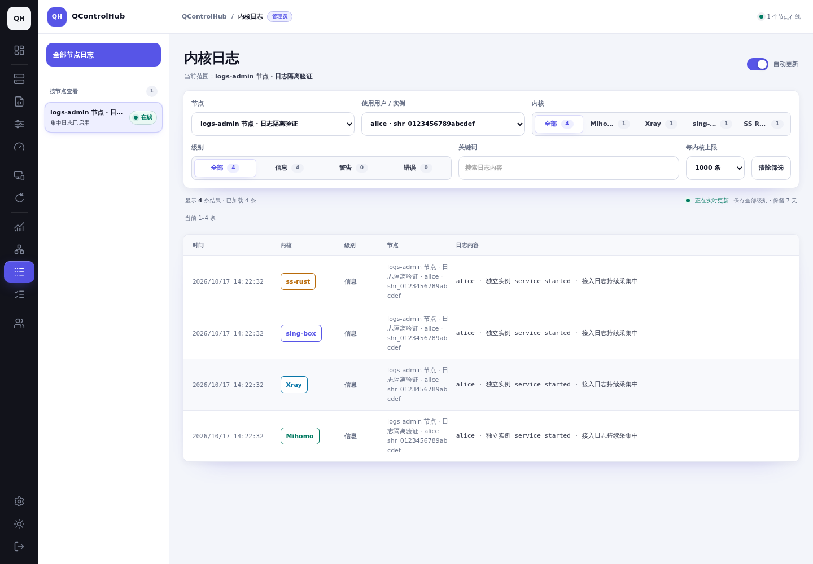 | 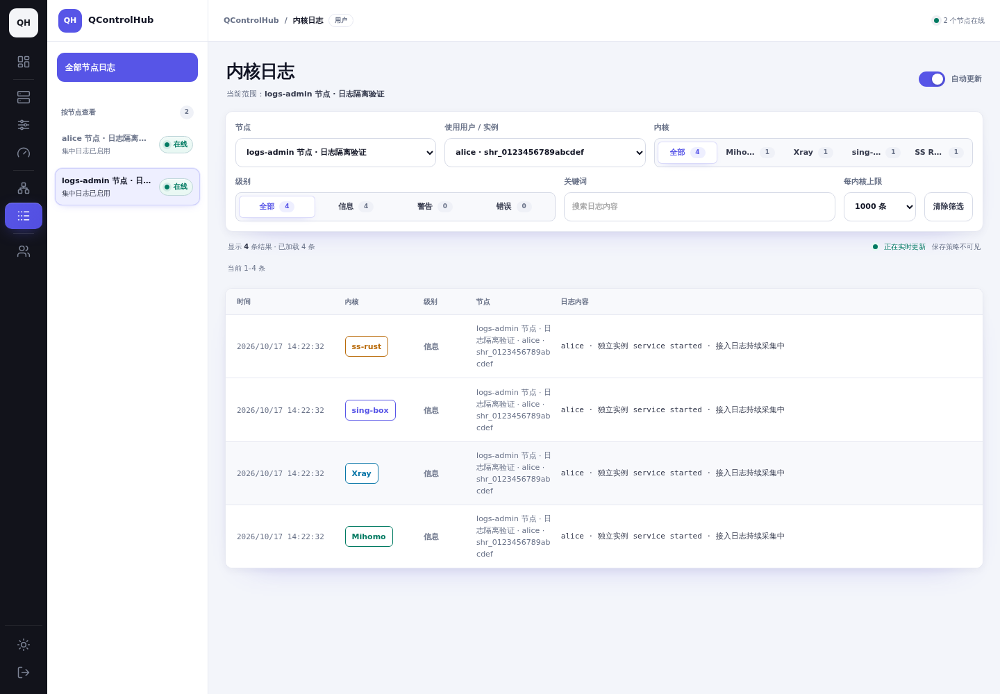 |
| 移动 390×844，顶部 | 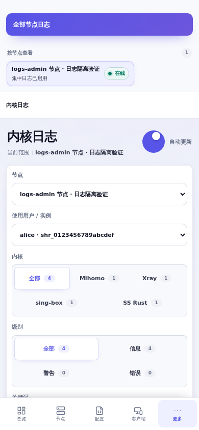 | 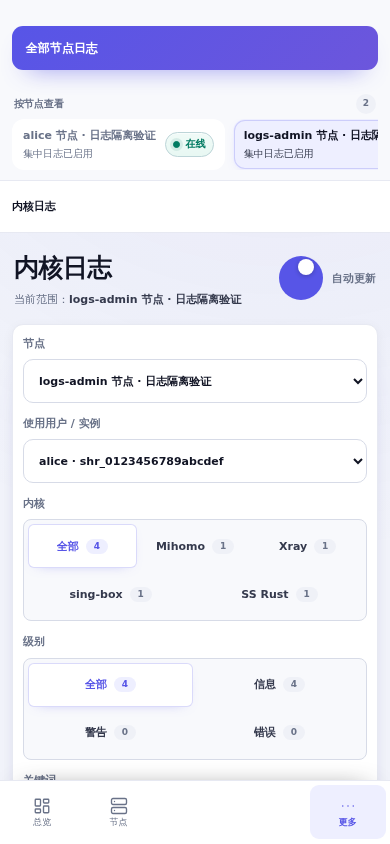 |
| 移动 390×844，滚动到正文 | 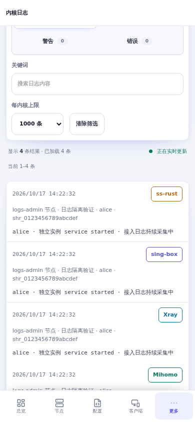 | 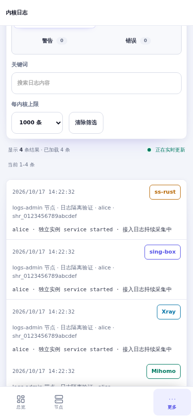 |

### 状态和长选项（`d744ec66`）

以下图片通过调整隔离测试数据库的来源状态与合法长名称展示边界，页面和 API 均为真实实现；失败信息取自实际权限漂移故障。截图后恢复造数数据。桌面和移动端 `documentElement.scrollWidth` 分别等于 1440 和 390，无页面横向溢出。

| 状态 | 桌面 1440×1000 | 移动 390×844 |
| --- | --- | --- |
| 单实例采集失败，历史仍可读 |  | 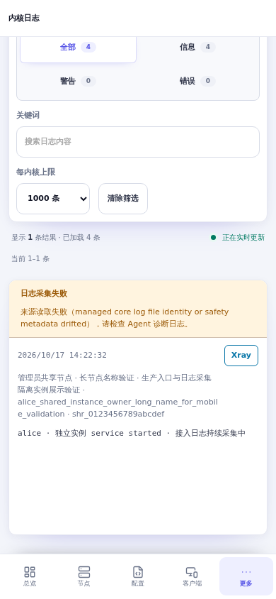 |
| 采集正常但尚无日志 | 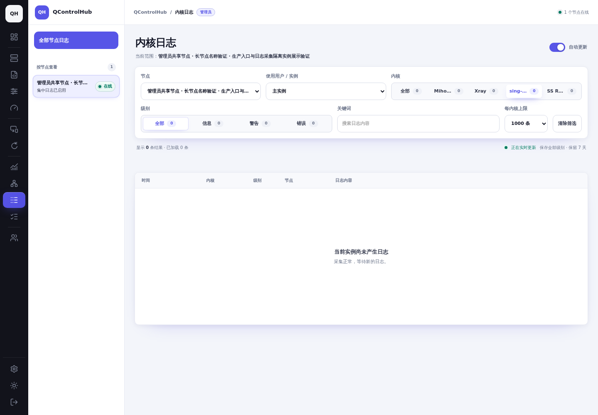 | 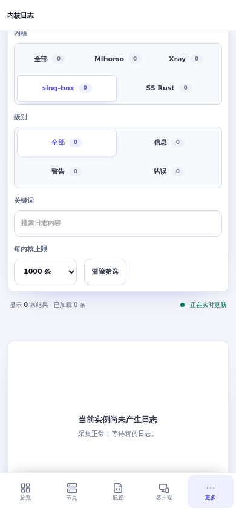 |
| 长节点名、用户名和实例 ID | 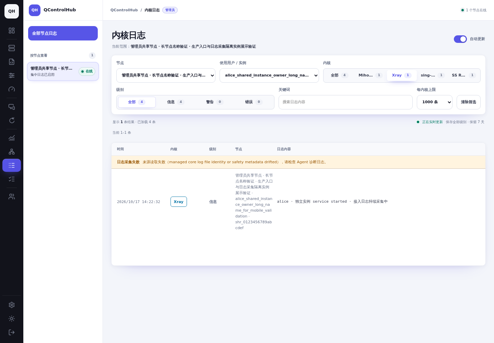 | 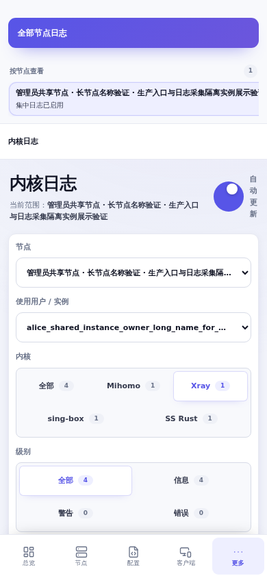 |

## 风险与回滚

- 迁移增加并重建日志覆盖索引。大量历史数据会增加启动迁移时间、临时磁盘需求和写入锁等待，应先做数据库备份并预留维护时间。
- 旧历史和旧 Agent 的来源无法猜测；升级后可见历史减少、旧共享来源需要升级 Agent，是明确的兼容边界。
- 先升级控制面，再升级提供共享实例的节点 Agent。新 Agent 的功能标识为 `core-log-instances-v1`。
- 旧控制面拒绝比自身更新的数据库版本。完整回滚应配合恢复迁移前数据库备份及原控制面镜像；不要仅降低 schema 版本或删身份列。仅回滚 Agent 可继续保守接收节点来源日志，但失去共享实例采集与实例状态能力。
