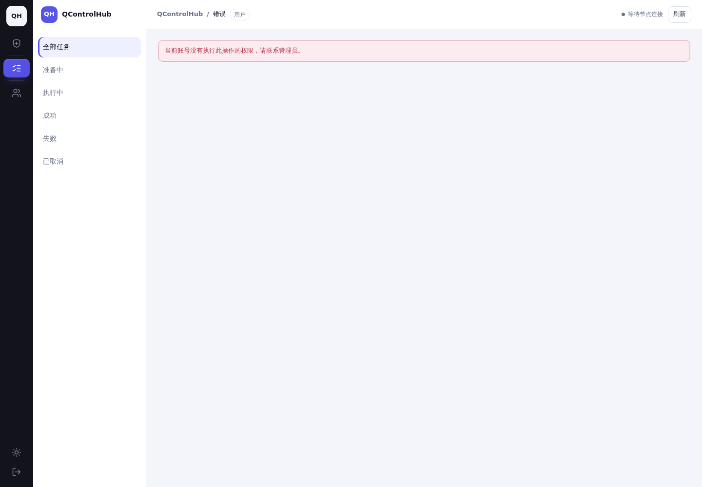
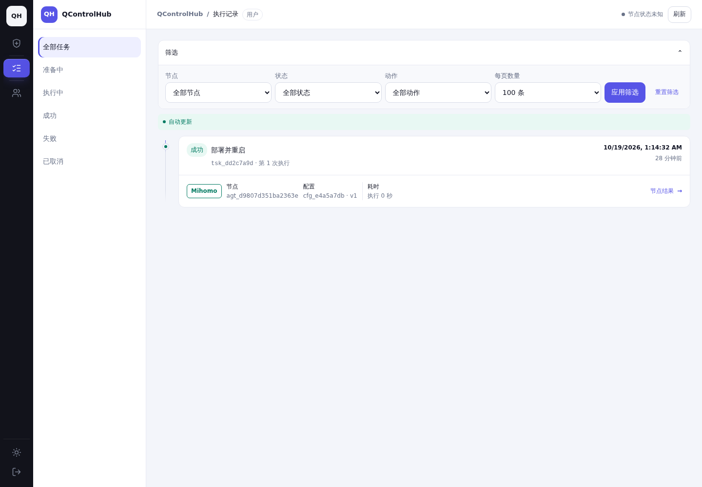

# 前后对比索引

完整截图为原始浏览器输出；缩放由查看器完成，文件未拼接或改写。取证账号、路由、视口、主题及交互见 JSON 记录。

| 页面 | 视口 | 主题 | 修改前 | 修改后 |
| --- | --- | --- | --- | --- |
| 仅任务读权限：执行记录 | desktop | light | [原图](screenshots/before-tasks-desktop-light.png) | [原图](screenshots/after-tasks-desktop-light.png) |
| 仅任务读权限：执行记录 | desktop | dark | [原图](screenshots/before-tasks-desktop-dark.png) | [原图](screenshots/after-tasks-desktop-dark.png) |
| 仅任务读权限：执行记录 | mobile | light | [原图](screenshots/before-tasks-mobile-light.png) | [原图](screenshots/after-tasks-mobile-light.png) |
| 仅任务读权限：执行记录 | mobile | dark | [原图](screenshots/before-tasks-mobile-dark.png) | [原图](screenshots/after-tasks-mobile-dark.png) |
| 仅流量读权限：流量配额 | desktop | light | [原图](screenshots/before-traffic-desktop-light.png) | [原图](screenshots/after-traffic-desktop-light.png) |
| 仅流量读权限：流量配额 | desktop | dark | [原图](screenshots/before-traffic-desktop-dark.png) | [原图](screenshots/after-traffic-desktop-dark.png) |
| 仅流量读权限：流量配额 | mobile | light | [原图](screenshots/before-traffic-mobile-light.png) | [原图](screenshots/after-traffic-mobile-light.png) |
| 仅流量读权限：流量配额 | mobile | dark | [原图](screenshots/before-traffic-mobile-dark.png) | [原图](screenshots/after-traffic-mobile-dark.png) |
| 无节点读权限：证书 HTTP 节点选择 | desktop | light | [原图](screenshots/before-certificates-desktop-light.png) | [原图](screenshots/after-certificates-desktop-light.png) |
| 无节点读权限：证书 HTTP 节点选择 | desktop | dark | [原图](screenshots/before-certificates-desktop-dark.png) | [原图](screenshots/after-certificates-desktop-dark.png) |
| 无节点读权限：证书 HTTP 节点选择 | mobile | light | [原图](screenshots/before-certificates-mobile-light.png) | [原图](screenshots/after-certificates-mobile-light.png) |
| 无节点读权限：证书 HTTP 节点选择 | mobile | dark | [原图](screenshots/before-certificates-mobile-dark.png) | [原图](screenshots/after-certificates-mobile-dark.png) |
| 共享实例离线状态及顶部计数 | desktop | light | [原图](screenshots/before-instance-desktop-light.png) | [原图](screenshots/after-instance-desktop-light.png) |
| 共享实例离线状态及顶部计数 | desktop | dark | [原图](screenshots/before-instance-desktop-dark.png) | [原图](screenshots/after-instance-desktop-dark.png) |
| 共享实例离线状态及顶部计数 | mobile | light | [原图](screenshots/before-instance-mobile-light.png) | [原图](screenshots/after-instance-mobile-light.png) |
| 共享实例离线状态及顶部计数 | mobile | dark | [原图](screenshots/before-instance-mobile-dark.png) | [原图](screenshots/after-instance-mobile-dark.png) |
| 无配置权限：错误与空态 | desktop | light | [原图](screenshots/before-permission-desktop-light.png) | [原图](screenshots/after-permission-desktop-light.png) |
| 无配置权限：错误与空态 | desktop | dark | [原图](screenshots/before-permission-desktop-dark.png) | [原图](screenshots/after-permission-desktop-dark.png) |
| 无配置权限：错误与空态 | mobile | light | [原图](screenshots/before-permission-mobile-light.png) | [原图](screenshots/after-permission-mobile-light.png) |
| 无配置权限：错误与空态 | mobile | dark | [原图](screenshots/before-permission-mobile-dark.png) | [原图](screenshots/after-permission-mobile-dark.png) |
| 旧 A 页面替换为 B cookie | desktop | light | [原图](screenshots/before-session-desktop-light.png) | [原图](screenshots/after-session-desktop-light.png) |
| 旧 A 页面替换为 B cookie | mobile | light | [原图](screenshots/before-session-mobile-light.png) | [原图](screenshots/after-session-mobile-light.png) |

## 录屏

| 场景 | 修改前 | 修改后 |
| --- | --- | --- |
| 同浏览器 cookie 更换（桌面） | [WebM](videos/before-session-desktop.webm) | [WebM](videos/after-session-desktop.webm) |
| 同浏览器 cookie 更换（手机） | [WebM](videos/before-session-mobile.webm) | [WebM](videos/after-session-mobile.webm) |
| 证书真实响应延迟至离开页面（桌面） | — | [WebM](videos/after-certificate-delay-desktop.webm) |
| 证书真实响应延迟至离开页面（手机） | — | [WebM](videos/after-certificate-delay-mobile.webm) |
| 空闲配置页自动感知分享停用 | — | [WebM](videos/after-idle-revocation-desktop.webm) |

## 任务页对比预览

| 修改前 | 修改后 |
| --- | --- |
|  |  |

截图环境的任务结果是夹具；真实内核日志测试独立记录。分享停用录屏结束后，按现有规则由接收者重新接受再次启用的邀请，再进行最终同状态审计。

## 审查补充：证书授权撤销

同一 Bob 账号、Alice 所有的同一证书、浅色主题；所有者撤销授权 6 秒后拍摄。修改前 API 已拒绝而详情仍保留，修改后无需导航或手动刷新即关闭详情并移除列表项。

| 视口 | 修改前 | 修改后 | 修改前录屏 | 修改后录屏 |
| --- | --- | --- | --- | --- |
| desktop | [原图](screenshots/before-certificate-revocation-desktop-light.png) | [原图](screenshots/after-certificate-revocation-desktop-light.png) | [录屏](videos/before-certificate-revocation-desktop.webm) | [录屏](videos/after-certificate-revocation-desktop.webm) |
| mobile | [原图](screenshots/before-certificate-revocation-mobile-light.png) | [原图](screenshots/after-certificate-revocation-mobile-light.png) | [录屏](videos/before-certificate-revocation-mobile.webm) | [录屏](videos/after-certificate-revocation-mobile.webm) |

审查同时验证 Escape 关闭已有表单后释放真实的延迟 HTTP 响应，表单不会重新弹出：[桌面](videos/after-certificate-escape-desktop.webm)、[手机](videos/after-certificate-escape-mobile.webm)。条件和结果分别见 [授权撤销](certificate-revocation-evidence.json)、[关闭与延迟响应](certificate-escape-evidence.json)。
