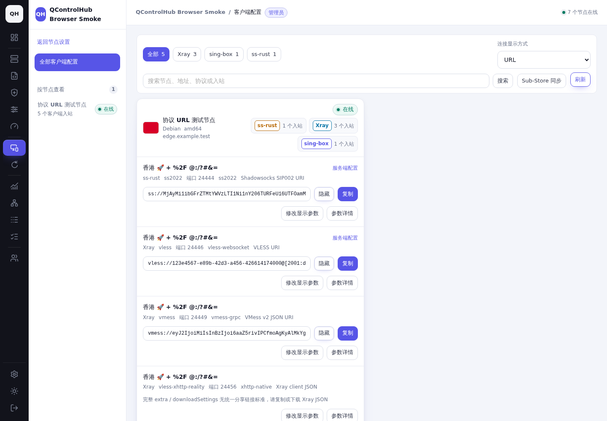
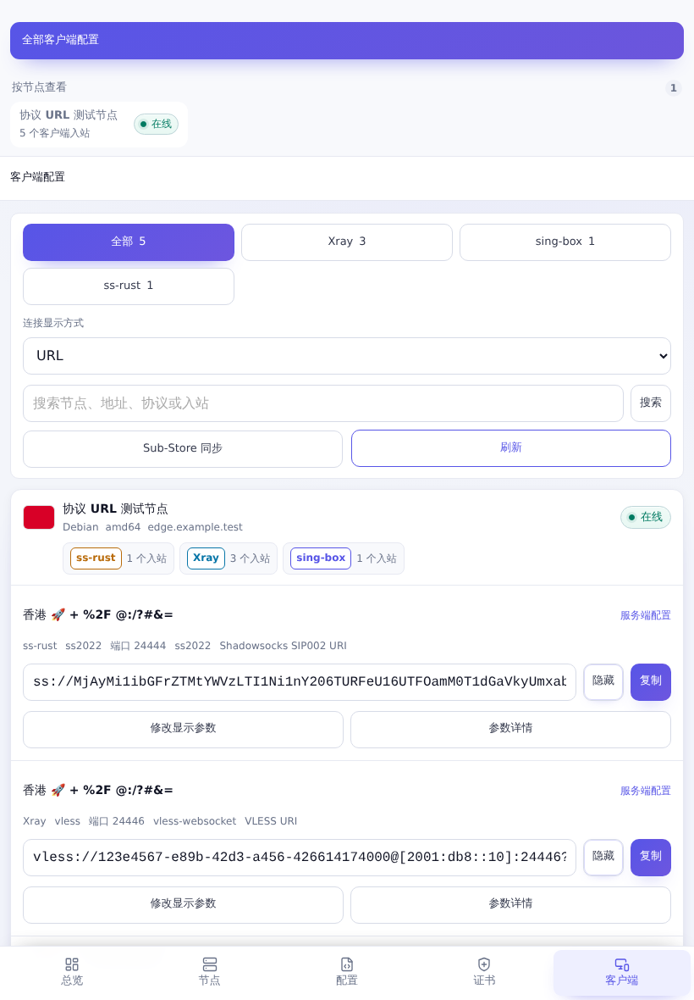
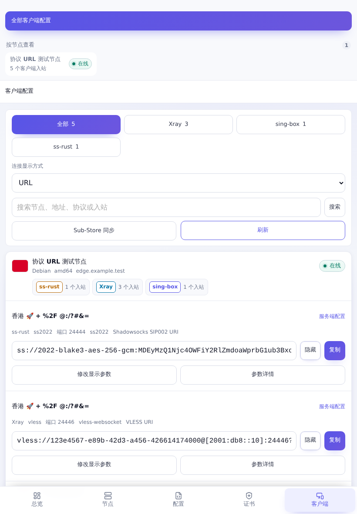
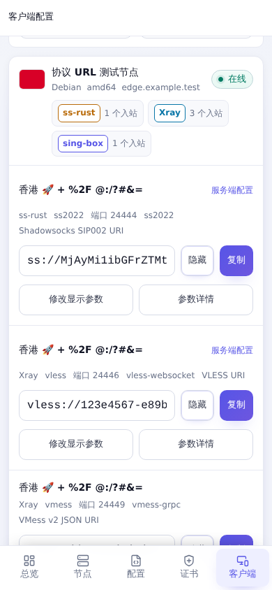
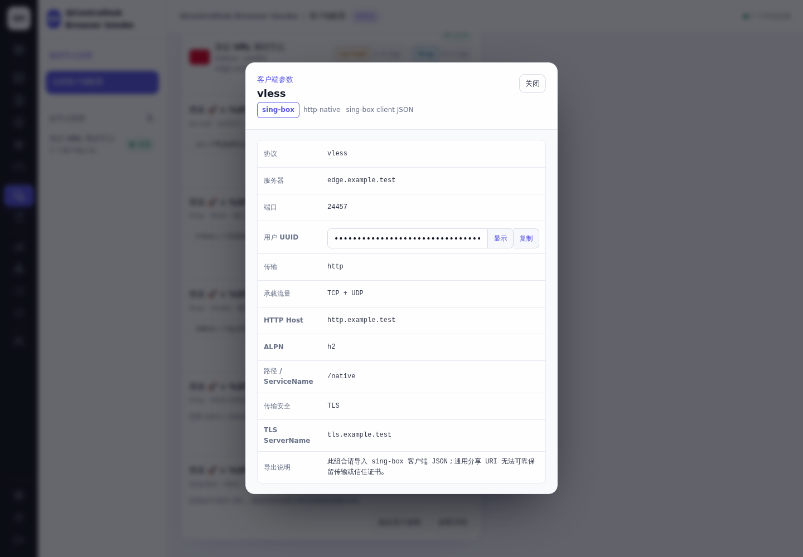
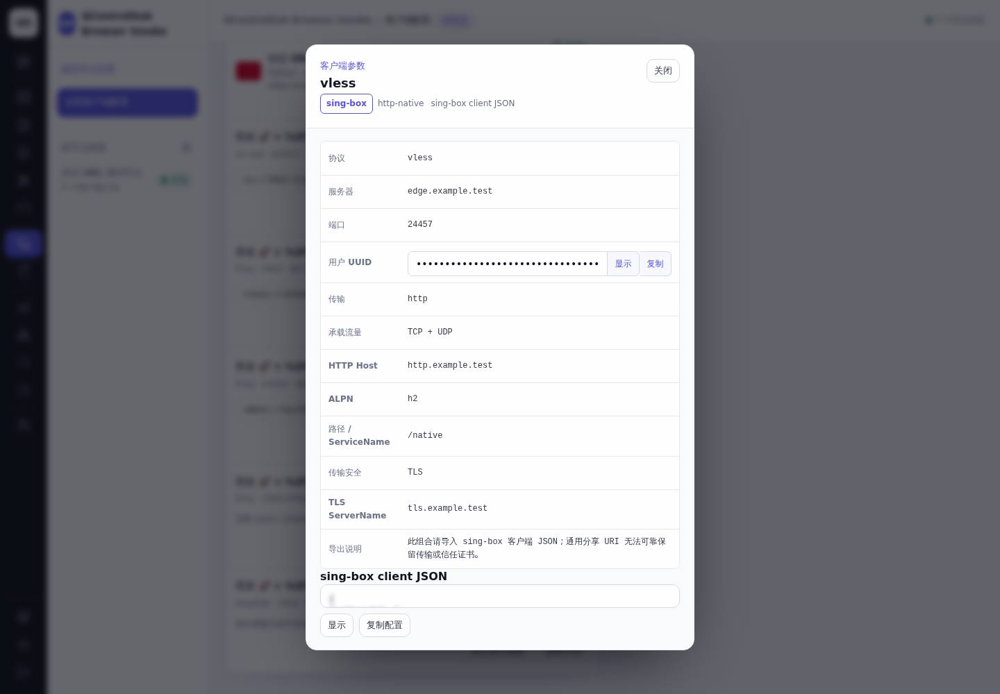

# 客户端协议 URL 导出验证

基准：`97c3700206f302551a71c3a20595ef9a57f385ba`（开始修改前 fetch 的最新 `origin/main`，提交 PR 前再次核对相同）。所有地址、UUID、密码、密钥和节点均为本次测试数据。

## 链路与范围

`clientAccessEntries` 从当前账号授权的节点、配置、已部署版本与共享实例生成接入资料；`client_addresses.go` 将各入站的端口显示参数、连接地址候选与名称传给 `BuildClientProfileNamed`。页面通过 `clientAccessExport` 选择 URL 或已有 Mihomo 格式，原始值进入只读控件；`copyClientValue` 从控件的 `value` 复制。Sub-Store 同步复用同一批接入资料、地址选项和生成器，再修改显示名称。

沿用已部署版本、端口与实例归属、默认名称及显示参数保存逻辑。现有 PostgreSQL 集成测试确认草稿不会覆盖部署资料，保存名称/地址/端口后重新导出，管理员、普通用户及共享实例的资料仍受各自权限约束。修改集中在协议序列化、同步直接使用方、格式识别、原生配置的已有参数弹窗和复制回退；没有增加 CSS、主题变量或页面组件体系。

## 发现的问题与修改

| 问题 | 根因 | 修改 |
| --- | --- | --- |
| VLESS WS/gRPC/XHTTP 中路径空格被导入成 `+` | `url.Values.Encode` 使用表单编码，部分分享 URL 导入器按 URI 解码 | 公共构造器统一编码组件，空格用 `%20`，原始 `+` 用 `%2B`，IPv6 用 `net.JoinHostPort` |
| SS2022 userinfo 不符合 SIP002 | AEAD2022 仍整体 Base64 编码 `method:password` | AEAD2022 改为分别百分号编码，普通 SS 保留 Base64URL |
| 同步改名无法改变 VMess 的导入名称，特殊名称可能破坏 fragment | 所有格式都直接追加 `#name`，VMess 的名称实际在 Base64 JSON 的 `ps` | 共用 URL 改名/取名函数；VMess 仅修改 `ps`，保留其他 JSON 字段、数值类型和未知扩展；其他 URL 原样保留连接部分；旧 VMess fragment 名称仅在同步组已管理元数据证明归属时迁移，保留手工条目 |
| HTTP Host、SNI、传输路径混淆 | VMess WS 的空 Host 自动复制 SNI；TCP/gRPC 携带残留 HTTP 字段 | 分开导出，仅在对应传输导出有意义的字段；省略空参数，保留明确的安全参数 |
| 原生配置被格式标签误判为 URL，或提示使用 JSON 却没有完整复制入口 | 格式标签参与内容判断，已有参数弹窗只显示字段/Xray 导出 | 按已支持 scheme 和单行内容识别 URL；在现有弹窗、密文控件和按钮中展示完整原生导出 |
| 浏览器拒绝现代剪贴板时复制失败；旧复制方式不能复制密码框 | 现代剪贴板异常未回退，`execCommand` 直接选择密码框 | 回退到现有复制路径；临时只读 textarea 使用已有 `visually-hidden` 类，复制后移除并恢复焦点/选择 |
| 客户端导入器改写特殊凭据或 WS 路径 | Mihomo 的 Hy2/SOCKS 分支直接使用转义后的 User.String；WS `ed/eh` 被识别为 early-data 参数 | 对这些组合使用已有原生导出，保留凭据和完整字面路径，页面说明简短 |
| Sub-Store 导入 TUIC/AnyTLS 的字面 `%2F` 密码发生二次解码，Hy2 显式 ALPN 丢失 | 2.42.6 对已解码密码再次 decodeURIComponent，Hy2 URI 分支忽略 ALPN | 同步入口复用已有 Mihomo 原生映射；页面仍提供符合协议规则的 TUIC/AnyTLS URL |

复杂 XHTTP 的 `mode/path/host` 保留，已有 `extra`、`xmux`、`downloadSettings` 继续由原生 Xray JSON 完整表达，不降级为不完整的 URL。HTTP、HTTPUpgrade、QUIC、自定义 CA 等已有原生回退继续保留。

## 测试 URL 与解析对照

完整、未经截断的前后数据见 [before-urls.json](evidence/before-urls.json)、[after-urls.json](evidence/after-urls.json)。固定名称为 `香港 🚀 + %2F @:/?#&=`，特殊密码为 `test 密码🚀 @:/?#&=+%2F`；覆盖域名、文档 IPv4、裸/带括号 IPv6、自定义端口、空名称回退、Base64 密钥、TLS、Reality、WS、gRPC、XHTTP。

### SS2022

修改前（完整 URL）：

```text
ss://MjAyMi1ibGFrZTMtYWVzLTI1Ni1nY206TURFeU16UTFOamM0T1dGaVkyUmxabWRvYVdwcmJHMXViM0J4Y25OMGRYWT0@[2001:db8::10]:24444#%E9%A6%99%E6%B8%AF%20%F0%9F%9A%80%20+%20%252F%20@:/?%23&=
```

修改后（完整 URL）：

```text
ss://2022-blake3-aes-256-gcm:MDEyMzQ1Njc4OWFiY2RlZmdoaWprbG1ub3BxcnN0dXY%3D@[2001:db8::10]:24444#%E9%A6%99%E6%B8%AF%20%F0%9F%9A%80%20%2B%20%252F%20%40%3A%2F%3F%23%26%3D
```

### VLESS WebSocket

修改前（完整 URL）：

```text
vless://123e4567-e89b-42d3-a456-426614174000@[2001:db8::10]:24446?alpn=h2%2Chttp%2F1.1&encryption=none&host=http.example.test&path=%2Frelay+%2B%252F%3Ftoken%3D%40%3A%23%2F%3D%26other%3D%2B&security=tls&sni=tls.example.test&type=ws#%E9%A6%99%E6%B8%AF%20%F0%9F%9A%80%20+%20%252F%20@:/?%23&=
```

修改后（完整 URL）：

```text
vless://123e4567-e89b-42d3-a456-426614174000@[2001:db8::10]:24446?alpn=h2%2Chttp%2F1.1&encryption=none&host=http.example.test&path=%2Frelay%20%2B%252F%3Ftoken%3D%40%3A%23%2F%3D%26other%3D%2B&security=tls&sni=tls.example.test&type=ws#%E9%A6%99%E6%B8%AF%20%F0%9F%9A%80%20%2B%20%252F%20%40%3A%2F%3F%23%26%3D
```

| 核对字段 | 修改前实际结果 | 修改后实际结果 |
| --- | --- | --- |
| Sub-Store 导入 WS `path` | `/relay++%2F?token=@:#/=&other=+` | `/relay +%2F?token=@:#/=&other=+`，与部署输入相同 |
| WS 连接地址 / SNI / HTTP Host | 分别核对 | `2001:db8::10` / `tls.example.test` / `http.example.test`，无串用 |
| IPv6 / 端口 | 已使用括号 | `[2001:db8::10]:24446`，保持准确 |
| SS2022 userinfo | Base64URL(method:password) | `2022-blake3-aes-256-gcm:<percent-encoded PSK>`，解码后密钥含末尾 `=` |
| VMess 同步名称 | 追加 fragment，JSON `ps` 仍为旧名称 | JSON `ps` 为 `同步 🚀 + %2F @:/?#&=`；其余字段等价 |
| TUIC/AnyTLS 字面 `%2F` 密码 | Sub-Store 二次解码为 `/` | 页面 URL 一次解码正确；现有同步用原生映射完整保留 `%2F` |
| WS 字面 `?ed=2048&token=test` | Mihomo 路径被改写 | 原生 YAML 的 `ws-opts.path` 与输入逐字一致 |
| XHTTP 高级配置 | 已有原生 JSON | 继续保留 `noGRPCHeader`、`xmux`、`downloadSettings`；Xray 配置检查通过 |

逐字段记录：[Mihomo](evidence/mihomo-checks.json)、[Sub-Store 原始 URL 前后](evidence/substore-imports.json)、[同步值](evidence/sync-values.json)、[同步解析](evidence/substore-sync-imports.json)。校验包含名称、服务器、端口、认证、TLS SNI/ALPN、Reality 公钥/short ID/flow、WS 路径/Host、gRPC serviceName 和 XHTTP mode/path/Host。

## 实际客户端导入

| 客户端 / 版本 | 实际执行 | 结果 |
| --- | --- | --- |
| Mihomo **v1.19.32** 官方 Linux amd64 核心 | 13 条协议 URL 写入文件 provider，运行核心并读取其控制 API；同版本官方源码 `common/convert.ConvertsV2Ray` 解码后逐字段比对 | URL **13/13**；[核心导入记录](evidence/mihomo-provider-import.json)、[解析记录](evidence/mihomo-parsed.json) |
| Mihomo **v1.19.32** | 项目生成的 16 个已有原生 YAML 分别作为 provider 导入 | **16/16**；含 Hy2/SOCKS 特殊认证和 WS 字面 ed 路径，[记录](evidence/mihomo-native-provider-import.json) |
| Sub-Store **2.42.6** 官方 release bundle | 运行本地服务，以 `/api/preview/sub` 导入原始 URL 和项目真实同步函数生成的内容 | 原始 URL **11/13**；TUIC/AnyTLS 的 `%2F` 二次解码问题仍存在于该客户端。同步使用原生回退后 **16/16**，名称及全部已核对连接参数一致 |
| Xray **26.3.27**（`d2758a0`）官方核心 | `xray run -test -config`，含 XHTTP 高级参数的完整原生客户端 JSON | `Configuration OK`，[日志](evidence/xray-native-check.txt) |

覆盖全部现有 URL scheme：SS/SS2022、VLESS（含 Reality/XHTTP 与现有加密变体的 Go 回归）、VMess、Trojan、Hysteria2、TUIC、SOCKS5、AnyTLS。Snell、Sudoku、Mieru、WireGuard 等继续使用项目已有原生格式。

未验证：v2rayN/Surge 等桌面 GUI 的点击导入、真实代理隧道连通性、系统原生 iOS/Android 剪贴板。上述结果是实际核心/解析器导入与配置检查，使用测试地址，不代表网络连通测试。特殊凭据的 Hy2/SOCKS URL 为兼容已核对客户端而回退到原生格式；TUIC/AnyTLS 的普通手动 URL 导入仍受 Sub-Store 2.42.6 的客户端缺陷影响。

## 页面、复制与对比

使用基准 git archive 与当前代码分别启动项目现有浏览器夹具，把同一份真实后端生成资料注入测试 API。截图并非生产节点或实际部署截图；API 与权限归属另外通过真实 PostgreSQL 集成测试验证。两组均为浅色主题、相同节点/内核/端口/名称/排序、URL 显示格式、相同公开状态与页面位置。

| 场景 / CSS 视口 | 修改前 | 修改后 |
| --- | --- | --- |
| 桌面 1440×1000 |  |  |
| 触摸平板 820×1180 |  |  |
| 触摸手机 390×844 |  |  |
| 相同 HTTP 原生配置参数弹窗 1440×1000 |  |  |

[真实操作录屏](evidence/after-interactions.webm)：密文/显示切换、复制、模拟现代剪贴板权限拒绝后的旧方式复制、原生配置复制。[弹窗内回退](evidence/clipboard-modal.txt)、[桌面剪贴板](evidence/clipboard-desktop.txt)、[所有可见协议 URL 复制](evidence/clipboard-urls.txt)、[触摸复制/选择](evidence/clipboard-touch.txt) 均比较实际系统剪贴板与控件原始值，确认没有掩码、省略号、HTML 转义或额外换行。手机和平板使用真实 Chromium 触摸设备上下文，页面无横向溢出，单行长 URL 保持已有选择与滚动行为。

## 项目检查

| 检查 | 结果 / 证据 |
| --- | --- |
| `make non-browser-checks` | 通过，[日志](evidence/non-browser.txt) |
| `QCH_TEST_DATABASE_URL=... make test` | 通过，真实 PostgreSQL，[日志](evidence/make-test.txt) |
| `make build` | 通过，[日志](evidence/build.txt) |
| `make check` | **未通过**：现有 `config-scope` 浏览器用例报 `shared runtime status or lifecycle controls leaked into the configuration page`；基准提交同样复现。[当前](evidence/make-check.txt)、[基准](evidence/baseline-config-scope.txt) |
| 聚焦浏览器矩阵 | `client-layout,client-layout-mobile,ports,ports-mobile,client-order,client-order-mobile` 全通过，[日志](evidence/browser-focused-final.txt) |
| 真实 API 浏览器矩阵 | `core-install-browser-check multi-user-browser-check core-log-browser-check` 通过，含管理员/普通用户、桌面/手机，[日志](evidence/api-browser.txt) |
| 最终 Go 回归 | 全部 `internal/serverconfig`；API `ClientProfile|ClientOutbound|SharedInstanceAPI|ConfigScope|SubStore` 通过，[配置](evidence/serverconfig-final.txt)、[API](evidence/integration-final.txt) |
| 最终格式/前端模块检查 | `make fmt-check frontend-module-check` 通过，[日志](evidence/final-static.txt) |

补充旧数据迁移回归：[legacy-sync-tests.txt](evidence/legacy-sync-tests.txt)，覆盖已有 VMess fragment 含 `@`、同步改名、删除旧受管条目与保留手工/未知归属条目；再次完整运行 `internal/serverconfig` 通过。

远程必需 CI 以 PR 的 Checks 为准；本地完整 `make check` 的已有失败没有标记为通过，也未调整无关配置页。

## 官方规则与实现依据

- [Shadowsocks SIP002](https://shadowsocks.org/doc/sip002.html)：AEAD2022 禁止整体 Base64 userinfo，普通 SS 保留 URL-safe Base64。
- [Xray 官方分享链接讨论](https://github.com/XTLS/Xray-core/discussions/716)：VLESS/Trojan、IPv6、URI 组件、TLS/Reality、WS/gRPC/XHTTP 字段与 `extra`。
- [Hysteria 2 URI scheme](https://v2.hysteria.network/docs/developers/URI-Scheme/)；[AnyTLS URI scheme](https://github.com/anytls/anytls-go/blob/main/docs/uri_scheme.md)。
- [v2rayN 分享实现](https://github.com/2dust/v2rayN/tree/master/v2rayN/ServiceLib/Handler/Fmt)：VMess Base64 JSON、TUIC/SOCKS 等导入约定。TUIC/SOCKS 分享格式按实际客户端约定核对，无统一官方 URI 标准可声称覆盖所有客户端。
- [Mihomo v1.19.32 converter](https://github.com/MetaCubeX/mihomo/blob/v1.19.32/common/convert/converter.go)、[Sub-Store 2.42.6 parsers](https://github.com/sub-store-org/Sub-Store/blob/2.42.6/backend/src/core/proxy-utils/parsers/index.js)：本次实际运行版本的解析行为。

## 重现资料

`go run ./docs/protocol-url-export` 调用真实生成器产生测试资料。将 [sync-evidence.go.txt](sync-evidence.go.txt) 临时复制为 `internal/api/url_evidence_tmp_test.go`，运行 `go test ./internal/api -run '^TestURLSyncEvidence$'` 后删除，可得到真实同步生成值。将 [mihomo-parser.go.txt](mihomo-parser.go.txt) 复制到同版本 Mihomo 源码根目录运行，输出 `evidence/mihomo-parsed.json`。本地启动 Sub-Store 2.42.6 于 `127.0.0.1:34129` 后，运行 `python3 docs/protocol-url-export/verify-imports.py` 复核；它会写入本目录的测试证据。

截图浏览器和测试服务仅使用本次专属环境；停止、端口释放及延迟清理登记见 [cleanup.json](evidence/cleanup.json)。截图、录屏、报告和脱敏测试日志均保留在此目录，延迟清理不删除交付证据。

## 清理登记

本地测试结束于 **2026-10-18 22:42:08 Asia/Shanghai (UTC+08:00)**。所有本次测试进程、两个浏览器会话和测试 PostgreSQL 容器均已停止，端口 `32835/34683/42309/34129/34130/42269/46833` 已释放。已启用持久化 systemd 任务 **`qch-url-dff6-cleanup.timer`**，将在 **2026-10-21 22:42:08 Asia/Shanghai (UTC+08:00)**（测试结束后 72 小时）删除带有本次专属标签的 `qch-url-dff6-pg` 容器与 `/var/tmp/qch-protocol-url-20261018-dff6`。登记成功，`Persistent=true`；主机若届时关机，会在恢复后补执行。交付证据保留在本目录。
