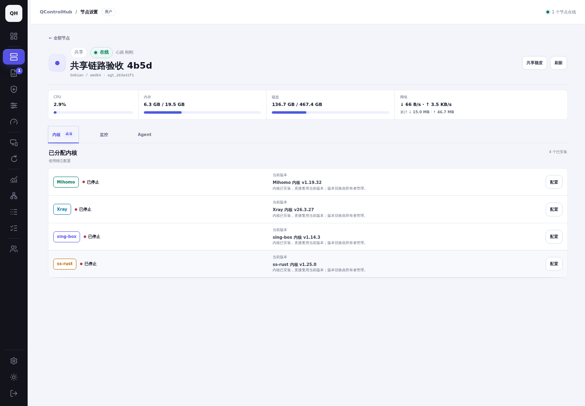
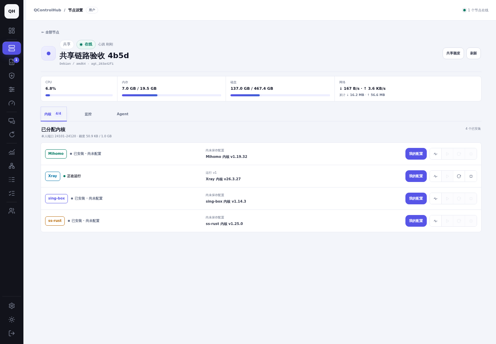
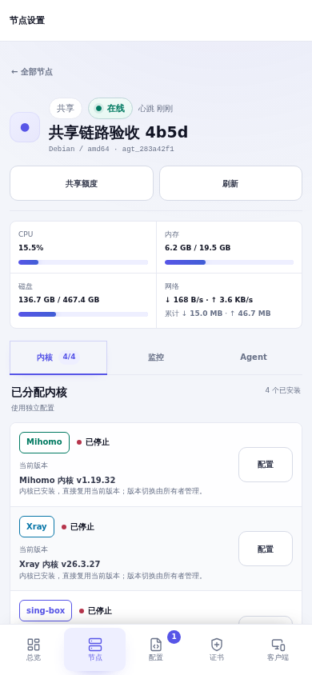
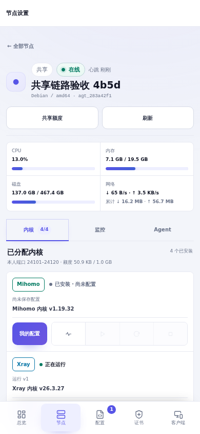

# 共享节点实例生命周期验收

最终对照基线：`c36a1374f4220fb0ae1483f0b1bd669b469b9051`（最新 main，#291 证书中心）；首次复现提交为 `42a2a28bec8bf4022fa439a4802a6443b589ac7c`（#290）。分支：`codex/shared-instance-lifecycle`。本目录保留实际截图、录屏、脱敏任务记录及清理登记；账号密码、会话、配置凭据和数据库快照不提交。

## 实际复现与根因

使用真实密码登录的 `shared-owner`、普通用户 `shared-alice`（A）及 `shared-bob`（B），节点 `agt_283a42f1d751a59b`。A/B 接受同一节点的四种内核授权，分别获分配 `24101–24120` / `24201–24220`，各 1 GiB。[基线任务、配置与共享标识](evidence/baseline.json) 可对应截图及后续任务。

| 问题 | 实际原因 | 修复 |
| --- | --- | --- |
| 普通用户无法启停 | 前端共享任务白名单、宿主管理按钮权限及任务创建/领取/重试均缺少实例级语义；基线 A 启动返回 403 | 服务端从登录用户和有效分配派生实例；启停、状态、读取均绑定该实例，Agent 使用实例服务模板 |
| 协议已部署但连接失败 | Xray VMess/Trojan 入站生成 `settings.users`，实际内核要求 `settings.clients`；服务可 active 而无可用认证用户 | 修正生成器，兼容读取历史 users，实际 VMess 与受信证书 TLS-Trojan 往返验证 |
| 配置保存后不生效 | 草稿、部署任务、运行实例及客户端配置缺少一致版本关联；编辑器重绑定还会把当前分片误当完整配置，丢失其他入站 | 精确版本任务快照、完整配置编辑基线及已部署版本客户端导出；保存草稿明确提示尚未部署 |
| “已停止”识别错误 | 共享页面混用节点基础服务和历史部署状态，停止后丢失可识别配置，缺失状态被当作停止 | 独立实例运行记录，保留停止后的配置身份；基础服务状态不参与用户实例判断；离线、缺失、过期显示未知 |
| 实例实际被停止 | WSS 初始 hello 尚未验证心跳时把共享授权作为撤销下发；Agent 重连/退出时取消的 nft 采样被当作隔离故障，停止同内核的其他实例 | 初始策略 pending，等待可信心跳；取消时用有限时的新上下文重读计数并重建规则，真正失败仍保护性停止并记录原因 |
| 重试可能改错服务 | 管理员重试用户生命周期任务时重新按管理员上下文构造，可能丢失共享目标 | 生命周期重试仅原用户可执行；配置任务保留原配置/共享目标并在事务内再次比较；上下文变化原子拒绝 |
| 删除最后协议误报失败 | 实际应用空配置并停止实例后，控制面未解包执行快照就判断空配置 | 解包后验证精确空配置版本；四种内核均允许“应用空配置且停止”成功 |

实际配置目录 `/etc/qagent/{mihomo,xray,sing-box,shadowsocks-rust}/shares/<share-id>/`；systemd 使用 `qagent-<core>@<share-id>.service`，OpenRC 使用对应实例服务。根属 `0600` 的 `.qch-instance.json` 保存实际配置摘要、配置 ID/版本和任务 ID，只有内核校验、服务启动、TLS 监听及文件访问检查通过后才提交身份。错误包含阶段和目标服务；无效配置、不可读证书及冲突端口保留原有效配置和原运行状态。

## 关联、权限及兼容

状态作用域为 **用户 → 节点 → 内核 → 有效共享关系 → 配置及版本 → 已应用任务**。当前草稿版本与运行版本分别返回；启动读取保留的已部署版本，不读取较新的草稿。任务结果和心跳在节点锁下合并，校验实例身份、已领取任务、采样时间及最近操作，防止迟到响应覆盖新状态。

创建、领取、标记执行中、完成和重试均复核账号、共享、内核、端口及额度。请求不接收用户、共享 ID、服务名或文件路径；伪造字段拒绝，跨用户配置/快照按权限返回 403/404。每实例互斥；同一请求复用待处理任务，冲突操作返回 409。额度耗尽仍允许状态、读取和停止，启动/部署被阻断；账本和端口保留规则继续生效。

数据库 schema **75 / 76 → 77** 为已有实例补充服务状态、原因、采样及观察时间、最近/已应用任务与部署时间；已有不明确状态迁移为 unknown。基础服务部署回填排除共享任务；v75、v76 数据、证书中心表、共享关系、流量账本及“运行 v1、草稿 v2”迁移回归通过。

新 Agent 声明 `shared-core-lifecycle-v1`，实例观察携带 share/core/config/version/task/time。旧 Agent 不下发实例生命周期任务，页面与接口明确要求升级；旧实例文件只有能精确复现已部署内容时才接纳，否则要求重新部署。宿主升级、卸载、能力开关与系统设置维持宿主管理权限。

日志继续使用现有多用户筛选和 ETag。普通用户只能看到本人共享实例与本人私有节点；节点所有者能看自己节点上的共享实例，不能借管理员角色读取普通用户私有节点。客户端和配置读取缓存按本人实例隔离；状态轮询批量读取元数据，不解密全部配置。

最新 main 的证书选择器保留在原协议表单中。授权证书的实际密钥只下发给目标配置所属实例，写入该实例的不可变版本目录；启停复核当前授权及已部署证书有效性，复用已部署任务绑定的证书版本，不在启动时替换证书或重新下发密钥。证书撤权后待领取的启动/重启任务被阻断。

## 当前主题与完整操作路径

复用已有节点卡片、服务图标按钮组、配置工具栏、“更多”菜单、版本标签、提示文字和弹窗。**不新增独立面板或样式文件**；仅修正既有配置菜单层级，避免编辑器遮挡协议修改操作。共享卡片直接进入本人工作区；分配提示显示本人端口/额度。**共享实例运行状态、运行版本及启停只放在节点管理**，沿用已有内核行和图标按钮。配置页保持协议编辑、草稿保存、校验和部署，不显示实例状态控件；“保存并部署”沿用工具栏按钮位置，更多菜单链接实例管理、实际文件及本人日志。客户端入口继续使用原页面。

“保存草稿”“保存并校验”“仅校验已保存配置”和“保存并部署”明确区分；部署任务完成还必须核对实际实例身份和启动结果。状态包括尚未配置、待部署、运行版本与新草稿、主动停止、失败但旧版仍运行、离线未知及额度限制。轮询只更新既有状态文字/按钮，不重建编辑器；页面/账号/内核切换及请求次序保护继续有效。

## 真实服务验证

环境仅用于本次验收：PostgreSQL 17；Debian/systemd 共享节点及 A 私有节点；Alpine 3.23/OpenRC B 私有节点。OpenRC 节点另临时分享给 A，完成四内核真实实例测试后撤销，恢复私有节点边界。内核为 Mihomo **1.19.32**、Xray **26.3.27**、sing-box **1.14.3**、shadowsocks-rust **1.25.0**。

| 验收项 | 证据与结果 |
| --- | --- |
| A/B 同节点同内核、不同协议与端口 | 四内核各自保存/部署，主机真实服务及监听成功；[部署标识](evidence/four-core-deployments.json) |
| 所有者基础服务停止，A/B 仍运行 | 真实停止基础 Xray，两个用户状态与进程保持 active；[操作记录](evidence/acceptance.json) |
| A 四内核停止、启动、重启 | 12 个真实操作成功，每一步比较所有者/B 的 service 状态和 PID 未变 |
| 不持有宿主管理权限的 A 启停 | 暂时收回 `agents.manage`，本人 stop/start/restart 成功；[扩展验证](evidence/extended.json) |
| 已部署旧版、保存新草稿、停止后刷新/重登录 | 运行 v4、草稿 v5；停止后仍导出已部署 v4，重新启动 v4 |
| 修改、删除单个协议及最后协议 | 实际监听和客户端导出随已应用版本更新；OpenRC 删除最后入站停止实例且成功，添加第一个入站重新启动 |
| 配置名称/版本相同的用户隔离 | 独立 A/B 同内核 v1；读取快照、客户端和缓存分别对应本人；伪造外部身份/路径字段 400，外部配置/快照 404 |
| 端口冲突、额度不足、证书权限、配置无效 | 真实占用 24120 检测明确 bind 错误；真实额度耗尽只停止 A，恢复额度不清账本；0600 root 证书失败；真实内核拒绝无效 network；旧版保持运行 |
| 断线与 Agent 重启 | 真实停止 Agent 等待节点离线，页面/API unknown 且保留版本；重启后恢复；所有者/B 原 PID 不变；[进程对照](evidence/reconnect.json) |
| 撤销共享、禁用账号、收回内核 | 真实待执行任务 canceled，重试 403，恢复后本人实例可重新运行，账本/共享身份保留；[对抗记录](evidence/adversarial.json) |
| 日志、ETag 与私有节点 | 三个真实 cookie 会话分别查询实际日志；A 的 ETag 对 B 不返回 304；同一授权上下文支持 304；所有者不能读取 A/B 私有日志 |
| 缺内核与多服务管理器 | 私有节点受控首次安装并部署；OpenRC 四内核 shared deploy/stop/start/restart 全通过，所有者基础 PID 不变；[OpenRC 任务](evidence/openrc-acceptance.json) |
| 当前 main 证书选择、部署及启停 | 所有者授权证书给 A；B 列表、读取、部署被拒绝；A 实际 TLS 部署、stop/start/restart 成功，密钥仅位于 A 实例目录、root:qcontrolhub-core 0640；撤权阻断待领取重启；[实际证书任务](evidence/certificates-shared.json) |
| 实际客户端可用 | 真实 Xray SOCKS 客户端访问测试 HTTP 目标，历史完整矩阵 19 个组合全部成功，包括临时 OpenRC 共享；撤销临时共享后，最新 main 集成最终 16 个在线端点全部往返成功，新增使用受信测试 CA 的 TLS-Trojan；[完整矩阵](evidence/client-roundtrips-matrix.json)、[最终往返](evidence/client-roundtrips-final.json) |

自动化补充覆盖领取/执行中撤权、能力缺失、旧 Agent、迁移、任务租约/延迟结果、摘要不符、流量取消与真实隔离失败、读缓存隔离和页面请求竞态。浏览器回归包括编辑器完整配置基线、私有/共享切换、证书表单、日志筛选、移动端及账号切换。真实客户端验证只针对隔离测试网络和上述协议组合，不等同于全部协议、公共网络/CDN、ACME 续期或人为网络分包延迟的验证。

## 测试命令与结果

使用 Go 1.25.12，`GOFLAGS=-buildvcs=false`，独立 PostgreSQL 测试数据库：

```sh
make non-browser-checks test
make browser-checks
QCH_TEST_XRAY_BIN=/path/to/xray go test ./internal/serverconfig \
  -run 'TestXrayGeneratedAuthenticationRoundTrip|TestLegacyXrayUsersPreset' -count=1 -v
```

`make non-browser-checks test` 全量通过；UI 融合后的非浏览器检查另行通过。`make browser-checks` 四个目标全部通过（包含证书与多用户五个浏览器测试套件）；最终只读实例文件及深色主题另行实际检查通过。CI 和测试结束时间记录在 [验证结果](evidence/validation.json)。真实内核和 systemd/OpenRC 使用独立容器，实际服务验证不以 mock 状态代替。第一次并发运行 API/Store 测试影响 PostgreSQL 全局 vacuum horizon，触发已有 HOT/index-only 性能断言；按 Makefile 串行重跑全部通过。期间暴露的空配置完成状态及重试授权问题均已修复并回归。

## 相同条件前后对照

基线数据库独立克隆用于修复后截图；两个阶段保持同账号、同节点、同配置 ID/v1、相同分配、浅色主题、语言、视口与页面入口。客户端连接地址在两个阶段均为同一测试容器地址。运行时间、实时指标、流量和部署任务时间随实际执行变化；没有伪造运行状态。桌面 **1440 × 1000**，移动 **390 × 844**。

| 普通用户 A 实例状态（节点管理） | 修改前 | 修改后 |
| --- | --- | --- |
| 桌面 |  |  |
| 移动 |  |  |

完整截图索引见 [screenshots.md](screenshots.md)：A/B/所有者 × 桌面/移动 × 节点卡片、实例控件、配置、协议、执行结果、客户端、日志，合计 84 张匹配截图；补充实际部署、实例启停及证书选择截图。

[实际流程录屏：增加协议 → 保存并部署 → 运行 → 停止 → 再次启动](videos/shared-instance-flow.webm)。录屏使用普通用户 A、实际任务、内核与服务；代码区域仅为保护凭据作视觉模糊。停止与再次启动后的客户端配置仍对应本人已部署版本。

## 72 小时保留与自动清理

测试结束先停止本次浏览器会话、服务和容器并释放端口，测试数据保留在停止的环境与本工作区 `.preview/shared-instance-4b5d/`。已登记并启用 **`qch-shared-4b5d-cleanup.timer`**：测试结束 **2026-10-17 19:23:01 Asia/Shanghai（UTC+08:00）**，计划清理 **2026-10-20 19:23:01 Asia/Shanghai / 2026-10-20 11:23:01 UTC**。持久 systemd timer 在结束后精确 72 小时执行本目录 [cleanup.py](cleanup/cleanup.py) 的受限副本；实际任务标识、UTC/Asia/Shanghai 时间、完整容器身份及登记结果见 [清理登记](evidence/cleanup-registration.json)。截图、录屏、报告和必要脱敏日志单独保留。

删除仅针对登记的完整容器 ID、名称及 `qch.test.scope=shared-instance-4b5d` 标签三者都匹配的五个容器及其匿名卷，以及精确测试目录。不会删除已有镜像、内核缓存、默认网络、其他聊天或真实环境。登记后的 dry-run 与提前执行拒绝检查均通过，systemd 已确认 active/enabled 和下一次执行时间。脚本默认 dry-run；提前执行被拒绝。Docker 不可用时保留数据并每 5 分钟重试。清理 runner、登记与结果保留用于核查，持久计时器支持主机重启后补执行。
