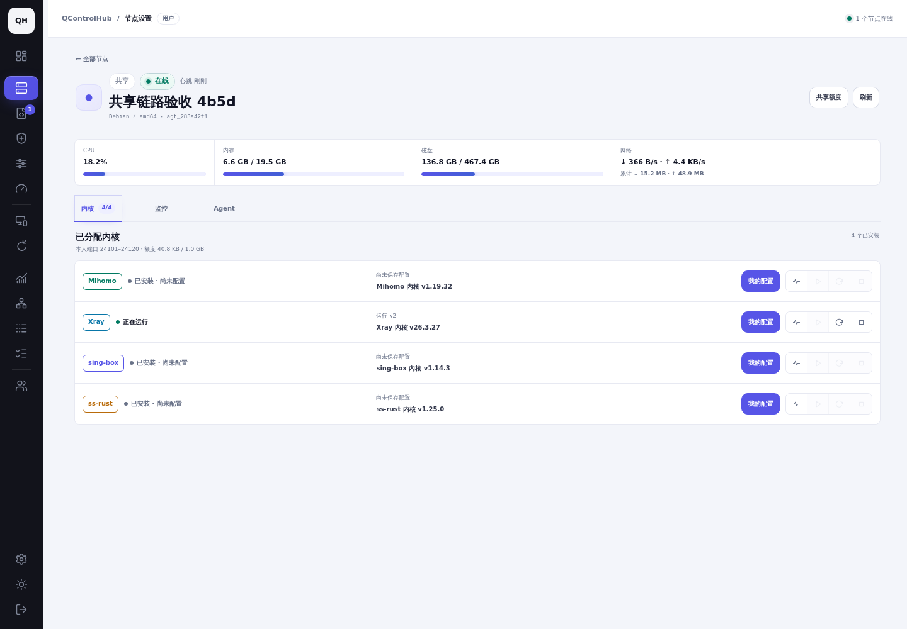
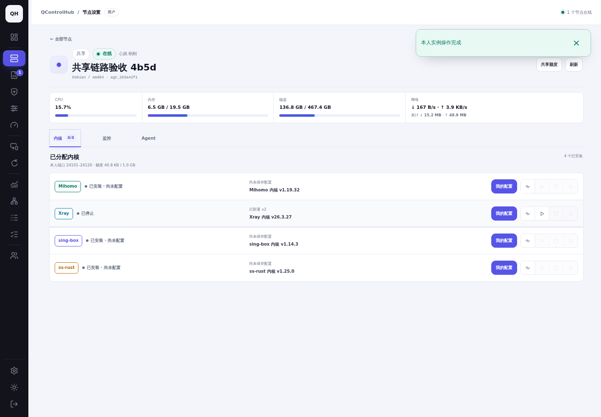

# 截图索引

基线提交 `c36a1374f4220fb0ae1483f0b1bd669b469b9051`。同一组账号/节点/配置 v1/浅色主题，桌面 1440×1000、移动 390×844；真实指标和时间自然变化。

| 页面 | A 桌面 | A 移动 | B 桌面 | B 移动 | 所有者桌面 | 所有者移动 |
| --- | --- | --- | --- | --- | --- | --- |
| 共享节点卡片 | [前](screenshots/before-alice-desktop-card.png) / [后](screenshots/after-alice-desktop-card.png) | [前](screenshots/before-alice-mobile-card.png) / [后](screenshots/after-alice-mobile-card.png) | [前](screenshots/before-bob-desktop-card.png) / [后](screenshots/after-bob-desktop-card.png) | [前](screenshots/before-bob-mobile-card.png) / [后](screenshots/after-bob-mobile-card.png) | [前](screenshots/before-owner-desktop-card.png) / [后](screenshots/after-owner-desktop-card.png) | [前](screenshots/before-owner-mobile-card.png) / [后](screenshots/after-owner-mobile-card.png) |
| 实例状态与操作 | [前](screenshots/before-alice-desktop-instance.png) / [后](screenshots/after-alice-desktop-instance.png) | [前](screenshots/before-alice-mobile-instance.png) / [后](screenshots/after-alice-mobile-instance.png) | [前](screenshots/before-bob-desktop-instance.png) / [后](screenshots/after-bob-desktop-instance.png) | [前](screenshots/before-bob-mobile-instance.png) / [后](screenshots/after-bob-mobile-instance.png) | [前](screenshots/before-owner-desktop-instance.png) / [后](screenshots/after-owner-desktop-instance.png) | [前](screenshots/before-owner-mobile-instance.png) / [后](screenshots/after-owner-mobile-instance.png) |
| 配置编辑与保存/部署 | [前](screenshots/before-alice-desktop-config.png) / [后](screenshots/after-alice-desktop-config.png) | [前](screenshots/before-alice-mobile-config.png) / [后](screenshots/after-alice-mobile-config.png) | [前](screenshots/before-bob-desktop-config.png) / [后](screenshots/after-bob-desktop-config.png) | [前](screenshots/before-bob-mobile-config.png) / [后](screenshots/after-bob-mobile-config.png) | [前](screenshots/before-owner-desktop-config.png) / [后](screenshots/after-owner-desktop-config.png) | [前](screenshots/before-owner-mobile-config.png) / [后](screenshots/after-owner-mobile-config.png) |
| 协议配置 | [前](screenshots/before-alice-desktop-protocol.png) / [后](screenshots/after-alice-desktop-protocol.png) | [前](screenshots/before-alice-mobile-protocol.png) / [后](screenshots/after-alice-mobile-protocol.png) | [前](screenshots/before-bob-desktop-protocol.png) / [后](screenshots/after-bob-desktop-protocol.png) | [前](screenshots/before-bob-mobile-protocol.png) / [后](screenshots/after-bob-mobile-protocol.png) | [前](screenshots/before-owner-desktop-protocol.png) / [后](screenshots/after-owner-desktop-protocol.png) | [前](screenshots/before-owner-mobile-protocol.png) / [后](screenshots/after-owner-mobile-protocol.png) |
| 实际执行记录 | [前](screenshots/before-alice-desktop-tasks.png) / [后](screenshots/after-alice-desktop-tasks.png) | [前](screenshots/before-alice-mobile-tasks.png) / [后](screenshots/after-alice-mobile-tasks.png) | [前](screenshots/before-bob-desktop-tasks.png) / [后](screenshots/after-bob-desktop-tasks.png) | [前](screenshots/before-bob-mobile-tasks.png) / [后](screenshots/after-bob-mobile-tasks.png) | [前](screenshots/before-owner-desktop-tasks.png) / [后](screenshots/after-owner-desktop-tasks.png) | [前](screenshots/before-owner-mobile-tasks.png) / [后](screenshots/after-owner-mobile-tasks.png) |
| 客户端配置 | [前](screenshots/before-alice-desktop-client.png) / [后](screenshots/after-alice-desktop-client.png) | [前](screenshots/before-alice-mobile-client.png) / [后](screenshots/after-alice-mobile-client.png) | [前](screenshots/before-bob-desktop-client.png) / [后](screenshots/after-bob-desktop-client.png) | [前](screenshots/before-bob-mobile-client.png) / [后](screenshots/after-bob-mobile-client.png) | [前](screenshots/before-owner-desktop-client.png) / [后](screenshots/after-owner-desktop-client.png) | [前](screenshots/before-owner-mobile-client.png) / [后](screenshots/after-owner-mobile-client.png) |
| 实例日志 | [前](screenshots/before-alice-desktop-logs.png) / [后](screenshots/after-alice-desktop-logs.png) | [前](screenshots/before-alice-mobile-logs.png) / [后](screenshots/after-alice-mobile-logs.png) | [前](screenshots/before-bob-desktop-logs.png) / [后](screenshots/after-bob-desktop-logs.png) | [前](screenshots/before-bob-mobile-logs.png) / [后](screenshots/after-bob-mobile-logs.png) | [前](screenshots/before-owner-desktop-logs.png) / [后](screenshots/after-owner-desktop-logs.png) | [前](screenshots/before-owner-mobile-logs.png) / [后](screenshots/after-owner-mobile-logs.png) |

| 操作过程 | 实际截图 |
| --- | --- |
| 部署并启动 |  |
| 主动停止，保留配置版本 |  |
| 再次启动 |  |

[完整流程录屏](videos/shared-instance-flow.webm)。

补充最终真实环境截图（A 的 TLS 配置 v23；与 v1 对照数据分开）：

- [桌面证书选择](screenshots/shared-certificate-desktop.png)
- [移动证书选择](screenshots/shared-certificate-mobile.png)
- [移动实例启停](screenshots/shared-lifecycle-mobile-detail.png)

[最终深色主题节点管理](screenshots/shared-lifecycle-desktop-dark.png)。
