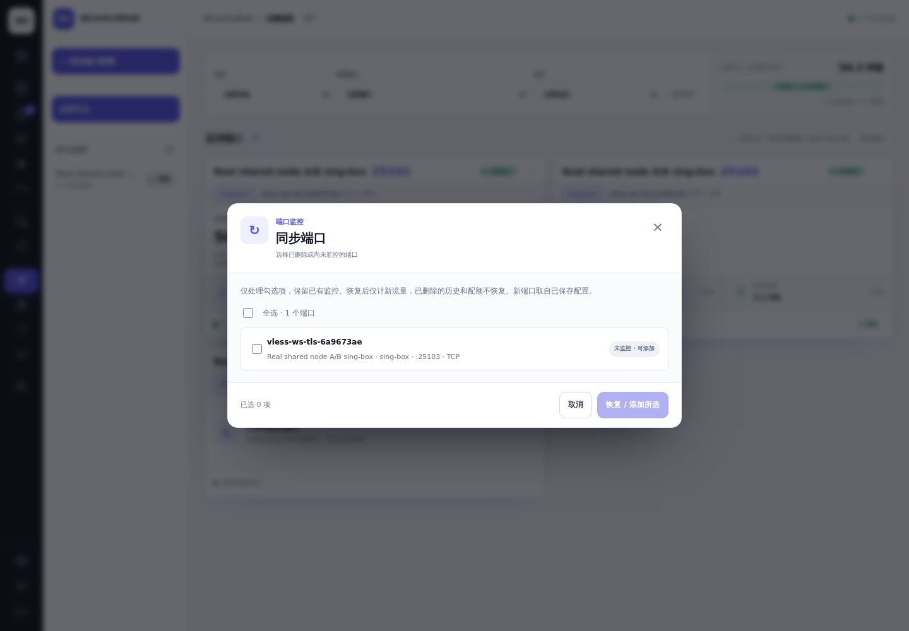
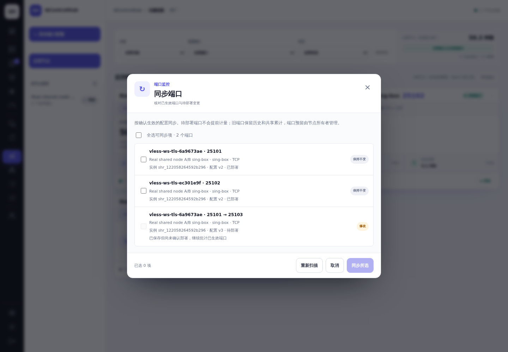
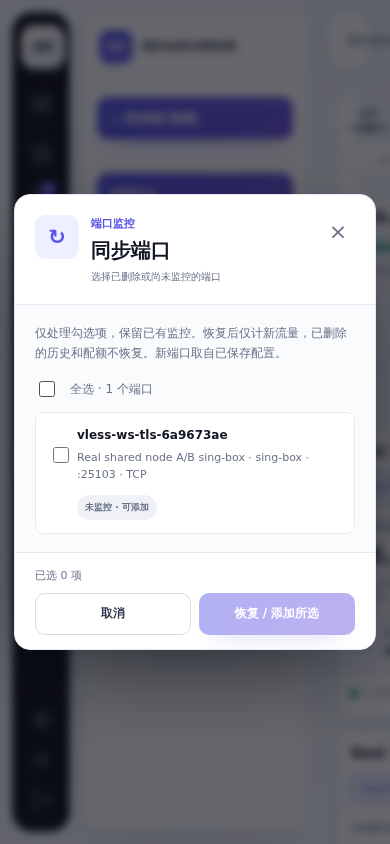
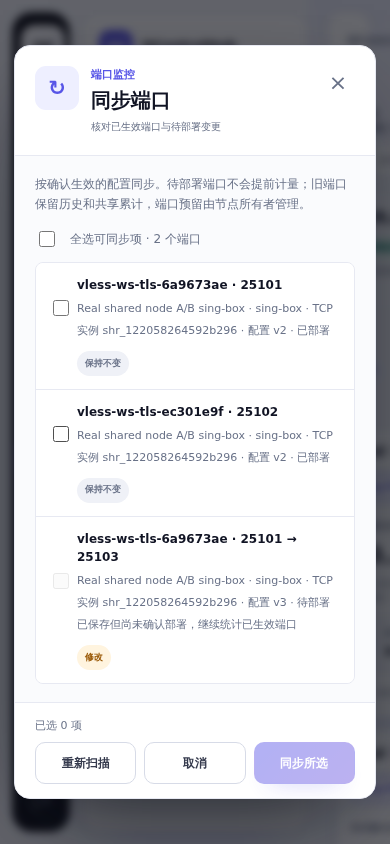
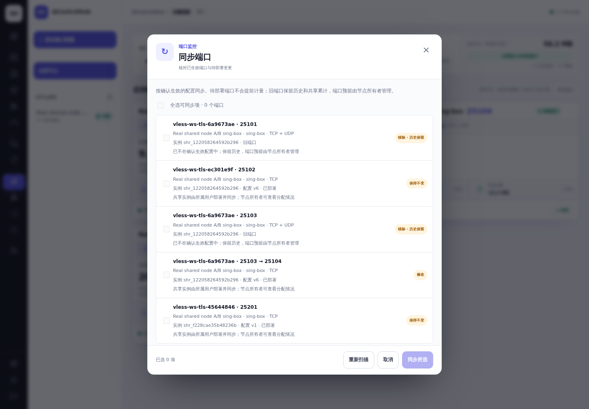
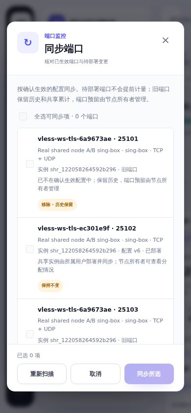

# Shared-instance received/sent undercount fix

Investigation baseline: `55e2d4ca4a85d3d23b026072cdb616144f81c462`. The branch started from main `dae30aaa` and includes main `3097ce3b` at merge review. The port-sync addition uses the original accounting fix `0ae34ba4ae90492998bce5f59cd61cdb75f3d618` as its before baseline, in the same PR.

## Root cause and focused fix

The shared collector explicitly skipped native/marked exit accounting. Shared runtimes already had independently marked outbound sockets, but only client-listener counters were collected. Consequently target → proxy bytes were missing from received detail, and proxy → target bytes were missing from sent detail. Testing upload alone did not reveal the omitted target receive leg.

The collector now selects the protected configuration and managed service by **engine plus allocation**, verifies its independently marked exits, and reads the existing four-leg counters. Two users running the same core never share a source. Fixed native statistics API ports remain disabled for independent shared instances. Invalid attribution preserves baselines and stops only the affected allocation.

The agreed quota rule is **measured client leg + target leg, received + sent**, matching administrator port statistics. Application upload is client → proxy; download is proxy → client. Host NIC totals are outside this personal accounting path. Network counters include IP/transport headers, TLS/WebSocket framing, ACKs and retransmissions; Ethernet headers are excluded.

Shared quota is now incremented from the same accepted deltas as period/history statistics, in the existing transaction. Raw `ShareUsedBytes` cannot charge rejected, duplicate, late or failed samples. PostgreSQL timestamp precision is normalized before deduplication. Existing epoch baselines and per-policy acknowledgements prevent checkpoint replay or listener-to-dual migration from charging already acknowledged bytes again. Connection reply marks include policy/epoch identity to avoid old-port replies entering the next allocation.

There are no new pages, node-card summaries, audit tables, database migrations or historical repair commands. The existing traffic status renderer stops incorrectly labeling a verified dual source as listener-only. The requested port-sync dialog changes are described below. Existing totals are retained; missing historical target traffic is not estimated. Calendar usage and allocation cumulative usage keep their existing lifecycles.

## Real VLESS TLS WS evidence

On the user-authorized affected node, the existing Caddy TLS WS deployment produced these before-fix observations:

| Operation | Application bytes | Listener RX | Listener TX |
|---|---:|---:|---:|
| Upload | 4,194,304 | 4,220,202 | 7,281 |
| Download | 4,194,304 | 14,148 | 4,223,490 |

The production observation can contain background traffic. Existing production binaries, configurations and balances were not changed.

The after-fix test used a disposable enrolled OpenRC Agent, two ordinary users, two independent sing-box 1.14.3 instances, three allocated ports and real native VLESS TLS WS clients. Accounts installed/deployed through authenticated panel APIs and normal Agent tasks. Transfer bodies had fixed sizes and SHA256 verification. Agent reports/tasks were not injected.

| User / port | Application up / down | Independent IP RX / TX | Agent RX / TX | Accepted RX+TX | Capture difference |
|---|---:|---:|---:|---:|---:|
| A / 25101 | 5,242,880 / 4,194,304 | 9,586,034 / 9,580,829 | 9,586,034 / 9,580,829 | 19,166,863 | 0 B |
| A / 25102 | 2,097,152 / 1,048,576 | 3,200,095 / 3,195,971 | 3,200,095 / 3,195,971 | 6,396,066 | 0 B |
| B / 25201 | 4,194,304 / 2,097,152 | 6,393,271 / 6,385,041 | 6,393,271 / 6,385,041 | 12,778,312 | 0 B |

The capture contained 9,493 packets and zero drops. Totals exceed twice the application body by 1.55%, 1.66% and 1.55% due to measured transport overhead. See [capture comparison](evidence/dual-pcap-comparison.json), [capture receipt](evidence/dual-capture.txt), [application transfers](evidence/dual-transfers-concurrent.json), and [actual API counter snapshots](evidence/deployed-node-measurements.json). The collector and deployed configuration path in this measurement remain the final implementation; the final quota SQL additionally uses the existing tables directly, without the earlier proposed audit extension.

A-only 4 MiB upload: RX 4,266,253 B, TX 4,250,959 B, allocation increment 8,517,212 B; A's other port and B stayed unchanged. Owner/system direct traffic left both users unchanged. Instance, Agent and panel restarts preserved settled totals; subsequent traffic continued normally. A quota exhaustion affected only A, while B's real transfer succeeded; top-up restored A's permitted start. UDP over VLESS TLS WS verified IPv4 and IPv6 targets. [Quota results](evidence/quota-results.json), [restart receipt](evidence/dual-after-restarts-receipt.json), [IPv4 UDP](evidence/dual-udp4.json), [IPv6 target UDP](evidence/dual-udp6.json).

## Validation boundaries

Focused regressions cover missing exits, same-core allocation isolation, duplicate/failed/late reports, concurrent submission, source migration, checkpoint overlap, cycle changes and quota acknowledgements. The disposable TCP/UDP IPv4/IPv6 namespace matrix passed. Final full Agent (237.35 s), store (145.58 s) and server configuration (0.33 s) suites passed on the rebased code. All-package compile, frontend-module, formatting and style checks passed. Latest CI results are linked in the PR.

Physical host reboot, a second live shared host, every protocol permutation and post-upgrade production Caddy traffic were not tested. The production Caddy before-fix observation and disposable native TLS WS after-fix test are distinct evidence. Existing Mihomo non-global-target socket-mark limits remain unchanged.

## Port-sync addition: saved versus deployed listening ports

### Reproduced causes and changes

The previous endpoints/sync API parsed the saved workspace, while shared runtime ownership tracked another, actually deployed revision. It had no scan version or allocation identity. Save-triggered reconciliation could prune the running monitor prematurely. A new reserved port with no current listener was also treated as an attribution failure. A regression run against the prior collector reproduces the protective stop: [baseline failure](evidence/port-sync/baseline-regression.txt).

Real replacement deployment exposed two further races: the collector could read a newly written configuration with the previous deployment digest, stopping the service during restart ([failed test deployment](evidence/port-sync/deployment-race-before.txt)); after successful deployment, retiring an old monitor could be interpreted as revoking the whole allocation and stop its new listener. The read-only cgroup warnings in that disposable OpenRC log are a fixture limitation; the conflicting protective stop/restart is the defect.

Discovery now joins the authenticated configuration workspace to confirmed base/shared instance ownership and its exact `config_revisions` version. Each endpoint includes node, config/version, allocation, engine, protocol/tag and port. Existing supported-core parsers remain in use. Saved changes appear separately as **pending deployment**, with selection disabled. Confirmed running endpoints continue counting until successful deployment and final settlement. Uncertain deployment never becomes a selectable replacement. Missing legacy deployment evidence is not guessed from the saved workspace.

The preview returns a configuration/version snapshot. Submit locks the affected resource scope, rebuilds candidates, checks that snapshot, and validates actual owner, grant, engine and reserved ports in the same transaction. Stale, undeployed, foreign or conflicting selections are rejected; byte counter updates do not invalidate a scan. Repeating an accepted selection is a no-op. The node owner can inspect allocations but cannot submit a recipient's independent deployment through this action.

Each shared instance now has its own deployment/sampling lock. If a policy refresh overlaps the next queued deployment, it returns a retryable session error before changing the activation guard or retiring old rules; the authenticated reconnect retries after deployment. A regression reproduced the prior false stop and now verifies that both running protection and the persisted guard remain intact. A sample during its transition retains baselines and waits for the next valid snapshot; another user's collector continues independently. Reserved future ports cannot bill unrelated traffic. Old verified nft counters can settle their tail after a listener disappears. On successful, settled deployment, old policies are disabled without deleting their history, counter lineage or allocation cumulative usage. Policies for ports still present in that instance remain active. A retired policy is removed without stopping the replacement only after its protected local mapping independently confirms an authorized replacement; actual revocation keeps the existing stop protection. Failed deployment preserves the existing accounting relationship. Port reservations remain under the existing explicit owner release workflow.

No schema change or historical rewrite is required. Existing daily records, policy IDs and shared used totals survive upgrade and replacement. Upgrade panel and Agent together; an older Agent without confirmed final settlement does not trigger automatic old-monitor retirement.

### Real node measurements after replacement

The same enrolled OpenRC node ran two ordinary users' independent sing-box 1.14.3 VLESS TLS WS instances. User A changed **25101 → 25103 → 25104** through normal authenticated save/validate/deploy tasks. Port 25102 and user B's port 25201 were retained. The test rejected 25104 before deployment, rejected an open dialog's stale snapshot after deployment, accepted the final revision v6, and repeated sync twice without any counter or quota change. The old port performed a SHA256-verified 1 MiB upload before replacement, and its history remained queryable. [Transition receipt](evidence/port-sync/port-transition.json).

A fresh independent capture then measured a 4 MiB upload and 2 MiB download on the deployed port 25104:

| Layer / direction | Received bytes | Sent bytes |
|---|---:|---:|
| Client-facing listener | 4,255,098 | 2,149,753 |
| Target-facing exit | 2,138,151 | 4,235,210 |
| Independent IP capture total | 6,393,249 | 6,384,963 |
| Agent and accepted period increment | 6,393,249 | 6,384,963 |

**Shared cumulative increment: 12,778,212 B**, exactly the accepted sum. Capture difference: **0 B** in either direction, 3,150 packets, zero drops. Measured network total exceeds twice the application bodies by **1.55210%**, from TLS/WebSocket and IP/TCP overhead. User B and retired ports 25101/25103 grew **0 B**. See [measurement and transfer hashes](evidence/port-sync/new-port-measurements.json), [capture receipt](evidence/port-sync/capture.txt) and [capture hash](evidence/port-sync/receipt.json).

Actual Agent and panel restarts preserved counters and shared cumulative values exactly; reconnect still discovered deployed v6/25104. Subsequent simultaneous 1 MiB uploads by A and B added 2,134,468 B and 2,134,518 B respectively, each equal to that user's quota increment. [Reconnect/concurrency receipt](evidence/port-sync/reconnect-concurrency.json).

### Regression results and screenshot comparison

Full PostgreSQL store **158.605 s**, API **222.042 s**, Agent **241.901 s** and server configuration **0.345 s** suites passed. The additional owner-scope regression passed in **0.936 s**. The final queued-deployment/policy-refresh regressions also passed ([before](evidence/port-sync/queued-refresh-before.txt), [after](evidence/port-sync/queued-refresh-after.txt)). Desktop/mobile traffic browser tests passed in **13.458 s**; module, format, generated-style, installer and `go vet` gates passed. [Store](evidence/port-sync/qch-sync-final-store.txt), [API](evidence/port-sync/qch-sync-final-api.txt), [Agent](evidence/port-sync/qch-sync-final-agent.txt), [browser](evidence/port-sync/qch-sync-final-browser.txt).

Database and API regressions cover A→B→C revisions, save without deploy, failed deployment, stale candidates, two users on the same core, unauthorized/conflicting ports, repeat sync and retained old history. Agent regressions reproduce future-port false stops, final old counter settlement, safe retirement, actual revocation and the deployment-digest race. Existing parser tests cover supported core/port forms and TCP/UDP. The new real port-change test covers sing-box native VLESS TLS WS; a live change on every other core, physical host reboot and production rollout remain unverified.

Merge review found one additional regression: deleting a configuration archive while its leased deployment was running removed the revision needed by the new monitor finalizer and rejected the successful task result. PostgreSQL reproduced `no rows in result set` on `ccd76d0b` ([before](evidence/port-sync/deleted-archive-before.txt)). Missing revision evidence now leaves existing accounting policies intact and still acknowledges the deployment. The new database regression also deploys an initial monitored port and confirms it remains active after this case; no replacement policy is invented. Seven relevant PostgreSQL regressions, including revision lifecycle, shared settlement and stale sync, pass in **6.710 s** ([results](evidence/port-sync/merge-review-store.txt)).

The comparison below uses **the same recorded real test API responses**, account A, light theme, saved v3/deployed v2 and identical background counters in each frontend. They are browser UI replays, not additional live traffic measurements. The after view clearly marks the changed port pending and keeps the deployed ports. The owner views use the live authenticated test API after deployment. [Screenshot provenance](evidence/port-sync/receipt.json).

| View | Before (`0ae34ba4`) | After |
|---|---|---|
| Desktop, 1440 × 1000 |  |  |
| Mobile, 390 × 844 |  |  |

| Owner desktop | Owner mobile |
|---|---|
|  |  |

## Cleanup

Both environments are stopped after verification. `qch-shared-traffic-d074-probe-cleanup.timer` is persistent and scheduled for **2026-10-20 23:27:38 UTC+08:00** (**15:27:38 UTC**), 72 hours after the probe ended. It removes only the marked temporary probe directory/binary after scope/hash checks; existing production services, configurations, rules and user data are excluded. [Receipt](evidence/remote-cleanup.json).

`qch-shared-traffic-d074-cleanup.timer` removes only the seven stopped ID/label-verified test containers, their dedicated network and marked temporary directory. Merge review reused only the scoped PostgreSQL fixture; retention was extended accordingly. Its final execution is **2026-10-21 02:18:39 UTC+08:00** (**2026-10-20 18:18:39 UTC**), exactly 72 hours after the final test end at **2026-10-18 02:18:39 UTC+08:00**. The registered scope includes the new port-change configurations, test accounts/database and replacement binaries. All seven containers and the browser were stopped before registration, and the scope check passed. Exact resource IDs and the previous schedule are in the [local registration receipt](evidence/local-cleanup.json). Reports, sanitized evidence, earlier screenshots and cleanup receipts are preserved outside the removed directory. No global prune or firewall flush is used.
