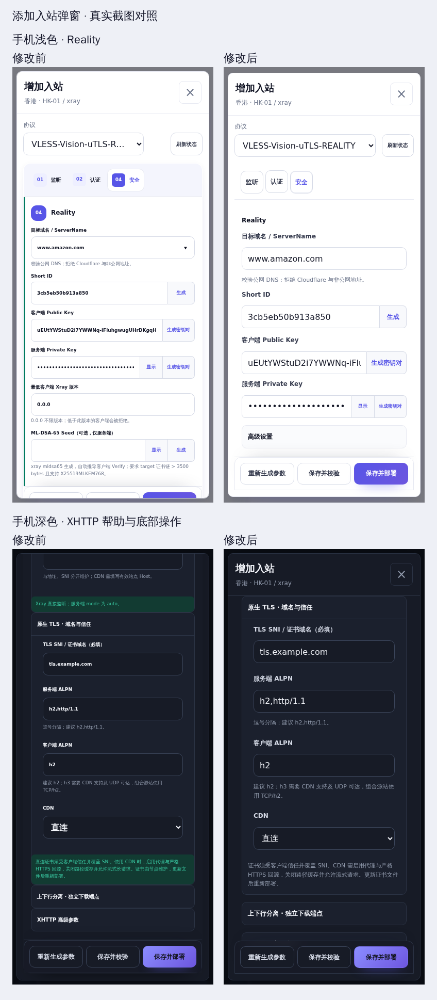
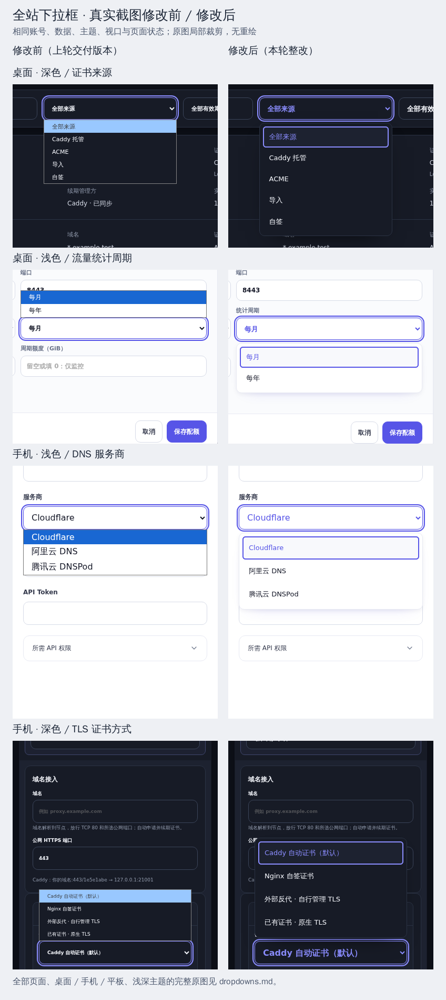
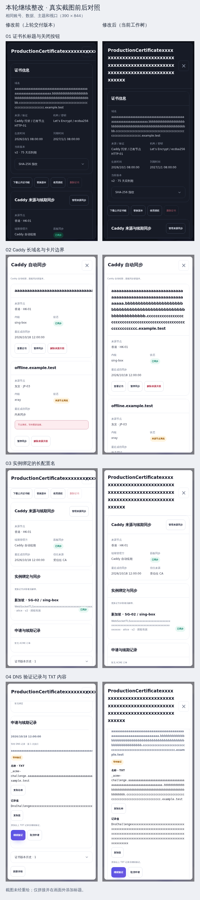
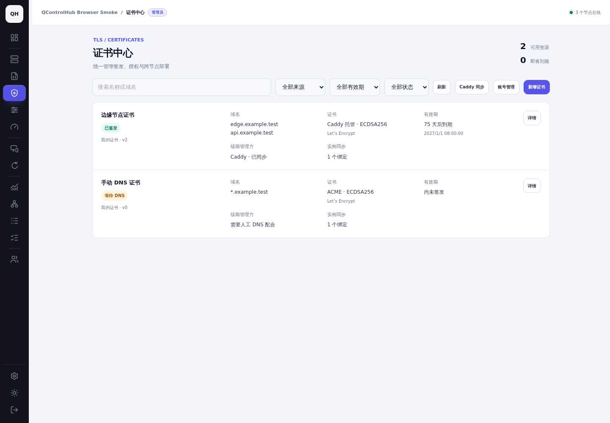
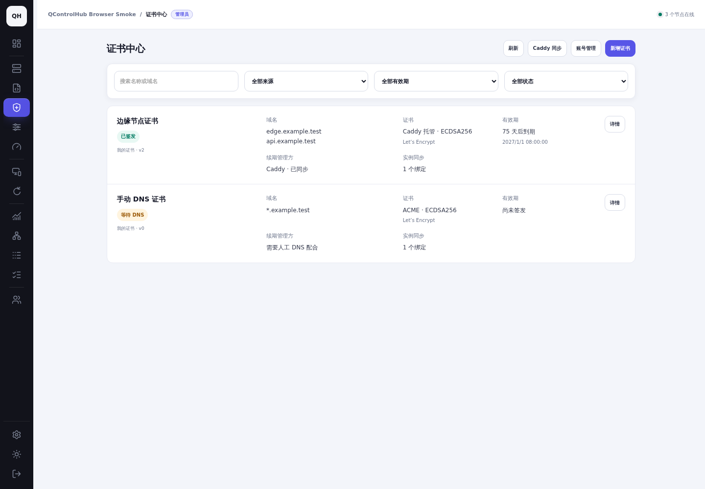
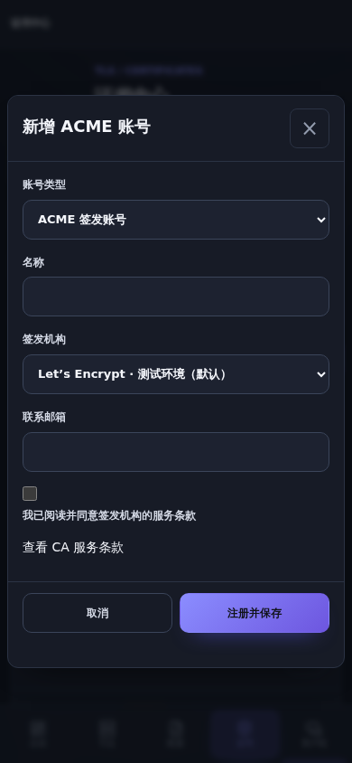
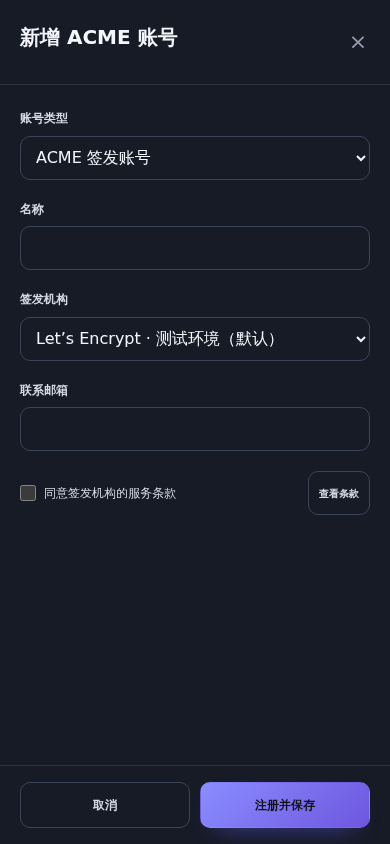
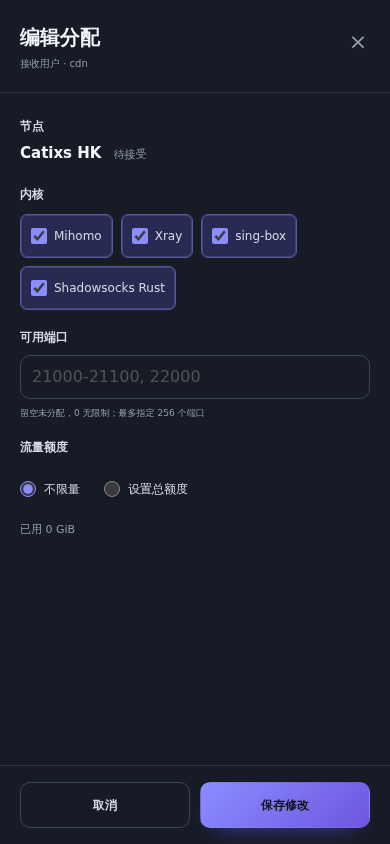

# 近期界面统一整改

## 第五轮：全面优化添加入站弹窗（当前结果）

覆盖 Xray、sing-box、Mihomo、ss-rust **59 个预设**。已去除 Reality / TLS 绿色竖条和普通说明的彩色提示条；弹窗复用现有配置弹窗、横向分组按钮和设置表单。统一标题、标签、输入值、复选项与帮助文字的排版，整理生成密钥等组合字段，将可选 Reality 参数收入高级设置。长表单改为正文滚动，标题和底部操作保持可见。此前全站下拉框整改保留。

**没有新增 CSS 文件、规则块、主题变量、内联样式或 UI 库**；复用现有规则并删除孤立装饰，样式源规则块 4776 → 4770。保留原字段值、校验、权限和提交行为。[本轮完整报告、文件清单与文案对照](inbounds.md) · [本轮差异](evidence/inbounds/turn-only.patch)。

同条件保存 **174 组前后对照、349 张 PNG**，其中添加入站弹窗 16 个状态覆盖桌面 / 手机 / 平板及浅深主题；已亲自查看全部弹窗状态拼图和重点原图。**59 个预设 × 6 种设备 / 主题的字段、约束、提交参数及布局检查通过**；8 个相关浏览器模式通过，最终高级字段校验与两种设备的配置入站回归再次通过。模块、样式和前端 Go 合约通过。[截图、回归结果与未验证项](inbounds.md#实际验证发现及限制) · [滚动录屏修改前](evidence/inbounds/before-modal-scroll.webm) / [修改后](evidence/inbounds/after-modal-scroll.webm)。

浏览器检查使用 Chromium 触摸模拟；物理设备、Safari/WebKit、Firefox、屏幕阅读器及真实节点部署未验证。测试环境已停止，72 小时持久清理任务见[清理登记](#测试环境停止与-72-小时清理)。以下保留此前各轮记录，便于追溯。

## 第四轮：全站下拉框融合当前主题（历史记录）

按追加要求检查全站 **28 个模块：74 处 select 模板、3 处动态创建点、1 处 Reality 域名建议入口**。展开区域统一复用现有配置菜单的主题、按钮、选中、悬停、焦点与禁用样式；收起控件统一字号与尺寸，触摸选项为 44px。保留原字段、值、校验、权限和联动；没有新增样式文件、主题变量、内联样式或 UI 库。既有样式规则已整理 / 迁移，移除局部重复覆盖。[本轮完整报告与逐页原图](dropdowns.md) · [本轮差异](evidence/dropdowns/turn-only.patch)。

本轮保存 **108 组页面状态对照，另有 36 组收起状态对照，共 291 张 PNG**（含集成图与合成图）；已亲自查看六组设备 / 主题截图并放大检查手机弹窗及长列表。基准原生 datalist 浮层无法被截图捕获的限制在完整报告中单独说明。合成图只拼接真实截图裁剪，未重绘产品画面。

**32 个浏览器模式、真实触摸选择联动、真实 PostgreSQL / 密码 / CSRF 证书集成、模块、样式与前端 Go 合约通过**；最终分组语义修改后共享菜单桌面 / 手机回归再次通过。[测试及限制](dropdowns.md#实际检查回归与限制) · [滚动录屏修改前](evidence/dropdowns/before-dropdown-scroll.webm) / [修改后](evidence/dropdowns/after-dropdown-scroll.webm)。

浏览器检查使用 Chromium；物理设备、Safari/WebKit、Firefox、屏幕阅读器未验证。缺少 popover / CSS 锚定能力的浏览器保留原生控件，其系统浮层配色未统一。测试环境的最终停止记录及持久清理时间见文末。下方前三轮内容保留用于追溯原始范围与文案整改。

## 第三轮继续排查：一图对比（历史记录）

按这次要求，修改前为上轮交付的工作树，修改后为当前工作树；同一账号、固定数据、主题、视口及操作顺序。修改前快照的完整差异保存在 [before-production.patch](evidence/round3/before-production.patch)，main 基准仍为 `26a63ff1a975c93f824c13d75961504fe3eb5fc5`。相对 main 的原始对比继续保留在下方。合成图仅拼接真实原图，未重绘产品画面。

亲自查看截图后继续修复四处遗漏：

| 页面 / 状态 | 修改前发现 | 修改后及现有样式复用 |
| --- | --- | --- |
| 证书详情标题 | 100 字符名称越过弹窗并压到关闭按钮 | 非编辑弹窗标题容器复用 `notice-message` 的最小宽度及换行；沿用原 19px 标题与关闭按钮 |
| Caddy 来源卡片 | 长域名被卡片边框裁掉，外层弹窗宽度检查仍正常 | `user-allocation-title` 内标题复用现有换行类；保留原 16px 分区标题及卡片结构 |
| 实例绑定 / 授权 | 长配置名越过元数据栏，挤到状态标签；说明有居中偏移 | `user-allocation-node` 复用现有换行类，元数据左对齐；继续使用 `agent-share-recipient-head`、原字号与状态标签 |
| DNS 验证记录 | 长验证域名撑宽订单网格，TXT 名称和值随之被裁切 | 域名复用现有换行类，恢复原网格约束；TXT 名称、值及复制操作完整可达 |

本轮只调整 `certificate-view.js` 和 `certificates.js` 的组件类，不新增 CSS、内联样式、主题变量，不修改校验、权限或请求行为。[本轮差异](evidence/round3/production.patch) · [本轮基准](evidence/round3/baseline.json)。

本轮重新执行：

- 6 个长文本状态 × 桌面 / 手机 / 平板 × 浅深主题：**36 组对比，72 张原图**。修改前能复现越界；修改后文字未越过所属卡片、标题不挡关闭按钮。检查使用文本实际绘制边界及卡片边界，不仅测量外层弹窗。[结果](evidence/round3/long-content-checks.json) · [逐页图片索引](round3.md)。
- 普通内容的主矩阵 **102 张修改后截图已刷新**；6 组定向交互 **134 项通过**，覆盖草稿、原校验、文件导入、提交锁定、错误、滚动、焦点、空状态和禁用。[主矩阵](evidence/round3/capture-metrics.json) · [交互](evidence/round3/interaction-checks.json)。
- 真实 PostgreSQL / 密码与 CSRF 会话的桌面、手机证书创建、账号保存、隔离、授权、协议选择、替换与撤销测试通过，耗时 8.864s。[日志](evidence/round3/certificate-integration.txt)。
- 模块、样式生成检查、前端 Go 合约和 `git diff --check` 通过。[模块 / 样式](evidence/round3/modules-styles.txt) · [前端合约](evidence/round3/frontend-contracts.txt)。
- 增补长 DNS 弹窗滚动录屏；修改前、修改后均能下滚至底部并返回顶部，修复后文字完整换行。[前](evidence/round3/before-long-dns-scroll.webm) / [后](evidence/round3/after-long-dns-scroll.webm) · [滚动数据](evidence/round3/scroll-checks.json)。

已查看最终合成图，以及桌面、手机、平板浅深主题的标题、来源、绑定、授权及 DNS 截图；针对手机细节另外查看完整分辨率原图。修改前检查确实发现了之前只看外层几何时漏掉的内部裁切。物理设备、Safari/WebKit、公网 CA/DNS 签发和真实 Agent/Caddy 部署仍未验证。以下保留前两轮范围、文案及回归记录；展开补图和成熟页面参照来自第二轮，第三轮新状态与重新拍摄的主矩阵以上述记录为准。

## 基准与范围

- 基准：`26a63ff1a975c93f824c13d75961504fe3eb5fc5`，main / PR #298。开始及交付前均执行 `git fetch origin main`，main 未变化。
- 分支：`codex/unify-recent-ui`。修改前用 `git archive` 保存完整基准，并先拍摄基准界面；其余对比继续从该基准读取。
- 主检查范围：#290–#298 的证书、节点共享、共享实例、配置状态、日志、流量同步、导航，以及证书选择和 TLS 表单的直接依赖。向前核对 #277–#289，实际延伸整改到 #280–#283 的 XHTTP、TLS 预设与 ACME 邮箱。
- 需求依据：PR 描述、提交差异和仓库随附验收文档。仓库没有完整保留每次聊天原文；下表按可追溯的需求记录判断，不将推断当作用户原话。22 个 PR 的描述摘要、提交及完整前端文件清单见 [PR 范围记录](evidence/pr-scope.json)。

| PR | 记录中的界面要求 | 检查页面与文件 | 本次处理 |
| --- | --- | --- | --- |
| [#298](https://github.com/qimaoww/QControlHub/pull/298) | 恢复配置状态及节点管理入口，保持原布局 | 节点、配置；`agent-view.js`、`live-config-view.js`、`shared-instance-state.js` | 保留已修复入口、状态位置及运行版本；桌面/手机回归通过 |
| [#296](https://github.com/qimaoww/QControlHub/pull/296)、[#297](https://github.com/qimaoww/QControlHub/pull/297) | 只修展开侧栏选中框漂移；撤回额外导航行为 | 侧栏、手机菜单；`shell-view.js`、`workspace-motion.js`、`700-shell-dock-rail.css` | 保留 #297 恢复的尺寸、交互和菜单，不改导航 |
| [#295](https://github.com/qimaoww/QControlHub/pull/295) | 原同步弹窗展示端口、实例、版本及阻断原因 | 流量同步、统计状态；`traffic-sync-dialog.js`、`traffic-accounting-view.js` | 删除同步副标题和整段计量内部流程说明；保留候选信息、历史、阻断原因及选择行为 |
| [#294](https://github.com/qimaoww/QControlHub/pull/294) | 证书界面复用主题和弹窗；共享 HTTP-01 与 Caddy 同步 | 证书列表、筛选、新增/导入、详情、订单、来源、账号、授权、节点共享；`certificate-view.js`、`certificate-forms.js`、`certificates.js`、`certificate-selector.js`、`agent-sharing.js`、`310-certificates.css` | 删除介绍/统计头、独立提示卡片外观和重复控件主题；复用成熟组件；精简技术说明 |
| [#293](https://github.com/qimaoww/QControlHub/pull/293) | 更新、迁移和回滚修复 | 无新增前端界面 | 排除部署实现 |
| [#292](https://github.com/qimaoww/QControlHub/pull/292) | 共享实例状态和生命周期只放节点管理；配置页负责编辑/部署 | 节点内核行、配置页与更多菜单；`agent-view.js`、`live-config-view.js`、`shared-instance-state.js` | 已使用原内核行与按钮，保留操作位置、限制、版本和未知状态；回归通过 |
| [#291](https://github.com/qimaoww/QControlHub/pull/291) | 证书功能复用列表、共享控件、弹窗和主题，移除多余介绍 | 证书及协议选择器；上述证书文件、`preset-bindings.js` | 按原有组件结构整改列表/表单/弹窗，精简重复选择摘要 |
| [#290](https://github.com/qimaoww/QControlHub/pull/290) | 授权实例过滤与日志采集状态 | 日志筛选、分页、空状态、错误；`core-log-view.js`、`core-log-dom.js`、`core-log-source-status.js`、`core-log-scope.js` | 沿用原日志控件；状态、错误和下一步具有操作价值，保留；桌面/手机回归通过 |
| [#280](https://github.com/qimaoww/QControlHub/pull/280) | XHTTP 基础字段与折叠高级设置复用现有组件 | XHTTP 独立/组合、上下行分离；`server-plan-xhttp.js` | 删除重复内部拓扑、导出实现、信任验证承诺与版本运行细节；保留端点、证书、CDN 接入及参数约束 |
| [#281](https://github.com/qimaoww/QControlHub/pull/281)、[#282](https://github.com/qimaoww/QControlHub/pull/282)、[#283](https://github.com/qimaoww/QControlHub/pull/283) | 邮箱继承、ZeroSSL 回退与简洁域名工作流，保持现有表单 | TLS 预设、系统设置；`server-plan-managed-tls.js`、`settings-view.js` | 删除字段复述和独立长说明，保留账号范围、重新部署及邮箱覆盖规则 |
| [#277](https://github.com/qimaoww/QControlHub/pull/277)、[#278](https://github.com/qimaoww/QControlHub/pull/278)、[#279](https://github.com/qimaoww/QControlHub/pull/279) | TLS 原表单及任务编辑重试工作区 | TLS、任务重试弹窗；`preset-view.js`、`task-edit-retry.js`、`535-tls-and-retry.css` | 作为成熟组件及直接依赖核对；保留编辑、校验、重试、错误原因和未保存确认；预设浏览器回归包含任务编辑重试 |
| #284–#289 | 就绪、流量、安装权限、账户并发、IP 质量错误等修复 | 相关提交及直接调用点，详见 JSON | 未将后端、部署与数据修复扩入本次生产改动 |

表中未写目录的模块文件均位于 `frontend/modules/`，样式源位于 `frontend/styles/`；JSON 保留完整路径。

前三轮生产修改限于证书界面及共享域名字段、流量同步文案、TLS/XHTTP 文案、ACME 设置文案、已有证书浏览器断言，以及被替代的局部样式。`app.css` 由原生成器生成。后端、权限、接口、路由和全局主题定义均保持基准内容。

## 本轮按截图继续整改

上一版仍有证书专用排版、过宽表单、微小复选文案、原生英文文件按钮、账号/详情信息堆叠等问题。本轮重新拍摄并查看实际截图，完成以下修正：

| 截图中发现的问题 | 实际修改 |
| --- | --- |
| 证书仍用单独外观覆盖项目主题 | 完整删除 `310-certificates.css`（基准 9492 字节）及清单引用；重新生成 `app.css` |
| 新增/账号表单过宽，底部操作与正文混在一起 | 使用原用户分配弹窗的 560px 表单、标题、滚动正文、固定操作栏；手机沿用其全屏结构 |
| 自动续期和条款文字过小、文件控件显示英文 | 使用原额度复选组与标准按钮；导入后显示文件名，保留文件限制及校验 |
| 账号管理、Caddy 来源及详情没有一致分区 | 复用设置分区标题、分配元数据、共享列表和操作栏，重新组织信息与按钮 |
| 窄屏元数据被容器查询重新排序 | 按原分配列表的包装结构使用元数据网格，保证域名、时间、版本、指纹顺序 |
| 折叠项缺少箭头，长文本和 DNS 记录展示不一致 | 使用原自有节点折叠结构及图标；DNS 值保持中性色，长错误使用现有反馈换行类 |
| 首轮手机 fullPage 截图未稳定保留触摸布局 | 基准和最终版本均重拍为视口截图；手机/平板启用 touch，滚动区域另拍并录屏 |

查看了桌面、手机、平板的浅深主题最终截图、成熟用户列表/分配弹窗及展开区域，重点核对表单宽度、字段顺序、按钮、复选项、边框、明暗主题、长错误和滚动底部。截图复查中纠正过 DNS 值误用警告外观、折叠箭头缺失和元数据排序问题。最终图在根证据目录；首轮被替代的 32 张图保存在 `evidence/round1/`，不计入最终验收数量。

## 实际复用的组件与样式

| 整改位置 | 成熟页面/模块 | 复用的结构与样式 |
| --- | --- | --- |
| 证书标题、列表、空状态 | 用户管理 `user-view.js` | `users-workspace`、`user-admin-workspace`、`users-toolbar`、`user-allocation-panel/row/node/terms/row-actions`、`user-share-empty` |
| 搜索与三个筛选 | 内核日志 `core-log-view.js` | `core-log-workspace`、`core-log-filters`、`core-log-search` 的响应式结构 |
| 证书/账号编辑弹窗 | 用户分配编辑与流量编辑 | `traffic-edit-dialog user-allocation-dialog`、原 header、`traffic-edit-body`、原 footer、`deploy-command-close` |
| 详情/账号管理/授权/来源弹窗 | 配置通用与出站弹窗 | `config-inbound-dialog config-common-dialog config-outbound-dialog`、`config-inbound-heading/body`、`config-access-close` |
| 详情和账号分区、元数据与记录 | 设置、用户分配、节点共享 | `settings-section/subsection/form/field/hint`、`user-allocation-head/title/tools/terms`、`agent-share-recipient/head/fields/meta/usage` |
| 复选项、折叠帮助、文件导入 | 用户额度、自有节点、通用按钮 | `user-quota-options`、`user-owned-nodes` 的 summary/图标/列表、`button small` |
| 状态、错误、长文本 | 原状态标签与反馈 | `status-label`、`alert error`、`notice-message`；DNS 正常值不使用错误样式 |
| 节点共享域名、TLS/XHTTP、流量、ACME 设置 | 各自原有页面 | 原字段、分区、按钮及现有主题；删减重复说明 |

没有新增 CSS 规则、内联样式、主题变量或 UI 库，也没有修改全局样式源。剩余 `560-traffic-sync.css` 仅删除无使用者的说明规则；`app.css` 由原生成器生成。[样式核对](evidence/style-reuse-check.json) · [完整生产差异](evidence/production.patch)。

表单初始化改为先恢复草稿、再绑定原节点提示和泛域名校验，恢复的值立即按原规则显示。接口、权限、请求载荷和业务约束沿用原实现。文件按钮继续调用原 file input，256 KiB 上限和 PEM 校验保留。

## 文案删减示例

| 位置 | 修改前 | 修改后 |
| --- | --- | --- |
| 证书列表 | 英文眉题、介绍“统一管理签发、授权与跨节点部署”、资源/到期统计头 | 现有工具栏标题“证书中心”及操作按钮 |
| HTTP-01 | 整段解释托管代理、临时监听、逐个 A/AAAA 检查、通知 CA 和跨节点部署 | 接入前提一句；“外部网站接入”折叠项只保留挑战路径、9080 和 Host 配置 |
| Caddy 详情 | “保持原证书的续期责任……向仍有有效授权的绑定实例同步；不会重复创建 ACME 续期订单” | 删除；已有“续期管理方”和“面板同步”字段表达状态 |
| Caddy 来源 | 长篇导入/分发流程与“无需手动上传私钥” | “Caddy 自动续期，面板同步新版本。” |
| 节点共享 | “每行一个精确域名……接受共享且启用后生效。协议部署仍按上方内核与端口权限单独检查。” | “每行一个完整域名；留空不授权，接受共享后生效。” |
| 流量同步 | 副标题及整段“待部署端口不会提前计量；旧端口保留历史……端口预留由节点所有者管理” | 删除；候选行继续显示待部署、旧端口、版本和阻断原因 |
| TLS 预设 | 重复解释默认 443、自动生成路径、Host 不修改证书域名 | 删除；字段值、标签和占位文字已表达 |
| XHTTP 高级设置 | 大段解释各版本 auto 模式、uTLS、完整导出及旧参数内部保存 | 保留最低版本、auto 建议、JSON 导出入口及填写约束 |
| ACME 设置 | 三处解释适用节点、其他 TLS 方式、邮箱继承、回退与既有任务 | “仅当前账号生效，保存后重新部署配置。”及“填写邮箱可启用 ZeroSSL 回退，单个预设可覆盖。” |
| 授权撤销确认 | 多句业务责任、影响列表及协调说明 | “撤销后停止分发和同步，现有部署保留。” |

保留了客户端信任自签证书、外部网站接入、手动 DNS 操作、API 权限、真实失败原因及撤销/删除确认。证书算法、字段约束、续期、授权、同步选择、端口版本检查与业务请求载荷保持原规则。

## 截图条件与材料

基准是上述 main 提交，修改后为当前工作树。相同本地账号、固定数据、主题、视口、语言与操作顺序；固定时钟 `2026-10-18T05:00:00Z`，zh-CN、Asia/Hong_Kong（UTC+08）、DPR 1。桌面 1440×1000；手机 390×844（mobile/touch）；平板 820×1180（touch）。截图均为真实 Chromium 生产模块渲染，使用视口截图；未绘制或重制产品画面。[基准记录](evidence/baseline.json)。

截图数据使用本地 API fixture 和项目原有预设 fixture。它们用于复现界面；实际密码/CSRF、数据库、创建/授权/选择/替换/撤销流程由另行运行的真实集成测试验证。公网签发和真实节点部署不以 fixture 结果代替。

- 主矩阵：17 个页面状态 × 3 类设备 × 浅深主题，**102 组前后对比**（204 张原图）。
- TLS/XHTTP 高级设置：桌面/手机浅深主题，另 **8 组对比**（16 张原图）。使用原独立预设 fixture；其手机高级入口出现旧容器底栏遮挡，补图以键盘展开，不能据此声称该旧容器触摸检查通过。当前配置入口使用原 `config-inbound-dialog`，该入口及其内嵌表单有独立回归。未扩大生产改动去改旧容器全局样式。
- 72 张成熟页面、日志/配置/共享节点及折叠/滚动区域补图；29 张等待/错误/禁用补图；2 张真实集成证书选择器截图。
- 合计 **689 张交付 PNG**（含第四轮 291 张下拉框相关原图、集成图及合成图；第三轮 75 张长文本材料保留）；另存首轮 32 张历史截图。文件校验值见 [证据清单](evidence/artifacts.json)。
- 手机导入表单滚动：[修改前录屏](evidence/before-mobile-scroll.webm) / [修改后录屏](evidence/after-mobile-scroll.webm)。相同 390×844 浅色、输入与 wheel 序列；抽帧查看确认正文滚动、标题及底部操作可用。正文可滚动范围前 64px、后 85px，后者采用成熟表单的正常字号和间距，未以压缩字号减少滚动。

### 代表对比：桌面浅色证书列表

| main 基准 | 本轮最终 |
| --- | --- |
|  |  |

### 代表对比：手机深色账号表单

| main 基准 | 本轮最终 | 成熟分配弹窗参照 |
| --- | --- | --- |
|  |  |  |

### 全部页面对比索引

每格为相同条件的“前 / 后”原图；展开区域见下一表。

| 页面状态 | 桌面浅 | 桌面深 | 手机浅 | 手机深 | 平板浅 | 平板深 |
| --- | --- | --- | --- | --- | --- | --- |
| 证书列表 | [前](evidence/before-desktop-light-certificates.png) / [后](evidence/after-desktop-light-certificates.png) | [前](evidence/before-desktop-dark-certificates.png) / [后](evidence/after-desktop-dark-certificates.png) | [前](evidence/before-mobile-light-certificates.png) / [后](evidence/after-mobile-light-certificates.png) | [前](evidence/before-mobile-dark-certificates.png) / [后](evidence/after-mobile-dark-certificates.png) | [前](evidence/before-tablet-light-certificates.png) / [后](evidence/after-tablet-light-certificates.png) | [前](evidence/before-tablet-dark-certificates.png) / [后](evidence/after-tablet-dark-certificates.png) |
| 新增证书 | [前](evidence/before-desktop-light-certificate-create.png) / [后](evidence/after-desktop-light-certificate-create.png) | [前](evidence/before-desktop-dark-certificate-create.png) / [后](evidence/after-desktop-dark-certificate-create.png) | [前](evidence/before-mobile-light-certificate-create.png) / [后](evidence/after-mobile-light-certificate-create.png) | [前](evidence/before-mobile-dark-certificate-create.png) / [后](evidence/after-mobile-dark-certificate-create.png) | [前](evidence/before-tablet-light-certificate-create.png) / [后](evidence/after-tablet-light-certificate-create.png) | [前](evidence/before-tablet-dark-certificate-create.png) / [后](evidence/after-tablet-dark-certificate-create.png) |
| ACME 账号 | [前](evidence/before-desktop-light-certificate-acme-account.png) / [后](evidence/after-desktop-light-certificate-acme-account.png) | [前](evidence/before-desktop-dark-certificate-acme-account.png) / [后](evidence/after-desktop-dark-certificate-acme-account.png) | [前](evidence/before-mobile-light-certificate-acme-account.png) / [后](evidence/after-mobile-light-certificate-acme-account.png) | [前](evidence/before-mobile-dark-certificate-acme-account.png) / [后](evidence/after-mobile-dark-certificate-acme-account.png) | [前](evidence/before-tablet-light-certificate-acme-account.png) / [后](evidence/after-tablet-light-certificate-acme-account.png) | [前](evidence/before-tablet-dark-certificate-acme-account.png) / [后](evidence/after-tablet-dark-certificate-acme-account.png) |
| 证书导入 | [前](evidence/before-desktop-light-certificate-import.png) / [后](evidence/after-desktop-light-certificate-import.png) | [前](evidence/before-desktop-dark-certificate-import.png) / [后](evidence/after-desktop-dark-certificate-import.png) | [前](evidence/before-mobile-light-certificate-import.png) / [后](evidence/after-mobile-light-certificate-import.png) | [前](evidence/before-mobile-dark-certificate-import.png) / [后](evidence/after-mobile-dark-certificate-import.png) | [前](evidence/before-tablet-light-certificate-import.png) / [后](evidence/after-tablet-light-certificate-import.png) | [前](evidence/before-tablet-dark-certificate-import.png) / [后](evidence/after-tablet-dark-certificate-import.png) |
| 账号管理 | [前](evidence/before-desktop-light-certificate-accounts.png) / [后](evidence/after-desktop-light-certificate-accounts.png) | [前](evidence/before-desktop-dark-certificate-accounts.png) / [后](evidence/after-desktop-dark-certificate-accounts.png) | [前](evidence/before-mobile-light-certificate-accounts.png) / [后](evidence/after-mobile-light-certificate-accounts.png) | [前](evidence/before-mobile-dark-certificate-accounts.png) / [后](evidence/after-mobile-dark-certificate-accounts.png) | [前](evidence/before-tablet-light-certificate-accounts.png) / [后](evidence/after-tablet-light-certificate-accounts.png) | [前](evidence/before-tablet-dark-certificate-accounts.png) / [后](evidence/after-tablet-dark-certificate-accounts.png) |
| 证书详情 | [前](evidence/before-desktop-light-certificate-detail.png) / [后](evidence/after-desktop-light-certificate-detail.png) | [前](evidence/before-desktop-dark-certificate-detail.png) / [后](evidence/after-desktop-dark-certificate-detail.png) | [前](evidence/before-mobile-light-certificate-detail.png) / [后](evidence/after-mobile-light-certificate-detail.png) | [前](evidence/before-mobile-dark-certificate-detail.png) / [后](evidence/after-mobile-dark-certificate-detail.png) | [前](evidence/before-tablet-light-certificate-detail.png) / [后](evidence/after-tablet-light-certificate-detail.png) | [前](evidence/before-tablet-dark-certificate-detail.png) / [后](evidence/after-tablet-dark-certificate-detail.png) |
| 手动 DNS 订单 | [前](evidence/before-desktop-light-certificate-dns-order.png) / [后](evidence/after-desktop-light-certificate-dns-order.png) | [前](evidence/before-desktop-dark-certificate-dns-order.png) / [后](evidence/after-desktop-dark-certificate-dns-order.png) | [前](evidence/before-mobile-light-certificate-dns-order.png) / [后](evidence/after-mobile-light-certificate-dns-order.png) | [前](evidence/before-mobile-dark-certificate-dns-order.png) / [后](evidence/after-mobile-dark-certificate-dns-order.png) | [前](evidence/before-tablet-light-certificate-dns-order.png) / [后](evidence/after-tablet-light-certificate-dns-order.png) | [前](evidence/before-tablet-dark-certificate-dns-order.png) / [后](evidence/after-tablet-dark-certificate-dns-order.png) |
| Caddy 来源 | [前](evidence/before-desktop-light-certificate-sources.png) / [后](evidence/after-desktop-light-certificate-sources.png) | [前](evidence/before-desktop-dark-certificate-sources.png) / [后](evidence/after-desktop-dark-certificate-sources.png) | [前](evidence/before-mobile-light-certificate-sources.png) / [后](evidence/after-mobile-light-certificate-sources.png) | [前](evidence/before-mobile-dark-certificate-sources.png) / [后](evidence/after-mobile-dark-certificate-sources.png) | [前](evidence/before-tablet-light-certificate-sources.png) / [后](evidence/after-tablet-light-certificate-sources.png) | [前](evidence/before-tablet-dark-certificate-sources.png) / [后](evidence/after-tablet-dark-certificate-sources.png) |
| 证书授权 | [前](evidence/before-desktop-light-certificate-grants.png) / [后](evidence/after-desktop-light-certificate-grants.png) | [前](evidence/before-desktop-dark-certificate-grants.png) / [后](evidence/after-desktop-dark-certificate-grants.png) | [前](evidence/before-mobile-light-certificate-grants.png) / [后](evidence/after-mobile-light-certificate-grants.png) | [前](evidence/before-mobile-dark-certificate-grants.png) / [后](evidence/after-mobile-dark-certificate-grants.png) | [前](evidence/before-tablet-light-certificate-grants.png) / [后](evidence/after-tablet-light-certificate-grants.png) | [前](evidence/before-tablet-dark-certificate-grants.png) / [后](evidence/after-tablet-dark-certificate-grants.png) |
| DNS 账号 | [前](evidence/before-desktop-light-certificate-dns-account.png) / [后](evidence/after-desktop-light-certificate-dns-account.png) | [前](evidence/before-desktop-dark-certificate-dns-account.png) / [后](evidence/after-desktop-dark-certificate-dns-account.png) | [前](evidence/before-mobile-light-certificate-dns-account.png) / [后](evidence/after-mobile-light-certificate-dns-account.png) | [前](evidence/before-mobile-dark-certificate-dns-account.png) / [后](evidence/after-mobile-dark-certificate-dns-account.png) | [前](evidence/before-tablet-light-certificate-dns-account.png) / [后](evidence/after-tablet-light-certificate-dns-account.png) | [前](evidence/before-tablet-dark-certificate-dns-account.png) / [后](evidence/after-tablet-dark-certificate-dns-account.png) |
| HTTP-01 | [前](evidence/before-desktop-light-certificate-http.png) / [后](evidence/after-desktop-light-certificate-http.png) | [前](evidence/before-desktop-dark-certificate-http.png) / [后](evidence/after-desktop-dark-certificate-http.png) | [前](evidence/before-mobile-light-certificate-http.png) / [后](evidence/after-mobile-light-certificate-http.png) | [前](evidence/before-mobile-dark-certificate-http.png) / [后](evidence/after-mobile-dark-certificate-http.png) | [前](evidence/before-tablet-light-certificate-http.png) / [后](evidence/after-tablet-light-certificate-http.png) | [前](evidence/before-tablet-dark-certificate-http.png) / [后](evidence/after-tablet-dark-certificate-http.png) |
| 证书空状态 | [前](evidence/before-desktop-light-certificate-empty.png) / [后](evidence/after-desktop-light-certificate-empty.png) | [前](evidence/before-desktop-dark-certificate-empty.png) / [后](evidence/after-desktop-dark-certificate-empty.png) | [前](evidence/before-mobile-light-certificate-empty.png) / [后](evidence/after-mobile-light-certificate-empty.png) | [前](evidence/before-mobile-dark-certificate-empty.png) / [后](evidence/after-mobile-dark-certificate-empty.png) | [前](evidence/before-tablet-light-certificate-empty.png) / [后](evidence/after-tablet-light-certificate-empty.png) | [前](evidence/before-tablet-dark-certificate-empty.png) / [后](evidence/after-tablet-dark-certificate-empty.png) |
| 节点共享 | [前](evidence/before-desktop-light-node-sharing.png) / [后](evidence/after-desktop-light-node-sharing.png) | [前](evidence/before-desktop-dark-node-sharing.png) / [后](evidence/after-desktop-dark-node-sharing.png) | [前](evidence/before-mobile-light-node-sharing.png) / [后](evidence/after-mobile-light-node-sharing.png) | [前](evidence/before-mobile-dark-node-sharing.png) / [后](evidence/after-mobile-dark-node-sharing.png) | [前](evidence/before-tablet-light-node-sharing.png) / [后](evidence/after-tablet-light-node-sharing.png) | [前](evidence/before-tablet-dark-node-sharing.png) / [后](evidence/after-tablet-dark-node-sharing.png) |
| 流量同步 | [前](evidence/before-desktop-light-traffic-sync.png) / [后](evidence/after-desktop-light-traffic-sync.png) | [前](evidence/before-desktop-dark-traffic-sync.png) / [后](evidence/after-desktop-dark-traffic-sync.png) | [前](evidence/before-mobile-light-traffic-sync.png) / [后](evidence/after-mobile-light-traffic-sync.png) | [前](evidence/before-mobile-dark-traffic-sync.png) / [后](evidence/after-mobile-dark-traffic-sync.png) | [前](evidence/before-tablet-light-traffic-sync.png) / [后](evidence/after-tablet-light-traffic-sync.png) | [前](evidence/before-tablet-dark-traffic-sync.png) / [后](evidence/after-tablet-dark-traffic-sync.png) |
| TLS 预设 | [前](evidence/before-desktop-light-tls-preset.png) / [后](evidence/after-desktop-light-tls-preset.png) | [前](evidence/before-desktop-dark-tls-preset.png) / [后](evidence/after-desktop-dark-tls-preset.png) | [前](evidence/before-mobile-light-tls-preset.png) / [后](evidence/after-mobile-light-tls-preset.png) | [前](evidence/before-mobile-dark-tls-preset.png) / [后](evidence/after-mobile-dark-tls-preset.png) | [前](evidence/before-tablet-light-tls-preset.png) / [后](evidence/after-tablet-light-tls-preset.png) | [前](evidence/before-tablet-dark-tls-preset.png) / [后](evidence/after-tablet-dark-tls-preset.png) |
| XHTTP 预设 | [前](evidence/before-desktop-light-xhttp-preset.png) / [后](evidence/after-desktop-light-xhttp-preset.png) | [前](evidence/before-desktop-dark-xhttp-preset.png) / [后](evidence/after-desktop-dark-xhttp-preset.png) | [前](evidence/before-mobile-light-xhttp-preset.png) / [后](evidence/after-mobile-light-xhttp-preset.png) | [前](evidence/before-mobile-dark-xhttp-preset.png) / [后](evidence/after-mobile-dark-xhttp-preset.png) | [前](evidence/before-tablet-light-xhttp-preset.png) / [后](evidence/after-tablet-light-xhttp-preset.png) | [前](evidence/before-tablet-dark-xhttp-preset.png) / [后](evidence/after-tablet-dark-xhttp-preset.png) |
| ACME 设置 | [前](evidence/before-desktop-light-settings-acme.png) / [后](evidence/after-desktop-light-settings-acme.png) | [前](evidence/before-desktop-dark-settings-acme.png) / [后](evidence/after-desktop-dark-settings-acme.png) | [前](evidence/before-mobile-light-settings-acme.png) / [后](evidence/after-mobile-light-settings-acme.png) | [前](evidence/before-mobile-dark-settings-acme.png) / [后](evidence/after-mobile-dark-settings-acme.png) | [前](evidence/before-tablet-light-settings-acme.png) / [后](evidence/after-tablet-light-settings-acme.png) | [前](evidence/before-tablet-dark-settings-acme.png) / [后](evidence/after-tablet-dark-settings-acme.png) |
| TLS 高级设置 | [前](evidence/before-desktop-light-tls-advanced.png) / [后](evidence/after-desktop-light-tls-advanced.png) | [前](evidence/before-desktop-dark-tls-advanced.png) / [后](evidence/after-desktop-dark-tls-advanced.png) | [前](evidence/before-mobile-light-tls-advanced.png) / [后](evidence/after-mobile-light-tls-advanced.png) | [前](evidence/before-mobile-dark-tls-advanced.png) / [后](evidence/after-mobile-dark-tls-advanced.png) | — | — |
| XHTTP 高级设置 | [前](evidence/before-desktop-light-xhttp-advanced.png) / [后](evidence/after-desktop-light-xhttp-advanced.png) | [前](evidence/before-desktop-dark-xhttp-advanced.png) / [后](evidence/after-desktop-dark-xhttp-advanced.png) | [前](evidence/before-mobile-light-xhttp-advanced.png) / [后](evidence/after-mobile-light-xhttp-advanced.png) | [前](evidence/before-mobile-dark-xhttp-advanced.png) / [后](evidence/after-mobile-dark-xhttp-advanced.png) | — | — |

### 展开内容及成熟页面参照

| 内容 | 桌面浅/深 | 手机浅/深 | 平板浅/深 |
| --- | --- | --- | --- |
| 成熟用户列表 | [浅](evidence/reference-user-list-desktop-light.png) / [深](evidence/reference-user-list-desktop-dark.png) | [浅](evidence/reference-user-list-mobile-light.png) / [深](evidence/reference-user-list-mobile-dark.png) | [浅](evidence/reference-user-list-tablet-light.png) / [深](evidence/reference-user-list-tablet-dark.png) |
| 成熟分配表单 | [浅](evidence/reference-allocation-desktop-light.png) / [深](evidence/reference-allocation-desktop-dark.png) | [浅](evidence/reference-allocation-mobile-light.png) / [深](evidence/reference-allocation-mobile-dark.png) | [浅](evidence/reference-allocation-tablet-light.png) / [深](evidence/reference-allocation-tablet-dark.png) |
| 原日志筛选/列表 | [浅](evidence/audit-core-logs-desktop-light.png) / [深](evidence/audit-core-logs-desktop-dark.png) | [浅](evidence/audit-core-logs-mobile-light.png) / [深](evidence/audit-core-logs-mobile-dark.png) | [浅](evidence/audit-core-logs-tablet-light.png) / [深](evidence/audit-core-logs-tablet-dark.png) |
| 配置状态/入口 | [浅](evidence/audit-configuration-desktop-light.png) / [深](evidence/audit-configuration-desktop-dark.png) | [浅](evidence/audit-configuration-mobile-light.png) / [深](evidence/audit-configuration-mobile-dark.png) | [浅](evidence/audit-configuration-tablet-light.png) / [深](evidence/audit-configuration-tablet-dark.png) |
| 共享节点 Agent 页 | [浅](evidence/audit-shared-node-desktop-light.png) / [深](evidence/audit-shared-node-desktop-dark.png) | [浅](evidence/audit-shared-node-mobile-light.png) / [深](evidence/audit-shared-node-mobile-dark.png) | [浅](evidence/audit-shared-node-tablet-light.png) / [深](evidence/audit-shared-node-tablet-dark.png) |
| HTTP 外部网站帮助 | [浅](evidence/inspect-http-help-desktop-light.png) / [深](evidence/inspect-http-help-desktop-dark.png) | [浅](evidence/inspect-http-help-mobile-light.png) / [深](evidence/inspect-http-help-mobile-dark.png) | [浅](evidence/inspect-http-help-tablet-light.png) / [深](evidence/inspect-http-help-tablet-dark.png) |
| 导入底部操作 | [浅](evidence/inspect-import-actions-desktop-light.png) / [深](evidence/inspect-import-actions-desktop-dark.png) | [浅](evidence/inspect-import-actions-mobile-light.png) / [深](evidence/inspect-import-actions-mobile-dark.png) | [浅](evidence/inspect-import-actions-tablet-light.png) / [深](evidence/inspect-import-actions-tablet-dark.png) |
| DNS TXT 与继续验证 | [浅](evidence/inspect-dns-challenge-desktop-light.png) / [深](evidence/inspect-dns-challenge-desktop-dark.png) | [浅](evidence/inspect-dns-challenge-mobile-light.png) / [深](evidence/inspect-dns-challenge-mobile-dark.png) | [浅](evidence/inspect-dns-challenge-tablet-light.png) / [深](evidence/inspect-dns-challenge-tablet-dark.png) |
| 展开版本历史 | [浅](evidence/inspect-versions-desktop-light.png) / [深](evidence/inspect-versions-desktop-dark.png) | [浅](evidence/inspect-versions-mobile-light.png) / [深](evidence/inspect-versions-mobile-dark.png) | [浅](evidence/inspect-versions-tablet-light.png) / [深](evidence/inspect-versions-tablet-dark.png) |
| HTTP 共享授权 | [浅](evidence/inspect-http-grants-desktop-light.png) / [深](evidence/inspect-http-grants-desktop-dark.png) | [浅](evidence/inspect-http-grants-mobile-light.png) / [深](evidence/inspect-http-grants-mobile-dark.png) | [浅](evidence/inspect-http-grants-tablet-light.png) / [深](evidence/inspect-http-grants-tablet-dark.png) |
| ZeroSSL 条款/EAB | [浅](evidence/inspect-zerossl-desktop-light.png) / [深](evidence/inspect-zerossl-desktop-dark.png) | [浅](evidence/inspect-zerossl-mobile-light.png) / [深](evidence/inspect-zerossl-mobile-dark.png) | [浅](evidence/inspect-zerossl-tablet-light.png) / [深](evidence/inspect-zerossl-tablet-dark.png) |
| DNSPod 权限 | [浅](evidence/inspect-dns-provider-desktop-light.png) / [深](evidence/inspect-dns-provider-desktop-dark.png) | [浅](evidence/inspect-dns-provider-mobile-light.png) / [深](evidence/inspect-dns-provider-mobile-dark.png) | [浅](evidence/inspect-dns-provider-tablet-light.png) / [深](evidence/inspect-dns-provider-tablet-dark.png) |

等待、错误、禁用补图文件为 `after-设备-主题-certificate-{pending,error,disabled}.png`，另覆盖 375×812、844×390、1120×680。代表：[手机长错误](evidence/after-mobile-light-certificate-error.png)、[桌面深色错误](evidence/after-desktop-dark-certificate-error.png)、[流量长错误](evidence/after-mobile-light-traffic-error.png)。平板表单位置沿用成熟分配弹窗的左下方布局，未另加居中样式。

## 实际执行的验证

| 检查 | 结果与证据 |
| --- | --- |
| 模块和样式生成检查 | `make frontend-module-check styles-check` 通过。[日志](evidence/modules-styles.txt) |
| 前端 Go 合约 | `GOFLAGS=-buildvcs=false go test -count=1 ./frontend -skip '^TestAgentBrowserRuntimeSmoke$'` 通过。[日志](evidence/frontend-contracts.txt) |
| 本轮 12 个已有浏览器场景 | `presets{,-mobile}`、`sharing{,-mobile}`、`traffic-layout{,-mobile}`、`users-layout{,-mobile}`、`config-inbounds{,-mobile}`、`capabilities-settings{,-mobile}` 全部通过。[日志](evidence/browser-regressions.txt) |
| 真实证书浏览器/API 集成 | 独立 PostgreSQL 17，`QCH_MULTI_USER_BROWSER=1 go test -count=1 -timeout 5m ./internal/api -run '^TestCertificate(BrowserSessions\|OrdinaryUserIsolationSharingAndDeployment)$' -v` 通过。涵盖 DNS 账号保存、自签创建、隔离、授权、协议选择、受保护路径、替换版本、撤销待部署授权、同浏览器退出/登录清理。[日志](evidence/certificate-integration.txt) · [桌面选择器](evidence/desktop-certificate-selector.png) · [手机选择器](evidence/mobile-certificate-selector.png) |
| 9 组定向交互 | **200 项通过**：3 类设备浅深主题及 3 个窄屏/横屏；主题、草稿恢复、泛域名校验、离线节点、授权范围、文件上限/内容/文件名、提交锁定、错误聚焦、PEM 保留、换行、滚动、Tab/Shift+Tab、焦点恢复、空状态和禁用。[结果](evidence/interaction-checks.json) |
| 文件选择器与触摸流程 | 实际点击导入按钮→CLI 上传文件→检查回填与文件名通过；hasTouch 会话用 tap 完成新增→账号管理→恢复草稿→关闭→刷新。[文件选择](evidence/file-picker.txt) · [触摸结果](evidence/touch.txt) |
| 详情折叠与自动刷新 | 6 组设备/主题实际展开指纹和版本历史，等待超过 4 秒刷新后仍展开。[结果](evidence/disclosure-checks.json) |
| 几何与主题 | 102 张最终主矩阵图无页面/弹窗水平溢出，实际主题一致；个人查看截图另检查结构、颜色、次序和底部区域。[主矩阵](evidence/capture-metrics.json) · [补图](evidence/inspection-metrics.json) · [高级设置](evidence/preset-detail-metrics.json) |
| 范围检查 | `git diff --check` 通过；交付前 fetch，main 仍为基准提交；仅上述局部生产文件及证据材料 |

首轮已运行的额外日志、共享实例、配置布局、只读设置回归不并入本轮 12 场景计数。原用户分配、设置、配置入站弹窗和节点共享均有本轮回归，预设测试保留生成/编辑/保存/校验/部署请求、TLS 模式切换、XHTTP 参数与任务编辑重试；流量测试保留阻断原因、失效候选和同步错误。

测试工具出现过文件内容异步读取等待不足、弹窗未创建就枚举折叠项、预设表单初始渲染未完成等情况，已调整等待后补拍/复核；不将这些失败尝试计入通过项。截图服务器 favicon 的 500 为本地捕获容器缺少图标响应，未作为产品接口错误。

未验证：物理手机/平板、Safari/WebKit、系统键盘及浏览器地址栏变化；公网 CA/DNS 实际签发、真实 Agent/Caddy 部署。未运行全量后端/基础设施测试，未部署生产。旧独立预设 fixture 的触摸遮挡问题如上单独列明，不用它证明当前配置入口触摸可用。

## 测试环境停止与 72 小时清理

- 最终测试结束：**2026-10-18 17:38:28 Asia/Hong_Kong（UTC+08）**。
- 两个截图服务器、`ui-review-20261018` / `ui-review-mobile` 浏览器会话及本次数据库已停止；本轮 41767、45231、32834 及前三轮测试端口均无监听。[合并前停止复核](evidence/merge-review/shutdown.json) · [本轮停止记录](evidence/inbounds/shutdown.json) · [下拉框轮停止记录](evidence/dropdowns/shutdown.json) · [既有停止记录](evidence/shutdown.json)。
- 已登记并启用持久任务：**`qch-ui-review-7d05-20261018-cleanup.timer`**，状态 active/waiting、enabled。
- 执行时间：**2026-10-21 17:38:28 Asia/Hong_Kong（UTC+08）**，即 **09:38:28 UTC**，最终测试结束后 72 小时。`Persistent=true`，错过时间会补执行。
- 清理范围：本次 `qch-ui-review-20261018-db` 容器及唯一匿名 PostgreSQL 卷，`output/playwright/ui-review-20261018` 临时环境，以及本次创建的 `.playwright-cli` 记录目录。脚本校验固定容器 ID、任务标签、停止状态、挂载清单、目录设备/inode；不符时保留并重试。
- 既有数据、容器、镜像、网络均不在清理范围。**截图、录屏、报告及脱敏日志保留在本目录**。
- 运行程序与资源清单另存 `/var/lib/qch-ui-review-7d05-20261018/`；注册、下一次执行时间及清理范围检查成功。[清单](evidence/cleanup-manifest.json) · [任务注册](evidence/cleanup-registration.txt) · [清理程序](capture/cleanup.py)。

## 复现与工作树

第五轮的入站表单与弹窗捕获见 `capture/inbounds*`、`capture/modal-inbounds.js`、`capture/modal-catalog.js`、`capture/record-inbounds.py`；完整索引见 [inbounds.md](inbounds.md)。

第四轮的共享下拉捕获、触摸检查、录屏及合成脚本见 `capture/dropdown*`、`capture/record-dropdowns.py`、`capture/compare-dropdowns.py`；完整索引见 [dropdowns.md](dropdowns.md)。

[捕获服务器](capture/server.mjs)、[固定数据](capture/runtime.mjs)、[主截图步骤](capture/capture.js)、[展开/参照截图](capture/inspect.js)、[高级设置步骤](capture/preset-details.js)、[交互检查](capture/checks.js)随报告保存。占位参数在运行时替换，由 Playwright CLI `run-code --filename` 执行。环境如需重建，应新建任务资源清单与清理时间。

生产改动已提交至 `codex/unify-recent-ui`，生产提交 `08a836c0`；[合并前审查记录](review.md)。[生产差异](evidence/production.patch)可独立核对。
