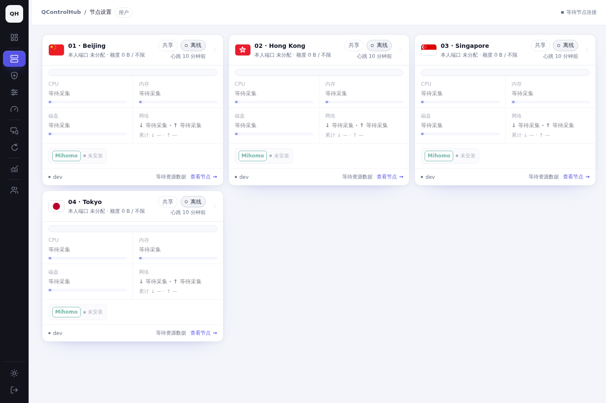
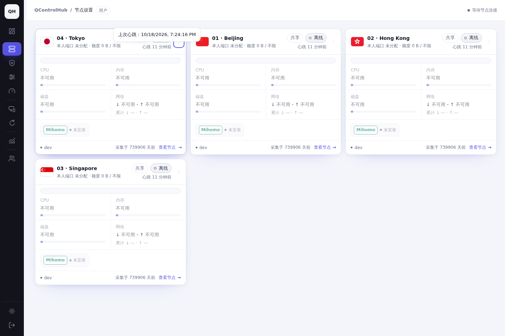
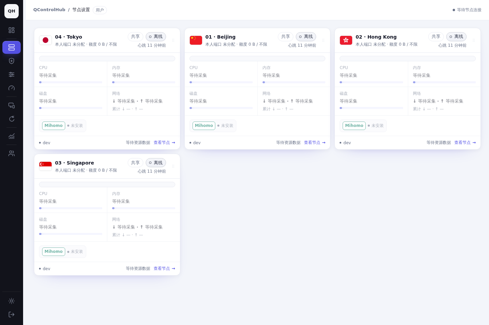

# Account node order validation

Date: 2026-10-18, Asia/Hong_Kong (UTC+08:00).

## Real panel acceptance

An isolated PostgreSQL 17 container and the production panel binary served four
fixture nodes. `order-alice` and `order-bob` are ordinary accounts receiving the
same four shared nodes; a separate database administrator was also tested through
the API. No production accounts, nodes, or services were used.

`node scripts/verify-account-node-order.mjs AFTER_LOOPBACK_URL BEFORE_LOOPBACK_URL`
runs opt-in acceptance with Playwright CLI. It requires seeded test accounts, the
`QCH_ORDER_TEST_PASSWORD` environment variable, and an explicit fixture systemd
unit in `QCH_ORDER_TEST_RESTART_UNIT`. Each named session has independent cookies,
storage, and browser context. The comparison uses the same account, nodes, light
theme and 1440x960 viewport. The baseline uses the unmodified main frontend
(`856fe65c`) against the same fixture API; its account cache is seeded with the
initial 01,02,03,04 order. There are no screenshot layout/style overrides.

| Check | Actual result |
| --- | --- |
| Mouse drop and confirmed persistence | PASS; A saved 04,01,02,03 |
| Independent browser B reload | PASS; B read 04,01,02,03 with empty initial storage |
| Clear local storage, refresh, logout/login | PASS; account order restored |
| Same-browser Alice/Bob switch | PASS; independent orders restored; Bob can save shared nodes |
| 800ms delayed writes and rapid keyboard submissions | PASS; final DOM and DB agreed |
| HTTP 503 save failure and retry | PASS; confirmed order restored; next save succeeded |
| 390x844 mobile native touch input | PASS; DOM and DB agreed |
| Actual panel process restart and fresh login | PASS; final account order restored |

Exact IDs and outcomes: [browser-results.json](browser-results.json).

## Screenshots and recordings

| Before: main | After: browser A | After: independent browser B |
| --- | --- | --- |
|  |  |  |

[Desktop mouse sorting recording](sorting-desktop.mp4) ·
[Mobile touch sorting recording](sorting-mobile.mp4) ·
[Mobile screenshot](mobile.png)

## Automated regression

- Frontend module smoke: PASS, including account isolation, scoped migration,
  concurrent initializers, conflict rebase, partial list saves, serial requests,
  failures, ambiguous commits, blocked storage, and stale account responses.
- PostgreSQL API tests: PASS, including separate token/database administrators,
  ordinary accounts, read-only sharing recipients, malformed/duplicate/invisible
  IDs, missing revisions, partial slots, concurrent migration and normal writes,
  new/deleted nodes, heartbeat state, and revoked sharing.
- Repository non-browser checks and full PostgreSQL Go shards: PASS on this host.
- Final browser matrix and hosted CI: results are recorded in the PR when complete.

The two-device test uses independent Chromium browser environments on one host.
Physical remote devices, real iOS Safari and Android hardware were not tested.
The local Linux checks do not substitute for hosted Alpine/OpenRC, systemd sandbox,
core-permission and historical-upgrade CI jobs.

## Resource retention

Screenshots, MP4 recordings, this report and sanitized test summaries are retained
in this directory. Temporary binaries, baseline source, seeded accounts/database,
and test services are isolated under task `qch-account-order-20261018`. A persistent
systemd cleanup timer will remove only these resources 72 hours after local test
completion. The final manifest records the exact timer, UTC and Asia/Hong_Kong
execution time, container identity, paths, and stopped services.
