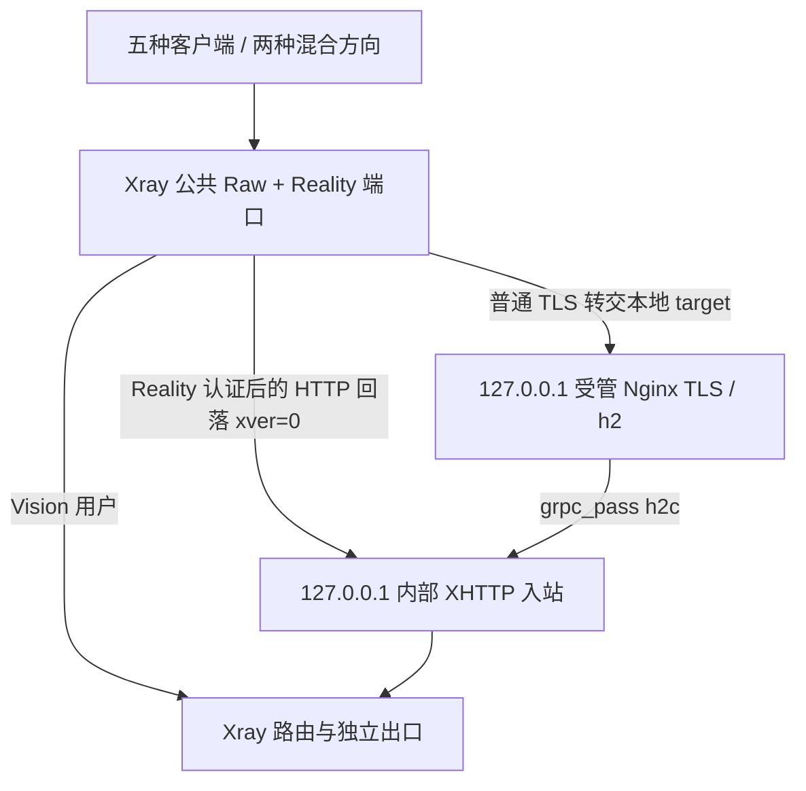

# Xray XHTTP 独立预设与五合一

## 依据与版本

本实现同时参考[作者正文](https://github.com/XTLS/Xray-core/discussions/4118)和[作者的简化独立配置](https://github.com/XTLS/Xray-core/discussions/4118#discussioncomment-11593313)。简化评论的原生 Xray Reality / TLS 入站分别对应两个独立预设；正文的公共 Reality、Raw 回落、TLS 反代和共享 XHTTP 后端对应三个组合预设。

实现以项目固定的 **Xray 26.3.27** 为实际连接验收版本，基础 XHTTP 最低 **24.12.15**。Agent 在部署时读取实际二进制版本，过旧或无法识别版本会提示升级。依据包括 [26.3.27 配置构建器](https://github.com/XTLS/Xray-core/blob/v26.3.27/infra/conf/transport_internet.go)、[XHTTP 拨号器](https://github.com/XTLS/Xray-core/blob/v26.3.27/transport/internet/splithttp/dialer.go)及 [24.12.15 配置构建器](https://github.com/XTLS/Xray-core/blob/v24.12.15/infra/conf/transport_internet.go)。

客户端应使用 26.3.27，尤其是 `xmux.hMaxReusableSecs` 等较新的高级字段。最低版本表示基础传输能力，不表示其认识当前所有高级选项。组合还要求更新 Agent，使其上报 `xhttp-presets-v1` 能力。

## 选择方案

在节点的 Xray「新增服务端预设」中选择：

| 预设 | 服务端入口与依赖 | 客户端方式 |
| --- | --- | --- |
| 已有 VLESS / Vision + Reality | Xray、公网 Reality target | Vision + Reality |
| 已有 VLESS-XHTTP-uTLS-REALITY | Xray、公网 Reality target；无需反代或本机证书 | Reality，支持独立下载端点 |
| VLESS-XHTTP-TLS / CDN | Xray 原生 TLS、本机证书和私钥；无需 Nginx / Caddy | TLS 直连或 CDN，支持独立下载端点 |
| TLS/CDN 上传 → Reality 下载 | Xray 公共入口、两个内部端口、受管 Nginx、本机证书 | 指定混合方向 |
| Reality 上传 → TLS/CDN 下载 | 同上；不创建额外 Vision 用户 | 指定混合方向 |
| 五合一组合 | 同上，额外启用公共入口的 Vision 用户 | 五种方式分别查看、复制、下载 |

普通 XHTTP 的 VLESS `flow` 留空。Vision 只出现在独立 Raw + Reality 或五合一的 Raw 客户端；已有 VLESS Encryption 预设继续遵循其独立的加密与 Vision 规则。

### 独立 Reality

1. 选择已有 XHTTP Reality 预设，填写节点可达连接地址和监听端口。
2. 设置客户端 Reality SNI，展开高级参数维护允许的 SNI 列表及可选 `target`。未指定 target 时使用所选 SNI 的 443 端口。
3. 公钥、私钥、Short ID 与路径自动生成；路径在服务端与客户端保持一致。Short ID 允许空值或最多 8 字节的偶数位十六进制。
4. 服务端 Host 留空时不限制客户端 Host；服务端 Host 非空时，两端必须完全一致。客户端 Host、连接地址与 Reality SNI 是不同字段。
5. 保存并部署，客户端详情中下载 Xray JSON。

独立 target 遵循项目现有公网 DNS、地址范围、TLS 及 SNI 探测规则；不能手填本地目标规避检查。允许 target 域名与客户端 SNI 不同，探测始终连接 target 并验证对应 SNI。

### 独立 TLS / CDN

Xray 自行终止 TLS、处理 XHTTP，独立创建和部署不安装 Nginx / Caddy。基础 TLS 参数维护源站证书、私钥、SNI 和 ALPN；XHTTP 参数单独维护连接地址、连接端口与 Host。

- **TLS 直连**：客户端必须信任源站证书链，证书必须覆盖 TLS SNI。连接 IP 或指定端点不会关闭证书验证。不要将仅由 CDN 信任的 Origin CA 证书用于普通客户端直连。
- **CDN**：将站点 DNS 记录代理到源站，填写可达的 CDN 地址、边缘端口、站点 SNI 和 Host。边缘证书须由客户端信任；CDN 到源站另行使用 HTTPS 严格验证及覆盖回源 SNI 的源站证书。这是两条独立信任链。
- 对 XHTTP 路径关闭缓存，允许 POST、长请求和流式响应，核对 CDN 的 HTTP/2 / gRPC、请求大小及超时限制。平台不会代替用户修改 DNS、CDN 或签发第三方证书。
- Cloudflare HTTPS 边缘端口校验为 443、2053、2083、2087、2096、8443，参见[官方端口列表](https://developers.cloudflare.com/fundamentals/reference/network-ports/)。源站端口与边缘不同，需要相应回源端口规则；填写客户端端口不会自动配置 CDN。
- 推荐客户端 ALPN `h2`。原生源站只监听 TCP，不提供 HTTP/3；只有 CDN 提供 HTTP/3、UDP 可达时才能使用单独 `h3`。

服务端与客户端 ALPN 分别保存。HTTP/1.1 单 ALPN 的 Xray 客户端使用 `fingerprint: "unsafe"` 选择标准 TLS，以免 Chrome ClientHello 协商成 h2；该字段不关闭证书验证，`allowInsecure` 始终为 false。h2 / HTTP/1.1 的三种显式上传模式都纳入真实内核连接测试。

## 上下行分离

### Reality 双栈

在独立 Reality 预设展开「上下行分离」，启用下载端点，上传填 IPv6、下载填 IPv4；交换按钮可交换连接地址和端口。监听使用 `::`，节点需具备实际 IPv4 / IPv6 入口，客户端两条路径都需可达。IPv6 地址字段填写裸地址，不附端口或方括号；导出的 URL 自动处理方括号与查询编码。

下载端点拥有独立地址、端口、SNI 与 Host，关联同一个 XHTTP 路径、Reality 公钥和 Short ID。重新生成路径或密钥时更新下载关联，保留其他高级参数。

作者简化评论的单栈限制对应其当时的入口安排，并不是当前内核对全部分离配置的普遍限制。本实现不禁止单 IPv4 分离：26.3.27 在同一 IPv4 后端的真实连接测试已通过。校验针对具体入口：IPv6 直接地址不能指向仅 IPv4 的监听，两个端点都必须能进入同一个 XHTTP 后端。面板无法从服务端证明客户端网络实际可达，公网双栈仍需在目标网络验收。

### TLS / 双 CDN 端点

在独立 TLS 预设启用下载端点，分别设置两个方向的连接地址、端口、SNI、Host 与下载 ALPN。两个 CDN 站点都应回源到同一 Xray TLS/XHTTP 服务及相同路径。服务端 Host 有限制时两个方向都必须匹配；需要不同 CDN Host 时将服务端 Host 留空。

高级「客户端 extra」是完整 JSON，可继续维护下载 `tlsSettings`、`xhttpSettings.extra.xmux`、`sockopt` 等字段。基础下载表单只更新其对应字段，保留其他键；关闭分离会明确删除 `downloadSettings`。不允许递归下载配置、不同后端路径、关闭证书验证或将 `stream-one` 与分离同时使用。

下载的单 HTTP/1.1 ALPN 同样需要 `tlsSettings.fingerprint: "unsafe"`；表单会生成此值，手填 JSON 会得到具体修正提示。

## 混合与五合一组合

公共端口由 Xray Raw + Reality 监听，依照正文的回落关系接入共享后端：



公共参数集中维护 UUID、用户名、路径、Reality 密钥与 SNI；TLS 入口另有连接地址、端口、SNI、Host、客户端 ALPN。五份客户端配置由这些公共参数实时生成。单独混合预设保留必需的公共入口、共享后端和 TLS 目标，公共 Raw 入站不添加 Vision 用户。

与作者的 Unix Socket 示例相比，本实现使用每实例独立的 **127.0.0.1 TCP 内部端口**，避免 `/dev/shm`、0666 Socket 和非 root 服务权限问题。公共、内部 XHTTP、本地 TLS 三个端口必须互不相同；所有实例的内部端口都需隔离。平台会预留内部端口、检查配置内冲突，并在 Agent 部署前检查实际监听。两套独立 Reality / TLS 不能直接重复绑定同一公网端口；需要共用时选择组合预设。

组合证书须覆盖 **TLS SNI 和所有允许的 Reality SNI**。组合的 Reality target 由受管关系派生，不能用任意本地 target 冒充。普通公网 Reality target 的探测不应用于这个经过校验的受管本地关系。

### 证书、服务与权限

- 证书由节点维护；建议 `/etc/qcontrolhub/tls`，目录 `root:qcontrolhub-core`、0750，证书和私钥 0640。所有父目录须允许服务用户遍历；私钥不能开放给其他用户。
- 组合证书不能位于 `/root`、`/home`、`/run/user`、`/tmp`、`/var/tmp` 等被现有服务 `ProtectHome` / `PrivateTmp` 隔离的路径。支持证书引用，不把私钥或证书内容放入客户端导出。
- 使用项目已有的受管 TLS 运行目录和独立 Nginx 服务，生成专属配置并执行 `nginx -t`，保留节点上已有 Nginx / Caddy 站点配置。原生独立预设不启动此服务。
- 沿用 systemd / OpenRC 的非 root 服务身份及最小权限。部署会区分证书引用、读取权限、监听、内核校验、反代语法和启动探测错误。
- 更新证书文件后重新部署；即使配置文本未变，也会重新加载引用证书。
- 公共入站与后端是同一个服务实例，遵循现有账号权限、节点归属、端口分配、独立出口和流量配额规则。组合的用户名必须在节点入站中唯一，以保证用户统计隔离。
- 组合使用认证 VLESS 用户上下载计数及独立出口统计；不把公共 Raw 转发计数与内部 XHTTP 计数相加，避免重复计算中继及 HTTP 开销。

### 分享节点给其他用户

1. 节点所有者先安装受支持的 Xray、升级 Agent，并在分享设置中授权 **Xray**。接收方接受邀请后，在自己的节点配置工作区创建预设；沿用账号已有的配置、任务和客户端查看权限。
2. 独立 Reality / 原生 TLS 只需分配其公网监听端口。混合 / 五合一需要分配 **公网、内部 XHTTP、本地 TLS 目标三个端口**；内部端口同样必须属于接收方，且与其他实例隔离。也可授予无限制端口权限，由部署事务预留实际所需端口。仅公网端口需要对外开放；CDN 边缘端口和客户端映射端口不要求在源站重复分配。
3. 原生 TLS / 组合证书由节点所有者准备在受支持目录，并允许非 root 服务组读取。接收方填写证书引用、域名和 CDN 参数；组合反代由 Agent 管理，不覆盖节点已有站点。
4. 接收方部署到自己的独立 Xray 服务，配置、加密元数据、反代关联和客户端偏好均按账号隔离。节点所有者的服务可继续运行；相同入站标签可用于不同账号实例，监听端口必须不同。
5. 部署完成后，接收方在自己的客户端页面查看、复制和下载完整 Xray JSON；五合一的五种连接方式全部保留。修改、重命名或删除预设会同步更新该用户的关联资源。

共享配额沿用 Agent 的认证公网端口计数，只计公共入口；内部 XHTTP / TLS 不创建额外计费端点，共享实例也移除固定本地统计 API，避免与所有者服务抢占端口。配额耗尽会阻止新部署并执行现有流量限制；撤销分享使接收方失去配置与导出入口，并通过既有运行策略停止该共享实例，保留其他账号的服务和配额。端口释放继续遵循停止服务并成功结算后的显式释放规则。

## 模式与高级字段

| 字段 / 组合 | 规则 |
| --- | --- |
| 服务端 `mode` | 固定 auto，接受客户端选择 |
| Reality 客户端 auto（26.3.27） | 无分离使用 stream-one，有下载分离使用 stream-up |
| TLS 客户端 auto（26.3.27） | packet-up；不要照搬其他版本的 auto 行为说明 |
| stream-one + downloadSettings | 拒绝；改用 auto / stream-up / packet-up |
| 五合一 / 混合的 stream-one | 拒绝；组合包含分离方向，使用 auto / stream-up / packet-up |
| `xmux.maxConnections` / `maxConcurrency` | 不能同时为正，至少一项为 0 |
| `xmux.cMaxLifetimeMs` | 历史字段；当前内核已移除，提示换算为秒后使用 hMaxReusableSecs |
| `host` / `path` / `mode` | 使用对应字段，不能放进 extra 被内核覆盖 |
| downloadSettings / xmux / noGRPCHeader / scMinPostsIntervalMs | 客户端字段，不写入服务端 extra |

保留旧 `splithttp` / `splithttpSettings` 别名和原生顶层高级字段的读取能力；普通 TLS、Reality、Vision、旧 XHTTP 和 VLESS Encryption 的识别及回归测试继续运行。

## 保存、回读与客户端导出

服务端原生参数从 Xray 配置恢复；客户端地址、端口、模式、完整 extra、CDN 设置和组合证书引用进入现有加密元数据。元数据绑定入站标签、监听、凭据、路径和内部关系，只在匹配当前配置版本时恢复。五合一的主入站和后端作为同一个配置文件单元保存、编辑、重命名和删除。

组合缺少匹配元数据或被手工改断关联时，部署会提示通过预设重新保存，不会猜测证书和方向。平台管理的组合复用一个 UUID；不把任意第三方多用户 / 不同 UUID 的配置图自动转换成受管组合。

在客户端页面打开参数详情，找到「完整 Xray 客户端配置」：每种方式均有查看、复制 JSON 和下载 JSON。默认本地 SOCKS 入口为 `127.0.0.1:10808`，启动多个客户端时自行修改本地端口。

| 格式 | 支持范围 |
| --- | --- |
| Xray JSON | 全部独立、双栈、双端点、两种混合方向及五合一每种方式；完整 downloadSettings / extra |
| VLESS 分享链接 | 基础 XHTTP Host / path / mode / TLS / Reality；存在 extra 的复杂方案禁用，提示使用完整 JSON |
| Mihomo 1.19.32 | 本导出器支持基础 XHTTP 与 Vision / Reality；真实双向连接已验收。HTTP/1.1 + stream-one 在 Mihomo 未通过连接测试，明确禁用；Xray 可用。含 extra 时禁用此映射并提示具体缺失字段 |
| sing-box 1.14.3 | 官方没有 XHTTP 传输，XHTTP 显示不支持；已有 Vision 等非 XHTTP 导出沿用原逻辑 |

[Mihomo 官方选项](https://github.com/MetaCubeX/mihomo/blob/v1.19.32/adapter/outbound/vless.go)已具备 `download-settings` / `reuse-settings`，但其结构与 Xray `downloadSettings` / `xmux` 不同，本次不输出丢失参数的近似转换。[sing-box 官方传输类型](https://github.com/SagerNet/sing-box/blob/v1.14.3/option/v2ray_transport.go)没有 XHTTP。客户端支持状态与导出器映射能力分别说明。

## 验证记录

2026-10-16，在隔离的本地测试目录、专用 PostgreSQL 17 数据库和容器内验证：

- Xray 26.3.27 真实 `run -test`，随后启动服务端及导出的客户端完成 TCP 双向数据回传。
- 独立 Reality 与原生 TLS 无 Nginx 参与；同 IPv4、IPv6 上传 / IPv4 下载及反向交换均连接成功。
- TLS 双端点使用两个本地可达地址、独立 TLS 参数连至同一后端；此测试模拟 CDN 端点拓扑，不代表真实 CDN 账号和边缘网络验收。
- h2 和 HTTP/1.1 的 packet-up、stream-up、stream-one 模式；HTTP/1.1 使用标准 TLS，证书验证保持开启。
- 两个混合方向及五合一全部五种配置，Nginx 1.26.3 真实语法校验与 h2c 转发；验证真实用户上下载统计存在。
- Mihomo 1.19.32 对基础导出执行真实配置校验和连接。
- systemd / OpenRC 容器内受管反代的创建、更新、实例隔离、证书失败恢复、删除和卸载；systemd 使用项目实际只读沙箱。
- PostgreSQL API 集成覆盖保存、修改、重命名、部署快照、加密元数据恢复、删除及服务端 / 客户端关联；额外验证旧 Agent 拒绝组合及其他用户无法占用排队部署的公共 / 内部端口。
- 使用真实登录的节点所有者和分享接收方，验证限定端口 / 无限制端口下原生 TLS、两种混合和五合一的完整生命周期、五份导出、所有者服务共存、账号隔离、公共 / 内部端口授权、配额耗尽和撤销分享；Agent 配额执行入口覆盖全部五种预设。真实 Xray 连接矩阵同时运行所有者与共享实例配置，覆盖双栈、双端点和五合一全部连接。
- 前端模块和完整 83 场景浏览器矩阵覆盖方案切换、默认值、完整分离 JSON 回读、高级项、端口校验、客户端布局；Playwright 对五份 JSON 逐份核对复制和下载。
- 桌面 1440、平板 768、移动端 390 像素，浅色 / 深色、长文本和展开状态均检查容器与弹窗边界。

运行命令：

```sh
make non-browser-checks
make build
QCH_TEST_DATABASE_URL='postgresql://...' make test
make frontend-browser-check
QCH_XRAY_BINARY=/path/to/xray \
QCH_MIHOMO_BINARY=/path/to/mihomo \
QCH_NGINX_BINARY=/path/to/nginx \
  go test ./internal/agent -run '^TestXHTTPLiveMatrix$' -count=1 -v
make managed-tls-systemd-test
make managed-tls-openrc-test
```

实际界面截图使用测试节点和随机测试凭据，不包含生产密钥：

- [五合一桌面配置](images/xray-xhttp/five-desktop.png)
- [移动端分离与高级参数](images/xray-xhttp/split-mobile-dark.png)
- [移动端完整配置导出](images/xray-xhttp/exports-mobile-dark.png)
- [长错误信息](images/xray-xhttp/validation-mobile.png)

仍需用户在部署环境验证：公网 DNS 与双栈路由、目标客户端入口可达性、真实 CDN 的流式限制 / HTTP/3 / 回源规则、公网 CA 证书签发与续期，以及真实网络下的长连接和吞吐。隔离测试使用测试 CA，仅加入子进程信任，不关闭证书验证、不修改主机信任库。

## 回滚

沿用已有部署事务：新配置及反代先准备、校验，再启动探测；失败恢复之前的内核配置与受管反代清单及服务状态。外部证书引用不作为平台拥有的文件删除。删除组合会同时清理主入站、后端、关联策略及自身反代实例，保留其他实例与节点原有服务。

可在配置历史中恢复旧版本并重新部署。撤回此功能前先删除新增组合或恢复旧预设，避免旧 Agent 无法识别新的受管快照；无需数据库迁移。首次部署前保留可用配置版本和证书文件。
